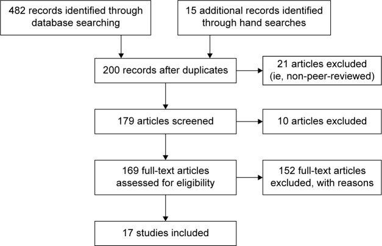

# The role of augmentative and alternative communication for children with autism: current status and future trends

Tên tài liệu: The role of augmentative and alternative communication for children with autism: current status and future trends

Tác giả hoặc tổ chức: Teresa Iacono; David Trembath; Shane Erickson

Link nguồn: https://doi.org/10.2147/ndt.s95967

Ngày xuất bản: 2016

Ngày cập nhật: Không được nguồn công bố / chưa xác minh; phiên bản: snapshot-20261017-b09029e5368f

Phạm vi nội dung: AAC evidence reviews include children/young people up to 21; pediatric and older-youth scope retained

ID nguồn: ASD-CSV-084

Giấy phép: https://creativecommons.org/licenses/by-nc/3.0/. Căn cứ: https://pmc.ncbi.nlm.nih.gov/api/oai/v1/mh/?verb=GetRecord&metadataPrefix=pmc&identifier=oai:pubmedcentral.nih.gov:5036660

Trạng thái chuyển đổi: complete_text. Giới hạn chuyển đổi và phạm vi sử dụng được ghi trong catalog.jsonl.

Bản đối chiếu phục vụ nghiên cứu; chưa có thẩm định lâm sàng độc lập.

---

## NỘI DUNG NGUYÊN BẢN

<!-- ORIGINAL_DOCUMENT_BODY -->
## The role of augmentative and alternative communication for children with autism: current status and future trends

Iacono Teresa 1 

Trembath David 2 

Erickson Shane 3 

1 Living with Disability Research Centre, La Trobe University, Bendigo, VIC, Australia

2 Menzies Health Institute Queensland, Griffith University, Gold Coast, QLD, Australia

3 Living with Disability Research Centre, La Trobe University, Melbourne, VIC, Australia

Correspondence: Teresa Iacono, Living with Disability Research Centre, La Trobe Rural Health School, 102 Arnold Street, Bendigo, VIC 3552, Australia, Tel +613 5449 9110, Email t.iacono@latrobe.edu.au

© 2016 Iacono et al. This work is published and licensed by Dove Medical Press Limited 2016 https://creativecommons.org/licenses/by-nc/3.0/The full terms of this license are available at [https://www.dovepress.com/terms.php](https://www.dovepress.com/terms.php) and incorporate the Creative Commons Attribution – Non Commercial (unported, v3.0) License ([http://creativecommons.org/licenses/by-nc/3.0/](http://creativecommons.org/licenses/by-nc/3.0/)). By accessing the work you hereby accept the Terms. Non-commercial uses of the work are permitted without any further permission from Dove Medical Press Limited, provided the work is properly attributed.

### Background

Augmentative and alternative communication (AAC) interventions are used for children with autism, often as stand-alone communication interventions for those who are minimally verbal. Our aim was to synthesize the evidence for AAC interventions for children (up to 21 years), and then consider the role of AAC within established, comprehensive, evidence-based autism interventions targeting learning across multiple developmental domains.

### Design

We completed a systematic search of three databases (OVID Medline, PsycINFO, ERIC) as well as forward citation and hand searches to identify systematic reviews of AAC intervention efficacy research including children with autism, published between 2000 and March 2016 in peer-reviewed journals. Data pertaining to the quality indicators of included studies, effect sizes for intervention outcomes, and evidence for effectiveness were extracted for descriptive analysis.

### Results

The search yielded 17 systematic reviews. Most provided indicators of research quality for included studies, of which only relatively few provided conclusive results. Communication targets tended to be focused on teaching children to make requests. Still, effect size measures for included studies indicated that AAC was effective to highly effective.

### Conclusion

There is growing evidence for the potential benefits of AAC for children with autism, but there is a need for more well-designed studies and broader, targeted outcomes. Furthermore, a lack of evidence for the role of AAC within comprehensive intervention programs may account for a tendency by autism researchers and practitioners to neglect this intervention. Attempts to compare evidence for AAC with other interventions for children with autism, including those in which the use of AAC is delayed or excluded in pursuit of speech-only communication, must take into account the needs of children with the most significant learning needs. These children pose the greatest challenges to achieving large and consistent intervention effects, yet stand to gain the most from AAC interventions.

## Keywords

autism

augmentative and alternative communication

intervention

research synthesis

### The role of augmentative and alternative communication for children with autism: current status and future trends

Over recent decades there has been increasing research that has provided empirical support for the use of augmentative and alternative communication (AAC) by children with autism. These children demonstrate pervasive deficits in social communication as well as repetitive and restricted behaviors.1 AAC encompasses various modalities that can replace or augment a person’s speech and other existing communication skills. These modalities are either unaided, usually in the form of manual signs, or aided, with systems including graphic symbols displayed on communication boards and in books, or devices relying on technology, such as speech generating devices (SGD), including mobile technologies.1 About 30% of children with autism who fail to develop speech skills sufficient for daily communication functions2 and have the most severe disability stand to benefit most from AAC.1 These children are at particular risk of developing problem behaviors, limited academic learning, lack of job prospects, poor social networks, and mental health problems as they move from childhood to adulthood.1,3

Aided AAC, in particular, would seem well suited to individuals with autism because it has been argued that they process visual information more easily than auditory information.4,5 Despite the growth of research influencing clinical applications,1 evidence for AAC as an autism intervention has been identified as emerging only, rather than established by the National Autism Centre (NAC)6,7 in the US. Emerging interventions are those found by a panel of expert reviewers to be supported by some, but without sufficient high-quality studies indicating their benefits for individuals with autism.6,7 This category contrasts with established interventions for which the NAC panel found sufficient high quality, quantity, and consistency of research evidence of treatment effects. Of interest was the separate consideration of manual signs (also rated as emerging) and visual schedules (established), both of which are considered forms of AAC within the field,8,9 and these were reported by Wendt and Mirenda and Brown, respectively. Further, there are indications from the autism field that AAC has been viewed as having only a limited role (eg, incorporated only after speech-alone instruction has failed to produce an adequate intervention response, as in the Early Start Denver Model10), or no role (eg, Pivotal Response Training11) in some comprehensive intervention programs. A failure to consider the benefits of AAC early in a child’s comprehensive intervention program is at odds with decades of work from within the AAC field. The aim of this work has been to ensure that children with significant communication impairment are provided with communication support as early as possible.12

Any attempt to evaluate the role of AAC for children with autism and identify future avenues for its efficacious application requires consideration of research from across both AAC and autism fields. Within each field, research accumulated over the last 40 years has led to an increasing number of systematic reviews in an attempt to synthesize and evaluate the quality of research addressing specific topics. In AAC, such synthesis began around 1999, in an effort to apply evidence-based principles from medicine.13 Early reviews by Schlosser and Lee14 indicated gaps in research quality, particularly in failures to demonstrate generalization and maintenance or social validity (ie, the practicality of interventions and the social importance of outcomes).15 Since then, a number of systematic reviews have been conducted with a specific focus on AAC and autism (eg, Ganz1). In autism, similarly, systematic reviews have provided a means to synthesize and evaluate the quality of a large body of intervention research (eg, Howlin et al16), but perhaps none has been as comprehensive as that completed over a number of years by the expert panel of the NAC.6,7

### Aim

Our aim was to summarize the systematic reviews in AAC of relevance to children with autism to provide a comprehensive overview of the state-of-the-art in this area. Along with this, our further aim was to consider the role of AAC within the context of established interventions identified by the NAC.6,7 In particular, we sought to consider existing and potential points of convergence so as to move both fields forward in addressing the problems with social communication and behavior that impede academic learning by and social inclusion of children with autism.

### Method

#### Identifying the reviews

We adopted a combined approach to locate published reviews addressing AAC in children with autism, beginning with systematic searches of the databases OVID Medline, PsycINFO, and ERIC, and then conducting forward citation and hand searches of reference lists.17 Database search terms were autis* or autism spectrum disorders or ASD; AAC or augmentative and alternative, or augmentative communication or alternative communication, and limits were from 2000 (coinciding with the earliest systematic reviews in AAC) to March 2016, review articles, and papers published in English. After the removal of duplicates, a title and abstract review was conducted, deleting dissertations and book chapters, and other non-peer-reviewed journal publications, and reviews relating to facilitated communication, given that it has been evaluated as a non-evidence-based strategy.6,18 Forward citations of early reviews (n=5) yielded two additional reviews, and hand searches of reference lists of later reviews (n=13) yielded eleven more. Following title and abstract reviews of retrieved papers, full-text papers were retrieved for 37 articles. The search and selection process are detailed in Figure 1.

Two of the authors then independently evaluated the retrieved full text articles against the following inclusion criteria: (1) a systematic search was conducted; (2) the review included one or more effect size metrics, with results reported in either aggregate form or for each included study, and/or a quality appraisal was conducted of included studies; (3) studies were of children with autism (up to 21 years, in line with the NAC6,7), or if other participant groups or older individuals were included, results for children with autism could be extracted; and (4) all included studies addressed some aspect of the efficacy of AAC as an intervention or part of an intervention.

### Results

#### Articles included and data extraction

Seventeen systematic reviews were included (with 100% agreement between authors). The aims, type of systematic review and effect size metric (if used), publication period of included studies, inclusion criteria, quality indicator or appraisal method, and key findings were extracted. This information is presented in Table 1, with studies organized according to key themes relating to review aims. These themes were (1) overall effectiveness of various types of AAC and comparison of effectiveness across variables (n=5); (2) evaluation of the AAC instructional package, Picture Exchange Communication System (PECS) (n=5); (3) effects on speech (n=2); (4) use of high technology, including SGD and newer mobile technologies of iPods®, iPads® (n=4); and (5) partner instruction (n=1).

#### Quality indicators

Most included reviews applied some measure of quality through appraisals that varied in detail: these are summarized in Table 2. These appraisals provided an evaluation of the rigor of studies, thereby indicating the confidence with which outcomes could be attributed to the AAC intervention being investigated. Across the reviews, most studies were of experimental single case designs (ESCD), and in fact, seven reviews had this design as an inclusion criterion.19,20,22,26–28,36 Strategies to address the certainty of the evidence varied. In some reviews, only studies in which experimental control was demonstrated were included, thereby focusing on internal validity, such as through the type of design used.35 In other reviews, studies were categorized according to the extent to which evidence was conclusive.34 More detailed appraisals, such as those based on indicators of quality of ESCD37 or group studies38 addressed internal validity and aspects of external validity, with indicators taken from Horner et al37 including social validity. In five studies, certainty of evidence was not addressed directly19,28,36 or specific design features, such as inclusion of treatment fidelity measures27 or broader indicators, were simply noted.30

Information from reviews that did include some form of critical appraisal suggests that only few studies provided conclusive results, with more providing evidence described as preponderant in one coding scheme: that is, based on studies with only minor flaws (Table 2). In some reviews, however, a large proportion of studies were evaluated as providing inconclusive results (eg, Schlosser and Koul32).

#### Measures of effect size

There was debate evident across reviews about the most appropriate means to measure effect size for ESCD. Ganz et al,19,20,28,36 for example, argued that the Improvement Rate Difference index had advantages over the frequently used Percentage of Nonoverlapping Data points, including that it allowed confidence intervals to be determined. Regardless of the index used, effect sizes enabled the aggregation of outcomes across studies, as well as a means for evaluating differential effects across variables, which have been reported in Table 1.

#### Effectiveness of AAC

Even taking into consideration concerns about study quality, the evidence presented across reviews, as summarized in Table 1, indicates that, overall, AAC has been found to be effective to highly effective for children with autism according to the metrics applied (Table 2). The reviews included favored aided AAC, with most evidence supporting the use of PECS, a manualized instructional package for teaching individuals to exchange pictures for desired wants – that is, to learn to request (described by Flippin et al25) – and SGD (including newer mobile tablets and other handheld devices), with evidence being weaker for other picture-based systems or manual signs. In fact, studies of manual signs were included in systematic reviews only when compared to aided systems.22,26,31,33,34 It has been suggested that manual signs may pose a number of challenges, including being difficult to produce in the presence of motor difficulties and reduced use of gestures and/or poor imitation skills seen in many children with autism.20,42 On the other hand, arguments that aided AAC suits strengths in processing visual material26,28 have been made because pictures provide a concrete representation to which a child can refer back.20 This premise was questioned in a recent study, in which it was found that children with autism, unlike children with global developmental delays or without disability,43 did not show improved task performance when asked to complete a series of short instructions under speech + pictures vs speech-only experimental conditions.

Effectiveness of AAC appears overwhelmingly to relate to teaching functional communication, with a focus on requests.20 As shown in Table 1, key targeted outcomes were predominantly requests across the included reviews; this was particularly the case for studies of PECS, designed to teach requests through picture exchange.25 A tendency to target requests may reflect the relative ease with which they can be taught to children with autism in light of their strengths in behavioral regulation (ie, communication to gain desired objects or actions, usually through requests), as opposed to deficits in social interaction.1 In particular, much research has focused on the efficacy of PECS, designed specifically for children with autism (Table 1). Aggregation of data through meta-analysis indicates that the first three stages of PECS are effective to highly effective in teaching children to request preferred items.24–27 In stages IV and V of PECS, the use of requests in multiword utterances is targeted, with other communicative functions not introduced until the final stage VI.25 Ganz et al28 found large effects for the only two included studies in their review in which all stages were taught, but improvement rate differences ranged from 0.15 to 0.94, indicating some effects were questionable (Table 2).

AAC has also been found effective for reducing challenging behaviors.20,21,26,28,29,32,36 Interventions reported in Table 1 were of functional communication training, in which AAC was taught as a replacement behavior.1 In addition, reduction in challenging behavior has been examined as a nontargeted, but rather collateral outcome, again with the rationale that AAC would provide a functional behavior as a replacement (eg, Ganz et al28).

In many reviews, speech as an outcome, but usually not as a primary target of intervention, was examined. Results point mostly to negligible or small effects.25,28,32 The two reviews focused on speech outcomes were motivated by a concern often expressed in AAC literature about the potential for AAC to impede speech development, as well as a desire to investigate the potential for speech to be enhanced.33,34 These reviews indicate variable outcomes, with Schlosser and Wendt34 finding that, for individuals with autism, although modest gains in speech could not be attributable directly to AAC intervention, there was no evidence of loss of speech skills.

### Discussion

#### Reconciling evidence from the fields of AAC and autism

The finding of the NAC6,7 that AAC is an emerging area, only, appears at odds with the findings from the 17 reviews presented here, even considering differences in publication periods captured: the most recent reviews in Table 1 included studies published in 2014;31,32 the NAC reviews were completed for two time periods, the first ending 2007,6 and the second covering 2007–2012.7 The main difference appears to be that studies that incorporated AAC as a component or primary part of the intervention were not grouped together as AAC interventions, but rather according to the categories of AAC devices (ie, low- and high-tech aids, including SGD, with 14 studies published from 1983 to 2007 included), and PECS (ie, this was treated separately from other aided AAC, with 13 studies published from 1994 to 2007 included), and sign instruction (with 11 studies published from 1976 to 2004 included). These were all judged to be emerging interventions in the first report,6 with further research reviewed for the second report failing to result in changing the classification for any of these forms of AAC to established interventions.7

In the current review, the number of studies judged as lacking rigor or to be of overall poor quality is perhaps further evidence of the emerging status of AAC. On the other hand, closer inspection of studies that contributed to classifying some interventions as established in the first NAC report6 reveal some included the use of AAC as part of intervention protocols. In studies of functional communication training, a type of behavioral package6 (established), for example, were the use of signs and picture systems,44 and high-tech devices45 as replacements for problem (challenging) behaviors. Schedules, also an established intervention,6 are the use of task lists, often in the form of pictures (ie, AAC), to support comprehension and learning within structured activities (eg, Dettmer et al46). Finally, studies incorporating AAC were also considered by the NAC in determining that naturalistic teaching strategies were established.47

Regardless of the form of AAC used, interventions are multicomponent, with effective implementation requiring considerations beyond the actual modality or system used. Hence, although there have been many attempts to compare across types of AAC, the system used is part of an intervention only. Pictures used in PECS, for example, comprise one component of a comprehensive instructional package that draws on applied behavior analysis (ABA), which has a strong research base,6 implemented in a natural context.24 Lorah et al31 argued that intervention needs to address both learning how to use these AAC systems, including the newer technologies of iPods® and iPads®, as well as how to communicate effectively and efficiently with them. van der Meer and Rispoli29 suggested that, in addition to behavioral approaches, greater use of naturalistic strategies that take advantage of incidental teaching moments, environmental arrangement, and following the child’s lead might help extend communication to a range of functions beyond requests, including joint attention and social interactions.

A concern expressed both in the AAC and the autism literature has been the reliance on interventionists highly skilled in the teaching approaches used, resulting in potential problems in translating evidence into real-world settings. Tincani and Devis,27 for example, suggested that improvements gained through teaching PECS may fail to maintain or generalize to new communication partners and settings once highly skilled researchers, who implement many and complex teaching strategies, have completed their research. Only one review focused on training people in a child’s social environment to support the use of AAC, which indicated varying levels of success across studies.35 Some studies did show strong effects, with perhaps greater potential for maintenance than when outcomes rely solely on highly skilled intervention agents, usually researchers. Within the autism literature, there is an emerging focus on training parents to implement evidence-based interventions, such as those based on ABA, or a combination of ABA and naturalistic teaching strategies.48 Furthermore, incorporating AAC into an approach combining established interventions and delivered by parents has been shown to be effective in improving the communication skills of young children with autism.49 However, as in the AAC literature, a recent autism evidence update50 indicated that more research is needed to determine if approaches considered established or emerging by the NAC6,7 prove to be as effective when parents are trained to deliver them.

#### Clinical implications

A goal of the NAC was to provide families, teachers, and other professionals supporting children with autism clear guidance for selecting evidence-based interventions.6,7 This task appears challenging in light of the large and diverse evidence bases in AAC and autism, with studies of variable quality, in addition to differences in the role assigned to various forms of AAC across the fields. In addition, the heterogeneity evident across children with autism further complicates attempts to take an evidence-based approach to intervention.

It has been suggested that there is now sufficient evidence that early and intensive intervention can ameliorate skill deficits and, thereby, ensure that children with autism will enjoy academic success.50 In particular, in the last few years there has been an increase in randomized controlled trials (RCTs), considered to provide more robust evidence for both treatment effects and their potential to generalize to the population from which samples have been drawn, than can be provided using ESCD.50 A review of this more recent research by Smith and Iadarola50 provides further support for the findings by the NAC in terms of interventions considered established, emerging, or questionable.6,7 The extent to which this research base, as well as that for AAC, as reviewed here, can inform intervention in real-world settings would seem to be complicated by limitations of even robust research designs.

A problem with RCTs is the need to obtain homogeneous samples, a challenge that has seen the proliferation of ESCD in both AAC1 and autism50 research. The results of group studies suggest that individual differences across participants may be lost in group means, although measures of variance or the reporting of individual data can reveal that some children may fail to benefit from interventions found effective for others.43 Parents and practitioners would benefit from the reporting of subgroup analyses of intervention outcomes so that treatment effects for children with the most complex communication needs can be evaluated. As a result of the extent and complexity of their social, communication, and behavioral needs, these children face challenges in achieving the rapid and consistent progress that may be attainable only by children with lesser difficulties. More detailed reporting of individual variations in intervention performance might avoid masking poor results for children with severe disability. Such reporting would provide better indicators of the quality, quantity, and consistency of evidence for intervention effects. Individual patterns of learning are readily discernible in ESCD, an alternative to RCTs, and therefore make comparison with a child for whom a practitioner may be considering the intervention an easier task. Further, Smith and Iadarola50 noted that child variables, including preintervention IQ, age, functional language, and play, as well as intervention variables, such as treatment intensity or whether pure or eclectic approaches are used, may influence outcomes. It is these potential influences that have relevance in implementing the findings from research reviews to practice.

In light of these complex issues, families and practitioners may do well to adopt an eclectic approach. Use of AAC may prove useful when extended beyond the fairly focused aim of teaching basic communication skills, particularly requests.1,29 Promises that AAC can support ongoing language development12 have yet to be demonstrated convincingly for children with autism, but may be more likely if integrated into comprehensive interventions that combine evidence-based approaches, such as those using ABA and naturalistic teaching strategies in everyday contexts, as in Pivot Response Training11 and the ESDM.10 Developers of the ESDM, in suggesting that AAC be considered only when a child has failed to demonstrate progress in spoken language,10 may see AAC as a last-resort intervention. This approach could increase the potential for learned helplessness, challenging behavior, and missed learning opportunities. Rather, incorporating AAC into early interventions might avoid or reduce these problems. In particular, the use of visual supports, and other forms of AAC within a child’s learning environments, has been suggested as good practice.50 Even children who demonstrate increasing spoken language skills stand to benefit from the additional supports that could assist with comprehension and extending language skills. For those who may not make use of visual stimuli for learning,43 providing AAC within child-led naturalistic teaching situations is unlikely to impede learning, including of speech.33,34

The underlying tenets of AAC research are that communication is multimodal and that individuals differ in terms of those modalities that may best suit their learning needs and preferences.12 The reliance on aided AAC has resulted in few studies including sign as a component of instruction or as a communication modality. Sign models provided within naturalistic teaching could play a valuable role for children with autism, including extending vocabulary across situations.51 Systematic reviews have tended to include only very early manual sign studies6 or those in which signs have been compared to aided systems (Table 1). Although some studies have demonstrated better outcomes using aided AAC, Gevarter et al22 found that (1) signs combined with speech were more effective than speech alone in increasing communication; (2) signs were more likely to result in maintenance and generalization; and (3) in comparison to PECS, signs were as effective, while being associated with more vocalizations. Such findings demonstrate the value of considering individual differences, both in terms of exploring the evidence base, and making various AAC modalities available. The provision of models using both signs and symbols on aids, for example, could maximize the potential to meet individual child learning needs and preferences. Furthermore, although it has been suggested that reduced fine motor, gesture, and imitation skills in children with autism may, to some extent, preclude the use of signing,20,42 manual sign instruction may in fact provide a highly salient and ecologically valid communication context in which to target these skills.

#### Future directions

In light of the potential for individual differences across children with autism to influence the success of both established and emerging interventions, research that provides details of participant characteristics would seem a priority. Of the reviews included here, most provided details of children’s age and diagnosis, but only two addressed communication skills of children at the start of intervention. Schlosser and Wendt34 included only studies in which participants lacked functional speech, but no information was provided about comprehension ability. In studies included by Hart and Banda,26 children with autism were described as having limited expressive language, limited speech, being nonverbal, using only 1–2 word phrases, using a few signs, or demonstrating some vocal imitation prior to intervention. Such varied descriptions fail to provide information about possible outcome predictors for children whose communication profiles vary dramatically in terms of underlying linguistic ability and social communication.52

The potential for AAC to support ongoing language development is reliant on moving children beyond simple requests. The extent of research into the effectiveness of AAC in increasing requests in children with autism seems to warrant a meta-analysis.32 While such a review may further understanding of the most effective and efficient strategies to enhance communication for behavior regulation, there appears to be a greater need to evaluate eclectic teaching strategies in real-world environments that incorporate AAC as a means of addressing deficits in social-communication. Research into comprehensive and intensive programs, such as the ESDM,53 modified by incorporating various forms of AAC, would help build evidence for effective intervention for children with variable skill profiles and learning needs.12,43 In this way, AAC, when integrated with established interventions, which start early,50 could provide more socially valid outcomes than have been demonstrated to date for children with autism.

### Conclusion

Extensive research across the fields of AAC and autism provides a strong evidence base to inform decisions about how and when to intervene to ensure optimal communication support for children with autism. Yet this evidence base lacks the detail needed to determine the potential for successful outcomes for children with the most significant learning needs, including those who are minimally verbal, following even those interventions with the strongest empirical support. A tendency to ignore the role of AAC or relegate it to a last-resort strategy for children who fail to show progress may be a response by autism researchers to an apparent narrow focus of AAC research. Achieving meaningful changes in the developmental trajectories of children with autism requires comprehensive and intensive approaches that have been based on a solid research foundation. AAC has a role in such approaches, but future research that broadens the lens beyond immediate communication targets, while also addressing the learning needs of children with the most severe and complex disabilities is required to converge research across autism and AAC fields.

## End matter (original)

## Acknowledgments

David Trembath is supported by a National Health and Medical Research Council ECR Fellowship (GNT1071811).

<bold>Disclosure</bold>

The authors report no conflicts of interest in this work.

## References

1 Ganz JBAAC Interventions for individuals with autism spectrum disorders: state of the science and future research directionsAugment Altern Commun20153132032142599508010.3109/07434618.2015.1047532

2 Rose VTrembath DKeen DPaynter JThe proportion of minimally verbal children with autism spectrum disorder in a community-based early intervention programmeJ Intellect Disabil Res20166054644772712098910.1111/jir.12284

3 Iacono TJohnson HForster SSupporting the participation of adolescents and adults with complex communication needsMirenda PIacono TAutism Spectrum Disorders and AACBaltimore MDPaul H Brookes2009443478

4 Schuler ABaldwin MNonspeech communication and childhood autismLang Speech Hear Ser Schools198112246257

5 Mirenda PAutism, augmentative communication and assistive technology: what to we really know?Focus Autism Other Dev Disabil200116141151

6 National Autism CenterNational Autism Center National Standards ReportRandolph, MANational Autism Center2009Available from: [http://www.nationalautismcenter.org/reports/](http://www.nationalautismcenter.org/reports/)Accessed March 3, 2016

7 National Autism CenterFindings and Conclusions: National Autism Center National Standards Project, Phase 2Randolph, MANational Autism Center2015Available from: [http://www.nationalautismcenter.org/national-standards-project/results-reports/](http://www.nationalautismcenter.org/national-standards-project/results-reports/)Accessed March 3, 2016

8 Wendt OResearch on the use of manual signs and graphic symbols in autism spectrum disorders: a systematic reviewMirenda PIacono TAutism Spectrum Disorders and AACBaltimore, MDPaul H. Brookes200983140

9 Mirenda PBrown KA picture is worth a thousand words: using visual supports for augmented input with individuals with autismMirenda PIacono TAutism Spectrum Disorders and AACBaltimore, MDPaul H. Brookes2009303332

10 Rogers SJDawson GEarly Start Denver Model for Young Children with Autism: Promoting language, learning, and engagementNew York, NYGuilford Press2010

11 Koegel RLO’Dell MCKoegel LKA natural language teaching paradigm for nonverbal autistic childrenJ Autism Dev Disord1987172187200361099510.1007/BF01495055

12 Romski MSevcik RABarton-Hulsey AWhitmore ASEary intervention in AAC: what a difference 30 years makesAugment Altern Commun20153131812022615390110.3109/07434618.2015.1064163

13 Schlosser RRaghavendra PEvidence-based practice in augmentative and alternative communicationAugment Altern Commun2004201121

14 Schlosser RLee DPromoting generalization and maintenance in augmentative and alternative communication: a meta-analysis of 20 years of effectiveness researchAugment Altern Commun2000164208226

15 Schlosser RSocial validation of interventions in augmentative and alternative communicationAugment Altern Commun1999154234247

16 Howlin PMagiati ICharman TSystematic review of early intensive behavioral interventions for children with autismAm J Intellect Dev Disabil2009114123411914346010.1352/2009.114:23;nd41

17 Greenhalgh TPeacock REffectiveness and efficiency of search methods in systematic reviews of complex evidence: audit of primary sourcesBMJ20053317524106410651623031210.1136/bmj.38636.593461.68PMC1283190

18 Schlosser RWBalandin SHemsley BIacono TProbst Pvon Tetzchner SFacilitated communication and authorship: a systematic reviewAugment Altern Commun20143043593682538489510.3109/07434618.2014.971490

19 Ganz JBEarles-Vollrath TLMason RARispoli MJHeath AKParker RIAn aggregate study of single-case research involving aided AAC: participant characteristics of individuals with autism spectrum disordersRes Autism Spectr Disord20115415001509

20 Ganz JBEarles-Vollrath TLHeath AKParker RIRispoli MJDuran JBA meta-analysis of single case research studies on aided augmentative and alternative communication systems with individuals with autism spectrum disordersJ Autism Dev Disord201242160742138061210.1007/s10803-011-1212-2

21 Gevarter CO’Reilly MFRojeski LComparisons of intervention components within augmentative and alternative communication systems for individuals with developmental disabilities: a review of the literatureRes Dev Disabil20133412440444142413971610.1016/j.ridd.2013.09.018

22 Gevarter CO’Reilly MFRojeski LComparing communication systems for individuals with developmental disabilities: a review of single-case research studiesRes Dev Disabil20133412441544322437710110.1016/j.ridd.2013.09.017

23 Ganz JBRispoli MJMason RAHong ERModeration of effects of AAC based on setting and types of aided AAC on outcome variables: an aggregate study of single-case research with individuals with ASDDev Neurorehabil20141731841922410244010.3109/17518423.2012.748097

24 Preston DCarter MA review of the efficacy of the picture exchange communication system interventionJ Autism Dev Disord20093910147114861949595210.1007/s10803-009-0763-y

25 Flippin MReszka SWatson LREffectiveness of the Picture Exchange Communication System (PECS) on communication and speech for children with autism spectrum disorders: a meta-analysisAm J Speech Lang Pathol20101921781952018184910.1044/1058-0360(2010/09-0022)

26 Hart SLBanda DRPicture exchange communication system with individuals with developmental disabilities: a meta-analysis of single subject studiesRemed Spec Educ2010316476488

27 Tincani MDevis KQuantitative synthesis and component analysis of single-participant studies on the picture exchange communication systemRemed Spec Educ2011326458470

28 Ganz JBDavis JLLund EMGoodwyn FDSimpson RLMeta-analysis of PECS with individuals with ASD: investigation of targeted versus non-targeted outcomes, participant characteristics, and implementation phaseRes Dev Disabil20123324064182211968810.1016/j.ridd.2011.09.023

29 van der Meer LARispoli MCommunication interventions involving speech-generating devices for children with autism: a review of the literatureDev Neurorehabil20101342943062062959510.3109/17518421003671494

30 Still KRehfeldt RAWhelan RMay RDymond SFacilitating requesting skills using high-tech augmentative and alternative communication devices with individuals with autism spectrum disorders: a systematic reviewRes Autism Spectr Disord20148911841199

31 Lorah ERParnell AWhitby PSHantula DA systematic review of tablet computers and portable media players as speech generating devices for individuals with autism spectrum disorderJ Autism Dev Disord20144512379238042541314410.1007/s10803-014-2314-4

32 Schlosser RWKoul RKSpeech output technologies in interventions for individuals with autism spectrum disorders: a scoping reviewAugment Altern Commun20153142853092617025210.3109/07434618.2015.1063689

33 Millar DCLight JCSchlosser RWThe impact of augmentative and alternative communication intervention on the speech production of individuals with developmental disabilities: a research reviewJ Speech Lang Hear Res20064922482641667184210.1044/1092-4388(2006/021)

34 Schlosser RWWendt OEffects of augmentative and alternative communication intervention on speech production in children with autism: a systematic reviewAm J Speech Lang Pathol20081732122301866310710.1044/1058-0360(2008/021)

35 Kent-Walsh JMurza KAMalani MDBinger CEffects of communication partner instruction on the communication of individuals using AAC: a meta-analysisAugment Altern Commun20153142712842605954210.3109/07434618.2015.1052153

36 Ganz JBMason RAGoodwyn FDBoles MBHeath AKDavis JLInteraction of participant characteristics and type of AAC with individuals with ASD: a meta-analysisAm J Intellect Dev Disabil201411965165352535412210.1352/1944-7558-119.6.516

37 Horner RHCarr EGHalle JMcGee GOdom SWolery MThe use of single-subject research to identify evidence-based practice in special educationExcept Child2005712165179

38 Gersten RFuchs LSCompton DCoyne MGreenwood CInnocenti MSQuality indicators for group experimental and quasi-experimental research in special educationExcept Child2005712149164

39 Scruggs TMastropieri MASummarizing single-subject research: issues and applicationsBehav Modif199822221242972247310.1177/01454455980223001

40 Ma HHAn alternative method for quantitative synthesis of single-subject researches: percentage of data points exceeding the medianBehav Modif20063055986171689423210.1177/0145445504272974

41 Maughan DRChristiansen EJenson WROlympia DClark EBehavioral parent training as a treatment for externalizing behaviors and disruptive behavior disorders: a meta-analysisSchool Psychol Rev2005343267286

42 Rose VTrembath DBloomberg KVisual attention and key word sign in children with autism spectrum disorderJ Dev Phys Disabil20162813355

43 Trembath DVivanti GIacono TDissanayake CAccurate or assumed: visual learning in children with ASDJ Autism Dev Disord20154510327632872607027510.1007/s10803-015-2488-4

44 Brown KAWacker DPDerby KMEvaluating the effects of functional communication training in the presence and absence of establishing operationsJ Appl Behav Anal200033153711073895210.1901/jaba.2000.33-53PMC1284222

45 Durand VMFunctional communication training using assistive devices: recruiting natural communities of reinforcementJ Appl Behav Anal19993232472671051302310.1901/jaba.1999.32-247PMC1284191

46 Dettmer SSimpson RLMyles BSGanz JBThe use of visual supports to facilitate transitions of students with autismFocus Autism Other Dev Disabil2000153163169

47 Hamilton BSnell MUsing the milieu approach to increase spontaneous communication book use across environments by an adolescent with autismAugment Altern Commun19939259272

48 Strauss KMancini FFava LParent inclusion in early intensive behavior interventions for young children with ASD: a synthesis of meta-analyses from 2009 to 2011Res Dev Disabil2013349296729852381663210.1016/j.ridd.2013.06.007

49 Hemmeter MLKaiser AEnhanced milieu teaching: effects of parent-implemented language interventionJ Early Intervention1994183269289

50 Smith TIadarola SEvidence base update for autism spectrum disorderJ Clin Child Adolesc Psychol20154468979222643094710.1080/15374416.2015.1077448

51 Tan XYTrembath DBloomberg KIacono TCaithness TAcquisition and generalization of key word signing by three children with autismDev Neurorehabil20141721251362439306010.3109/17518423.2013.863236

52 Tager-Flusberg HKasari CMinimally verbal school-aged children with autism spectrum disorder: the neglected end of the spectrumAutism Res2013664684782412406710.1002/aur.1329PMC3869868

53 Dawson GRogers SMunson JRandomized, controlled trial of an intervention for toddlers with autism: the early start denver modelPediatrics20101251e17e231994856810.1542/peds.2009-0958PMC4951085

Figure 1 

Flow chart of systematic search.

[Original figure transcription; formatting conversion, no interpretation]

482 records identified through database searching → 200 records after duplicates
15 additional records identified through hand searches → 200 records after duplicates
200 records after duplicates → 21 articles excluded (ie, non-peer-reviewed)
200 records after duplicates → 179 articles screened
179 articles screened → 10 articles excluded
179 articles screened → 169 full-text articles assessed for eligibility
169 full-text articles assessed for eligibility → 152 full-text articles excluded, with reasons
169 full-text articles assessed for eligibility → 17 studies included

Table 1 

Summaries of included reviews

<table><thead><tr><th align="left" rowspan="1" colspan="1">Study</th><th align="left" rowspan="1" colspan="1">Aims (review period)</th><th align="left" rowspan="1" colspan="1">Effect size indicator</th><th align="left" rowspan="1" colspan="1">Key findings</th></tr></thead><tbody><tr><td colspan="4" align="left" rowspan="1"><bold>Overall effectiveness and comparison across variables</bold></td></tr><tr><td align="left" rowspan="1" colspan="1">Ganz et al19</td><td align="left" rowspan="1" colspan="1">Meta-analysis of ESCD for effects of AAC on communication, social skills, and CB, and differences across age and autism diagnostic categories (1980–2008)</td><td align="left" rowspan="1" colspan="1">IRD</td><td align="left" rowspan="1" colspan="1">•24 studies•Aided AAC: PECS, SGD, PIC; key outcomes included requesting (n=13), social communication (n=4), CB (n=4), vocalizations or speech (n=5), spelling (n=2), and word comprehension and production (n=1)•IRD across diagnostic groups: autism =0.83; autism + DD =0.70; autism + multiple comorbidities =0.53•IRD across age groups: preschool =0.86; elementary =0.70; secondary = 0.64</td></tr><tr><td align="left" rowspan="1" colspan="1">Ganz et al20</td><td align="left" rowspan="1" colspan="1">Meta-analysis of ESCD studies of individuals with autism for effects of AAC on communication, social skills, CB, and academic skills (1980–2008)</td><td align="left" rowspan="1" colspan="1">IRD</td><td align="left" rowspan="1" colspan="1">•24 studies; 64% of children•Aided AAC: PECS, PIC, SGD; key outcomes included requests (n=13), social communication (n=4), CB (n=4), vocalizations or speech (n=5), spelling (n=2), use of SGD (n=2)•Using 84% CI for IRD: overall effects =0.99; communication =0.99; social skills =0.90, CB =0.80; academic skills =0.79•PECS and SGD =0.99; PICs =0.61</td></tr><tr><td align="left" rowspan="1" colspan="1">Gevarter et al21</td><td align="left" rowspan="1" colspan="1">Systematic review of ESCD and group studies of individuals with developmental disabilities for AAC intervention component comparisons (2004–2012)</td><td align="left" rowspan="1" colspan="1">ESCD: meeting or approaching mastery criterion; group studies – statistical significance</td><td align="left" rowspan="1" colspan="1">•14 studies; seven of only autism; three with at least 50% autism•6/10 compared PECS to other AAC•Conclusive evidence: Phase I–II PECS; PECS + prompting + video modeling; function-preferred mands in Phases I, II acquired more rapidly than non-function-preferred mands•Preponderant evidence: PECS + Braille more effective than PECS only for child with visual impairment; pictures and photographs equal; 3/4 children more likely to use picture exchange for items with establishing operations; speech output, speech output with print, and print only effective for teaching spelling; function based more effective than non-function-based mands for setting generalization•All other comparisons were suggestive or inconclusive</td></tr><tr><td align="left" rowspan="1" colspan="1">Gevarter et al22</td><td align="left" rowspan="1" colspan="1">Systematic review of ESCD studies of individuals with developmental disabilities for comparisons of AAC modalities and outcomes (2004–2012)</td><td align="left" rowspan="1" colspan="1">Meeting or approaching mastery criterion</td><td align="left" rowspan="1" colspan="1">•28 studies; 15 of only autism; three with autism and other disability groups•Conclusive evidence: PECS/other picture system and SGD equal effectiveness for stages I &amp; II PECS; pictures and microswitch equal, pictures preferred; speech + sign more effective than speech only, results in maintenance and generalization•Preponderant evidence: PECS/PIC vs SGD: PECS/PIC more effective and efficient (n=3) or no difference (n=5) to SGD; preference for SGD (n=2), for PECS/PIC (n=1); both microswitch and PIC reduced CB, preference for microswitch (n=1); PECS/PIC vs sign: both effective (n=7), PECS more efficient (n=3); more vocalizations with sign (n=3); SGD, PIC, microswitch: equal (n=2), SGD, PIC more effective (n=2), SGD preferred (n=1), sign harder to maintain (n=1); SGD, PIC, sign equal in effectiveness, sign less efficient (n=3), preference for SGD (n=1), SGD better maintained (n=3); PIC more effective than speech (n=1); speech, sign, echoic model most efficient combined, result in maintenance and generalization (n=2)•All other comparisons were suggestive or inconclusive</td></tr><tr><td align="left" rowspan="1" colspan="1">Ganz et al23</td><td align="left" rowspan="1" colspan="1">Meta-analysis of ESCD studies of individuals with autism foreffectiveness of aided AAC to bemoderated by research setting, type of AAC, and outcome variables (1980–2011)</td><td align="left" rowspan="1" colspan="1">IRD</td><td align="left" rowspan="1" colspan="1">•35 studies•IRD across settings: home (n=11) =0.70; general education (n=5) =0.84; special education (n=17) =0.71; therapy room (n=5) =0.66•IRD across AAC type/outcomes: PECS/communication (n=15) =0.73; SGD/communication (n=8) =0.71; PICs/communication (n=7) =0.58; PECS/CB (n=2) =0.83; PECS/social skills (n=2) =0.77; SGDs/academic skills (n=2) =0.66; SGD/CB (n=2) =0.83</td></tr><tr><td colspan="4" align="left" rowspan="1"><bold>PECS</bold></td></tr><tr><td align="left" rowspan="1" colspan="1">Preston and Carter24</td><td align="left" rowspan="1" colspan="1">Systematic review of ESCD and group studies of individuals with autism for efficacy of PECS (1992–2007)</td><td align="left" rowspan="1" colspan="1">ESCD: PND &amp; PEMRCT: Cohen’s <italic>d</italic></td><td align="left" rowspan="1" colspan="1">•27 studies; 24 of children only•ESCD (n=14): PND/PEM calculated for 9, overall PND range =55.6–100 (mean =78.5), picture exchange 68.7–100 (mean =90.0); overall PEM range =72.3–100; picture exchange 87.7–100 (mean =94.3)•RCT (n=1): <italic>d</italic>=0.63 for speech frequency; 0.50 for different words used•Other group studies (n=9): significant increases in communication behaviors•Maintenance data in five studies; three with positive findings•Generalization data in 15 studies, most with positive findings</td></tr><tr><td align="left" rowspan="1" colspan="1">Flippin et al25</td><td align="left" rowspan="1" colspan="1">Systematic review of ESCD and group studies of children with autism for efficacy of PECS in terms of communication and speech outcomes (1994–2009)</td><td align="left" rowspan="1" colspan="1">ESCD: ITSACORR software, PNDGroup studies: inferential statistics</td><td align="left" rowspan="1" colspan="1">•11 studies•Six studies taught to Stage III, two to Stage IV, two to Stage VII, one not reported•ESCD (n=8): communication outcomes (n=7), ITSACORR range =0.16–1.04 (mean =0.51, 95% CI [0.04–0.67]) indicating significant impact; PND range =64.4%–100% (mean =84.26%), indicating fairly effective (ES could not be determined n=2); speech outcomes (n=6), ES range =−1.45 to 0.26 (mean =0.17, 95% CI [−0.01 to 0.36]), PND range =6.5%–100% (mean =44.7%) indicating questionable effectiveness (ES not determined n=4)•Group studies (n=3): communication outcomes (n=3), ES 0.95, 0.65 suggesting strong and moderate, but inadequate quality (not determined n=1); speech outcomes (n=2), ES =0.05, 0.57 (negligible)•General lack of maintenance and generalization data</td></tr><tr><td align="left" rowspan="1" colspan="1">Hart and Banda26</td><td align="left" rowspan="1" colspan="1">Systematic review of ESCD of individuals with autism or other developmental disabilities for efficacy of PECS: communication, speech, CB, generalization, and social validity (1994–2007)</td><td align="left" rowspan="1" colspan="1">PND</td><td align="left" rowspan="1" colspan="1">•13 studies, 10 of children with autism•PECS Phases taught: I in six studies, II in five, III in five, IV in two, III in three, VI in two•Mands taught to 90% of children with autism•PECS compared to SGD (n=1) and sign (n=2), autism only•Communication outcomes: PND range =40%–100% (mean =83.8%, effective)•Reductions in CB (four children) PND range =53%–97% (mean =78.5, effective)</td></tr><tr><td align="left" rowspan="1" colspan="1">Tincani and Devis27</td><td align="left" rowspan="1" colspan="1">Systematic review of ESCD studies of individuals with autism or other developmental disabilities for efficacy of PECS: establishing functional communication and potential for interactions among learner and other variables (2002–2009)</td><td align="left" rowspan="1" colspan="1">PND</td><td align="left" rowspan="1" colspan="1">•16 studies; 14 of children with autism•Phases I–IV; PND mean =74.4 (SD =28.8)•Across all studies: PND preschool children =80.5, school age =71.3, adults =89.7; highest level mastered was Phase I for three participants, II for 6, III for 20, IV for 8; relationships between PND and diagnosis, sex, age, highest phase achieved, setting taught not significant</td></tr><tr><td align="left" rowspan="1" colspan="1">Ganz et al28</td><td align="left" rowspan="1" colspan="1">Meta-analysis of ESCD studies of individuals with autism for efficacy of PECS:(a) Differentiated across learner age, diagnosis, phase mastered(b) Differentiated across target (use of PECS) and non-target (CB, socialization, speech) (1980–2009)</td><td align="left" rowspan="1" colspan="1">IRD</td><td align="left" rowspan="1" colspan="1">•13 studies•94 separate effect sizes, IRD range =0.49–0.62 (mean =0.56)•Targeted – mean IRD =0.65 (0.59–0.73)•Non-targeted – mean IRD =0.61 (CB), 0.73 (socialization), 0.37 (speech)•IRD across age groups for targeted/non-targeted: preschool =0.79/0.48; elementary =0.60/0.44; secondary =0.49/0.32•IRD across disability groups for targeted/non-targeted: autism =0.69/0.43; autism + DD =0.59/0.64; autism + multiple disabilities =0.44/none•IRD across PECS phases for targeted/non-targeted: three phases =0.65/0.78; four phases =0.33/0.33; six phases =0.84/0.45</td></tr><tr><td colspan="4" align="left" rowspan="1"><bold>SGD</bold></td></tr><tr><td align="left" rowspan="1" colspan="1">van der Meer and Rispoli29</td><td align="left" rowspan="1" colspan="1">Systematic review of ESCD or group studies of children with autism into the efficacy of SGD as part of intervention (up to September 2009)</td><td align="left" rowspan="1" colspan="1">None</td><td align="left" rowspan="1" colspan="1">•23 studies (29 interventions)•Outcome to increase communication functions (mostly requests): seven conclusive, two inconclusive•Outcome to compare SGD to other AAC: four conclusive•Outcome to reduce CB: three conclusive•Outcome as use of device: one conclusive, two inconclusive•Other outcome: three conclusive, one inconclusive•15 studies used ABA principles, others used naturalistic strategies•20 studies – positive outcomes; seven included follow-up and 10 included generalization</td></tr><tr><td align="left" rowspan="1" colspan="1">Still et al30</td><td align="left" rowspan="1" colspan="1">Systematic review of studies into efficacy of high-tech devices for children with autism: requesting skills (up to July 2013)</td><td align="left" rowspan="1" colspan="1">None</td><td align="left" rowspan="1" colspan="1">•16 studies•iPod® or iPad® (n=5); PECS (n=7) manual signing (n=3) mostly as comparison modalities; others used dedicated SGDs; the key outcome was requests (n=15) or requests and other communicative behaviors (n=1)•15 were ESCD (mostly MBL)•14 studies included ABA teaching strategies; one used enhanced milieu teaching and one naturalistic intervention•Children learned from one to eight requests (mostly for preferred food or toys)</td></tr><tr><td align="left" rowspan="1" colspan="1">Lorah et al31</td><td align="left" rowspan="1" colspan="1">Systematic review of efficacy of handheld tablets as SGDs for individuals with autism or other developmental disabilities (2007–2014)</td><td align="left" rowspan="1" colspan="1">None</td><td align="left" rowspan="1" colspan="1">•17 studies; 12 of only children with autism, two studies mostly autism•Effectiveness of SGD to teach requests (n=12 studies), labeling (n=1), other functions (n=1)•More requests using SGD for 2/3 children with autism (n=1)•Comparisons across modalities, better for SGD (n=9 children), better for PIC or sign (n=4); preference for SGD (n=17) and for PIC (n=1)</td></tr><tr><td align="left" rowspan="1" colspan="1">Schlosser and Koul32</td><td align="left" rowspan="1" colspan="1">Systematic review to map research of the efficacy of SGD interventions for individuals with autism or other developmental disabilities (up to 2014)</td><td align="left" rowspan="1" colspan="1">ESCD: PND &amp; PZDGroup: Cohen’s <italic>d</italic></td><td align="left" rowspan="1" colspan="1">•47 studies•Effects of SGD as part of a treatment package (n=26): requesting (n=4), PND range =43–100 (mean =0.79, fairly effective; reduction in CB (n=2), PZD =0–100 (mean =0.69, fair effectiveness); speech production PND =0 (2 ESCD), ES =0.21–0.62 (1 RCT, small to medium)•SGD vs other AAC (n=16): one at least preponderant, PND for SGD =100, for comparison AAC range =25–60•SGD with and without speech (n=5) three preponderant, PND for spelling or requesting using speech =31–100 (mean =71), fairly effective; increasing child’s speech, ineffective</td></tr><tr><td colspan="4" align="left" rowspan="1"><bold>Effects on speech</bold></td></tr><tr><td align="left" rowspan="1" colspan="1">Millar et al33</td><td align="left" rowspan="1" colspan="1">Systematic review to determine if AAC results in improved speech outcomes for individuals with developmental disabilities (1975–2003)</td><td align="left" rowspan="1" colspan="1">PND</td><td align="left" rowspan="1" colspan="1">•23 studies, 31% of 67 participants with autism•Six studies demonstrated experimental control: four children with autism, aged 3–12 (mean =6), two studies; PND for speech =21 for sign range =33–73 (mean =58) for aided (no speech output)</td></tr><tr><td align="left" rowspan="1" colspan="1">Schlosser and Wendt34</td><td align="left" rowspan="1" colspan="1">Systematic review to determine the effects of AAC on speech for children with autism (1975–2007)</td><td align="left" rowspan="1" colspan="1">ESCD: PNDRCT: Cohen’s <italic>d</italic></td><td align="left" rowspan="1" colspan="1">•11 studies•ESCD (n=9): PND range =0–100 across speech outcomes, 4/21 fairly or highly effective; 17/21 ineffective; PND range =0–100 for AAC outcomes, 12/18 fairly or highly effective, four questionable or ineffective, two not reported•Group (n=2): speech outcomes no differences across three sign and one speech only condition (n=1); PECS resulted in significantly more nonimitative speech than a non-AAC condition (n=1)</td></tr><tr><td colspan="4" align="left" rowspan="1"><bold>Partner training</bold></td></tr><tr><td align="left" rowspan="1" colspan="1">Kent-Walsh et al35</td><td align="left" rowspan="1" colspan="1">Meta-analysis of ESCD of individuals with autism or other disabilities for efficacy of partner instruction: communication of individuals who use AAC and differences across variables (up to 2013)</td><td align="left" rowspan="1" colspan="1">IRD</td><td align="left" rowspan="1" colspan="1">•17 studies, six of children with autism•Communication partners were peers for nine children and parents for eight children•IRD for communication turns range =0.21–1.0 across 12 children (mean =0.66); for picture exchange = 0. 80, 1.0, 1.0 for each of three children; requests 0.61, 0.83 for two children•IRD across all studies: SGD =0.95, very large effects, non-SGD =0.72, large effects; poorest effects for adolescents, others yielded very large effects; participants with autism =0.69, moderate effects, compared to very large for other disabilities</td></tr></tbody></table>

<bold>Abbreviations:</bold> CB, challenging behaviors; DV, dependent variable; ESCD, experimental single case designs; IRD, improvement rate difference; IV, independent variable; MBL, multiple baseline; PCS, picture exchange communication system; PIC, picture-based communication other than PECS; PEM, percentage of data points exceeding the baseline mean; PND, percentage of nonoverlapping data; PZD, percentage of zero data; SGD, speech generating devices; RCT, randomized controlled trial; CI, confidence interval; SD, standard deviation.

Table 2 

Effect size and quality indicators

<table><thead><tr><th align="left" rowspan="1" colspan="1">Indicator</th><th align="left" rowspan="1" colspan="1">Definition</th><th align="left" rowspan="1" colspan="1">Categories</th></tr></thead><tbody><tr><td align="left" rowspan="1" colspan="1"><bold>Effects sizes</bold></td><td align="left" rowspan="1" colspan="1"></td><td align="left" rowspan="1" colspan="1"></td></tr><tr><td align="left" rowspan="1" colspan="1">PND39</td><td align="left" rowspan="1" colspan="1">Percentage of nonoverlapping data – percentage of data points that are above the highest baseline data point</td><td align="left" rowspan="1" colspan="1">Highly effective =91%–100%Effective =71%–90%Questionable =51%–70%Ineffective =&lt;51%</td></tr><tr><td align="left" rowspan="1" colspan="1">PEM40</td><td align="left" rowspan="1" colspan="1">Percentage of treatment data points that are above the median baseline data point</td><td align="left" rowspan="1" colspan="1">Highly effective =91%–100%Moderately effective =70%–89%Minimally effective =50%–69%Ineffective =&lt;50%</td></tr><tr><td align="left" rowspan="1" colspan="1">PZD</td><td align="left" rowspan="1" colspan="1">The first data point in the treatment that equals 0 and calculating the percentage of data points in treatment that stay at 0 from then on (used when the aim is to reduce a behavior)</td><td align="left" rowspan="1" colspan="1">High effectiveness =81%–100%Fair effectiveness =55%–80%Questionable effectiveness =18%–54%Ineffectiveness =&lt;18%</td></tr><tr><td align="left" rowspan="1" colspan="1">IRD</td><td align="left" rowspan="1" colspan="1">IRD – the improvement rate of the baseline phase is subtracted from the improvement rate of the treatment phase</td><td align="left" rowspan="1" colspan="1">Large or very large effects =&gt;0.75Large effects =0.71–0.75Moderate effects =0.51–0.70Very small or questionable effects =&lt;0.50</td></tr><tr><td align="left" rowspan="1" colspan="1">ITSACORR</td><td align="left" rowspan="1" colspan="1">Software program providing an <italic>F</italic> statistic and tests of changes in intercept and in slope for ESCD data, calculated as Glass’s delta41</td><td align="left" rowspan="1" colspan="1">Interpreted according to confidence intervals, determined for each outcome within included studies</td></tr><tr><td align="left" rowspan="1" colspan="1">Cohen’s <italic>d</italic></td><td align="left" rowspan="1" colspan="1">Used for inferential statistics applied to group designs</td><td align="left" rowspan="1" colspan="1">Small effect =0.2–0.5Moderate effect =0.5–0.8Large effect =&gt;0.8</td></tr><tr><td align="left" rowspan="1" colspan="1"><bold>Quality indicators</bold></td><td align="left" rowspan="1" colspan="1"></td><td align="left" rowspan="1" colspan="1"></td></tr><tr><td align="left" rowspan="1" colspan="1">Indicators of rigor of ESCD based on Horner et al37</td><td align="left" rowspan="1" colspan="1">Indicators for core elements of participant and setting descriptions, dependent and independent variables, baseline, experimental control/internal validity, external validity, and social validity</td><td align="left" rowspan="1" colspan="1">Various ways to apply these were used across studies, some with scoring systemsaStrong =90%+Adequate =75%–90%Inadequate =&lt;75%</td></tr><tr><td align="left" rowspan="1" colspan="1">Indicators of rigor for experimental and quasi-experimental group studies based on Gersten et al38</td><td align="left" rowspan="1" colspan="1">Indicators for core elements of underlying study rationale, participants/sampling, intervention descriptions and fidelity, outcome measures, data analysis</td><td align="left" rowspan="1" colspan="1">Strong =90%+Adequate =75%–90%Inadequate =&lt;75%</td></tr><tr><td align="left" rowspan="1" colspan="1">Certainty of evidence (four groups)</td><td align="left" rowspan="1" colspan="1">Features of the study are examined in terms of design, IOA, and treatment integrity</td><td align="left" rowspan="1" colspan="1">Conclusive evidence: sound design and at least adequate IOA and treatment integrityPreponderant evidence: minor design flaws and at least adequate IOA and treatment integritySuggestive evidence: strong design or minor design flaws but inadequate IOA and/or treatment integrity Inconclusive: fatal design flaws</td></tr><tr><td align="left" rowspan="1" colspan="1">Certainty of evidence (dichotomous)</td><td align="left" rowspan="1" colspan="1">Quality of the study is considered to determine if experimental control has been demonstrated</td><td align="left" rowspan="1" colspan="1">Conclusive: recognized experimental design through systematic introduction and removal (eg, ABAB) or sequential introduction (eg, MBL) of interventionInconclusive: nonexperimental design</td></tr></tbody></table>

<bold>Note:</bold>

a 

Indicates these categories used only by Flippin et al,25 others applied the indicators more descriptively.

<bold>Abbreviations:</bold> PND, percentage of nonoverlapping data; PEM, percentage of data points exceeding the baseline mean; PZD, percentage of zero data; IRD, improvement rate difference; IOA, inter-observer agreement; ESCD, experimental single case designs; MBL, multiple baseline.
