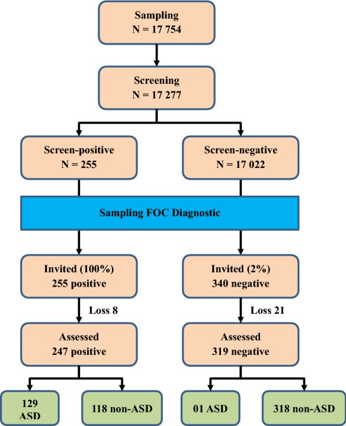

# Prevalence of autism spectrum disorders and their relation to selected socio-demographic factors among children aged 18–30 months in northern Vietnam, 2017

Tên tài liệu: Prevalence of autism spectrum disorders and their relation to selected socio-demographic factors among children aged 18–30 months in northern Vietnam, 2017

Tác giả hoặc tổ chức: Van Minh Hoang; Thi Vui Le; Thi Thuy Quynh Chu; Bich Ngoc Le; Minh Duc Duong; Ngoc Minh Thanh; Van Tac Pham; Harry Minas; Thi Thu Ha Bui

Link nguồn: https://pmc.ncbi.nlm.nih.gov/articles/PMC6487529/

Ngày xuất bản: 2019-4-29

Ngày cập nhật: Không được nguồn công bố / chưa xác minh; phiên bản: PMC distributed version 1

Phạm vi nội dung: Children aged 18–30 months in three northern Vietnamese sites, sampled in 2017

ID nguồn: ASD-OA-PMC6487529

Giấy phép: https://creativecommons.org/licenses/by/4.0/. Căn cứ: https://pmc.ncbi.nlm.nih.gov/api/oai/v1/mh/?verb=GetRecord&metadataPrefix=pmc&identifier=oai:pubmedcentral.nih.gov:6487529

Trạng thái chuyển đổi: complete_text. Giới hạn chuyển đổi và phạm vi sử dụng được ghi trong catalog.jsonl.

Bản đối chiếu phục vụ nghiên cứu; chưa có thẩm định lâm sàng độc lập.

---

## NỘI DUNG NGUYÊN BẢN

<!-- ORIGINAL_DOCUMENT_BODY -->
## Prevalence of autism spectrum disorders and their relation to selected socio-demographic factors among children aged 18–30 months in northern Vietnam, 2017

Hoang Van Minh 1 

http://orcid.org/0000-0002-5667-0156 Le Thi Vui084- 912370672ltv@huph.edu.vn 2 

Chu Thi Thuy Quynh 2 

Le Bich Ngoc 3 

Duong Minh Duc 2 

Thanh Ngoc Minh 4 

Tac Pham Van 5 

Minas Harry 6 

Bui Thi Thu Ha 2 

1 grid.448980.9Department of Health Economics and Finance, Hanoi University of Public Health, Hanoi, Vietnam 

2 grid.448980.9Department of Demography-Reproductive Health, Hanoi University of Public Health, Hanoi, Vietnam 

3 grid.448980.9Department of Biostatistics, Hanoi University of Public Health, Hanoi, Vietnam 

4 0000 0004 0498 8757grid.416693.fDepartment of Psychiatry, Vietnam National Hospital of Pediatrics, Hanoi, Vietnam 

5 grid.67122.30Departments of Personnel and Organization, Vietnam Ministry of Health, Hanoi, Vietnam 

6 Global and Cultural Mental Health Unit, Center for Mental Health, Melbourne School of Population and Global Health, Melbourne, Australia 

© The Author(s) 2019 https://creativecommons.org/licenses/by/4.0/<bold>Open Access</bold>This article is distributed under the terms of the Creative Commons Attribution 4.0 International License ([http://creativecommons.org/licenses/by/4.0/](http://creativecommons.org/licenses/by/4.0/)), which permits unrestricted use, distribution, and reproduction in any medium, provided you give appropriate credit to the original author(s) and the source, provide a link to the Creative Commons license, and indicate if changes were made. The Creative Commons Public Domain Dedication waiver ([http://creativecommons.org/publicdomain/zero/1.0/](http://creativecommons.org/publicdomain/zero/1.0/)) applies to the data made available in this article, unless otherwise stated.

### Background

Autism spectrum disorders are increasing worldwide and in Vietnam. This study reports the prevalence of autism spectrum disorders and examines their relation to selected socio-demographic factors among children aged 18 and 30 months in three northern cities/provinces in Vietnam, 2017.

### Methods

This was a cross-sectional study conducted among 17,277 children aged 18 and 30 months one city (Hanoi capital) and two provinces in northern Vietnam. The multi-stage sampling technique was applied in this study. We used M-CHAT to screen children with high risk of ASD. M-CHAT positive cases were diagnosed by pediatric neurologists from National Pediatrics Hospital using DSM-IV criteria. Descriptive and analytical statistics were performed.

### Results

The overall prevalence of ASD among children aged 18 and 30 months in the three studied sites was 0.752% (95% CI 0.629–0.893%). The odds of having ASD were statistically significant higher among (a) children living in urban area as compared to those from rural settings (OR = 2.7, 95% CI 1.73–4.21); (b) boys as compared to girls (OR = 4.04, 95% CI 2.57–6.35); and (c) children of mothers who worked as farmers as compared to children of mothers who were government staff (OR = 4.72, 95% CI 2.03–10.97).

### Conclusions

Our study revealed that the prevalence of ASD among children in Vietnam seems to be increasing. The significant correlates of ASD among the children were urban setting, male gender and mother’s occupation (farmer). Further and more in-depth studies on determinants of ASD are needed to provide insights into the problem.

## Keywords

Autism

Prevalence

Socio-demographic

Vietnam

http://dx.doi.org/10.13039/100007225Ministry of Science and Technology26/16 – ĐTĐL: CN – CNNHoang Van Minh

issue-copyright-statement: © The Author(s) 2019

### Introduction

Autism spectrum disorders (ASD) refer to a range of conditions characterized by some degree of impaired social behavior, communication and language, and a narrow range of interests and activities that are both unique to the individual and carried out repetitively [1]. ASD often impose significant emotional and economic burden on people with these disorders and their families [1, 2]. The impairments associated with ASD are present during the life-course [3] and are considered to have a substantial functional, social and financial impacts on affected individuals, their families and society.

Autism spectrum disorders prevalence appears to be increasing worldwide, with reported prevalence of about 0.5–1% [4]. In European countries, the prevalence of ASD, with an age range of birth to adulthood, varied from 0.019 to 7.2% [5]. The prevalence of ASD in the US in 2012 was 1.13% [6]. A recent systematic review reported the increasing trend in prevalence of ASD in South Asia, ranging from 0.09% in India to 1.07% in Sri Lanka [7]. ASD prevalence estimates were 0.118% in China in the last few years [8] and 2.64% in South Korea in 2011 [9].

In Vietnam, hospital statistics show that the number of cases of ASD admitted to the National Pediatrics Hospital increased more than threefold during the period 2000–2007 [10, 11] and fourfold during the period 2008–2010 [12]. A small-scale population-based study done by Giang et al. in 2012 in Thai Binh (a northern province of Vietnam) found the prevalence of ASD among children aged 18–24 months was 0.46% [13]. Another study conducted in Thai Nguyen in 2013 found that the prevalence of ASD among children aged 18–60 months was 0.52% [14]. In 2014, a screening program by Yen et al. [15] implemented among 94,186 children aged 18–60 months in three provinces/cities in the North of Vietnam found an ASD prevalence of 0.415%.

To provide information about epidemiologic aspects of ASD in Vietnam, this study investigated the prevalence of autism spectrum disorders and examined their relation to selected socio-demographic factors among children aged 18–30 months in three northern cities/provinces in Vietnam in 2017.

In this study, we used M-CHAT for screening ASD among the studied children as it has been widely used in other settings [16]. M-CHAT was proven to be an accessible, low-cost option for universal toddler screening [17]. The M-CHAT has also been validated internationally and estimated to have the positive predictive value (PPV) varying from 0.57 to 0.65 in low-risk samples [18–20]. M-CHAT has been translated into multiple languages [21] including Vietnamese. M-CHAT is currently being used as the main screening tool in clinical settings by physicians at the Vietnam National Pediatric Hospital with a positive predictive value (PPV) as high as 0.763 in 6583 children aged 18–24 months [13]. However, despite high PPV, sensitivity and specificity have not been clearly determined [22] and it is necessary to identify the percentage of false negatives [23]. We used DSM-IV for diagnosis of ASD because it has been previously applied in a variety of settings [7], including Vietnam [13]. In 2013, DSM-V was introduced and changed ASD diagnostic criteria, particularly eliminating diagnosis of a number of subtypes [24]. However, DSM-V was shown to be likely to decrease the number of individuals diagnosed with ASD [25–27].

### Methods

#### Design

This was a cross-sectional study of population-representative samples of children in nine study sites (urban and rural districts) located in three cities/provinces in northern Vietnam.

#### Research participants

Children aged 18 and 30 months in Vietnam who were living with their parents or caregivers at the time of research.

#### Research sites

The research was implemented in one city (Hanoi, capital of Vietnam) and two provinces (Thai Binh province in the Red River Delta Region and Hoa Binh province in the Northern Midlands and Mountainous Region). These research sites were purposively selected as they have typical characteristics of the region in which they are located in terms of socio-economic conditions, population structure and health system.

#### Sample size

The sample for each city/province was 5918 children. We estimated the sample size using the following formula:\documentclass[12pt]{minimal}
				\usepackage{amsmath}
				\usepackage{wasysym} 
				\usepackage{amsfonts} 
				\usepackage{amssymb} 
				\usepackage{amsbsy}
				\usepackage{mathrsfs}
				\usepackage{upgreek}
				\setlength{\oddsidemargin}{-69pt}
				\begin{document}$$n = z_{{\left( {1 - \alpha /2} \right)}}^{2} \frac{1 - p}{{\varepsilon^{2} p}}$$\end{document}<math id="M2" display="block" overflow="scroll" xmlns="http://www.w3.org/1998/Math/MathML"><mrow><mi>n</mi><mo>=</mo><msubsup><mi>z</mi><mrow><mfenced close=")" open="(" separators=""><mrow><mn>1</mn><mo>-</mo><mi>α</mi><mo stretchy="false">/</mo><mn>2</mn></mrow></mfenced></mrow><mn>2</mn></msubsup><mfrac><mrow><mn>1</mn><mo>-</mo><mi>p</mi></mrow><mrow><msup><mi>ε</mi><mn>2</mn></msup><mi>p</mi></mrow></mfrac></mrow></math>

In which, n was sample size at each study city/province; z (1−α/2) was equal to 1.96 (confidence level of 95%); ɛ was relative precision (35%); p was anticipated population proportion of children with ASD (0.46% [13]); and the estimated refusal rate of 15%. The total sample size was 17,754 children.

#### Sampling

Based on our experiences, we applied multistage sampling strategy. In the 1st stage, we selected a major city Hanoi and two provinces based on two socioeconomic regions in the northern Vietnam (as in the Decree No. 92/2006/ND-CP of 7 September 2006 on the establishment, approval and management of the general planning for socioeconomic development.) (as described in “Research sites” above). In the 2nd stage, we randomly selected one urban district and two rural districts in each city/province. A complete list of all children aged 18–30 months in the selected districts was compiled with the assistance of the District Health Center and Center of Population and Family Planning. In the 3rd stage, about 2000 children in each of the nine study districts were randomly selected from the lists of the children compiled in the 2nd stage.

#### Screening and diagnosis

##### Screening phase

We used the 23 item Modified Checklist for Autism in Toddlers (M-CHAT) to screen children with high risk of ASD. M-CHAT is a screening tool for ASD which has been being used worldwide [22]. In Vietnam, M-CHAT was shown to have sensitivity of 74.4% and specificity of 99.9% in screening ASD [13]. During the research design phase, we reviewed and considered different autism screening tools, including M-CHAT and M-CHAT-R/F. After the careful consideration, we chose M-CHAT as the screening tool in our study for a number of reasons. M-CHAT had been translated and validated in the Vietnamese context [13]. M-CHAT was also used in some other previous studies in Vietnam. This tool has been also commonly used to screen autism among children in clinical settings in a number of hospitals in Vietnam. Moreover, owing to financial limitations, M-CHAT was more much appropriate for our study than M-CHAT-R/F that required follow-up after screening. The screenings were conducted at the children’s homes with the children’s parents.

##### Diagnostic confirmation phase

All children of screen-positive group and 2% children of screen-negative group were invited to diagnostic confirmation assessment. Right after a screen-positive case was detected, the diagnosis was carried out at district health centers by eight doctors (04 pediatric neurologists and 04 psychologist) from National Hospital of Pediatrics using DSM-IV criteria. Each of screen-positive or screen-negative cases was diagnosed by two doctors (01 pediatric neurologists and 01 psychologist). These professionals have been performed the autism diagnosis and intervention among children for years at the hospital. The average length of time for the diagnosis was 35 min/case. The doctors were trained on DSM IV by the head of the Department of Psychiatry, National Hospital of Pediatrics who is pediatric psychologist. Figure 1 illustrates the process of ASD screening and diagnosis. There were 8 positive cases and 21 negative cases of loss to follow-up due to refusing to diagnose, moved to another province, the child was absent at the time of diagnosis, 03 children died. These professionals have been performed the autism diagnosis and intervention among children for years at the hospital.

Fig. 1 

Screening and diagnostic process

[Original figure transcription; formatting conversion, no interpretation]

Sampling N = 17 754 → Screening N = 17 277
Screening → Screen-positive N = 255
Screening → Screen-negative N = 17 022

Sampling FOC Diagnostic
Screen-positive → Invited (100%) 255 positive → Loss 8 → Assessed 247 positive
Assessed 247 positive → 129 ASD
Assessed 247 positive → 118 non-ASD
Screen-negative → Invited (2%) 340 negative → Loss 21 → Assessed 319 negative
Assessed 319 negative → 01 ASD
Assessed 319 negative → 318 non-ASD

#### Study variables

The dependent variable was ASD, as initially identified by screening and subsequently diagnosed by pediatric neurologists, among the study participants. Independent variables included age and gender of the child, parents’ age, education and occupation, and the family’s economic status. Regarding parents, age was classified into three groups with (1) less than 29 years, (2) 29 to 39 years, and (3) 40 years and over. Education level was dichotomized into primary, secondary, high school, and university/college. Occupation status contained government and private sector staff, farmer, unstable job and other jobs. Family economy classified as poor when the annual household income was less than 1000 USD.

#### Data collection

In each city/province, 46 local health workers (either medical doctor or nurse, midwives) were recruited and trained. 12 supervisors were assigned to supervise and monitor the survey data collectors throughout the process of data collection and to confirm positive screened cases at the household level. A team of pediatric neurologists, public health specialists and child development therapists provided 1 day of training on data collection to all the field data collection staff. The data collectors conducted face-to-face interviews with the mother/father or caregivers of the child using a structured questionnaire with three vital components including the children and their parents’ socio-demographic information, and 23 items of M-CHAT. The screening data were collected during July and September 2017. As noted above, M-CHAT was used as the primary screening tool for ASD and M-CHAT-positive cases were diagnosed by pediatric neurologists from National Pediatrics Hospital using DSM-IV criteria.

#### Data analysis

Descriptive and analytical statistics were performed. Prevalence estimates were derived and stratified by socio-demographic variables. Binary logistic regression models were used to evaluate the odds of the dependent measure according to the demographic and socio-economic measures. An alpha level of 0.05 was used to determine statistical significance in all analyses. Data were analyzed using EPI Info 3.54 and Stata 14 software.

### Results

97.3% of children’s parents (17,277 out of 17,754) consented to participate in the study and completed the M-CHAT interviews. Of the 17,277 screened children, 255 (100%) screen-positive cases and 340 screen-negative cases (2%) were diagnosed by using DSM-IV criteria. There were 8 positive cases and 21 negative cases of loss to follow-up due to refusing to diagnose, moved to another province, the child was absent at the time of diagnosis, 02 children died. Of these 247 positive cases getting assessed, 129 were diagnosed with ASD. Of these 319 negative cases getting assessed, 01 was diagnosed with ASD.

Table 1 presents general characteristics of the study sample. Most of the study children (73.8%) lived in rural areas. There were more boys (53.6%) than girls (46.4%). More than half (58.7%) of the children were aged 24–30 months. The majority of the children’s mothers (67.4%) were aged less than 29 years. Most of the mothers (71.6%) had secondary school education or higher. Of the mothers 25.3% worked as farmers and 32.1% had unstable employment. Among the fathers 50.1% were less than 29 years and 45.9% were 29–39 years. Most of the fathers (70.3%) had completed secondary school education or higher. 22.2% of fathers worked as farmer and 43.3%, had unstable employment. Almost all the children’s households (91%) were classified as non-poor.

Table 1 

General characteristics of the study participants

<table><thead><tr><th align="left" colspan="1" rowspan="1"></th><th align="left" colspan="1" rowspan="1">Frequency</th><th align="left" colspan="1" rowspan="1">Percentage (%)</th></tr></thead><tbody><tr><td align="left" colspan="3" rowspan="1">City/province</td></tr><tr><td align="left" colspan="1" rowspan="1"> Ha Noi</td><td align="char" colspan="1" rowspan="1">5501</td><td align="char" colspan="1" rowspan="1">31.8</td></tr><tr><td align="left" colspan="1" rowspan="1"> Thai Binh</td><td align="char" colspan="1" rowspan="1">5883</td><td align="char" colspan="1" rowspan="1">34.1</td></tr><tr><td align="left" colspan="1" rowspan="1"> Hoa Binh</td><td align="char" colspan="1" rowspan="1">5893</td><td align="char" colspan="1" rowspan="1">34.1</td></tr><tr><td align="left" colspan="3" rowspan="1">Area</td></tr><tr><td align="left" colspan="1" rowspan="1"> Rural</td><td align="char" colspan="1" rowspan="1">12,754</td><td align="char" colspan="1" rowspan="1">73.8</td></tr><tr><td align="left" colspan="1" rowspan="1"> Urban</td><td align="char" colspan="1" rowspan="1">4523</td><td align="char" colspan="1" rowspan="1">26.2</td></tr><tr><td align="left" colspan="3" rowspan="1">Gender</td></tr><tr><td align="left" colspan="1" rowspan="1"> Girl</td><td align="char" colspan="1" rowspan="1">8009</td><td align="char" colspan="1" rowspan="1">46.4</td></tr><tr><td align="left" colspan="1" rowspan="1"> Boy</td><td align="char" colspan="1" rowspan="1">9268</td><td align="char" colspan="1" rowspan="1">53.6</td></tr><tr><td align="left" colspan="3" rowspan="1">Age (months)</td></tr><tr><td align="left" colspan="1" rowspan="1"> 18–23</td><td align="char" colspan="1" rowspan="1">7128</td><td align="char" colspan="1" rowspan="1">41.3</td></tr><tr><td align="left" colspan="1" rowspan="1"> 24–30</td><td align="char" colspan="1" rowspan="1">10,149</td><td align="char" colspan="1" rowspan="1">58.7</td></tr><tr><td align="left" colspan="3" rowspan="1">Mother age</td></tr><tr><td align="left" colspan="1" rowspan="1"> Less than 29</td><td align="char" colspan="1" rowspan="1">11,649</td><td align="char" colspan="1" rowspan="1">67.4</td></tr><tr><td align="left" colspan="1" rowspan="1"> 29 to 39</td><td align="char" colspan="1" rowspan="1">4061</td><td align="char" colspan="1" rowspan="1">23.5</td></tr><tr><td align="left" colspan="1" rowspan="1"> 40 and older</td><td align="char" colspan="1" rowspan="1">1567</td><td align="char" colspan="1" rowspan="1">9.1</td></tr><tr><td align="left" colspan="3" rowspan="1">Mother’s education</td></tr><tr><td align="left" colspan="1" rowspan="1"> Primary education</td><td align="char" colspan="1" rowspan="1">4908</td><td align="char" colspan="1" rowspan="1">28.4</td></tr><tr><td align="left" colspan="1" rowspan="1"> Secondary education</td><td align="char" colspan="1" rowspan="1">5847</td><td align="char" colspan="1" rowspan="1">33.8</td></tr><tr><td align="left" colspan="1" rowspan="1"> High school</td><td align="char" colspan="1" rowspan="1">3419</td><td align="char" colspan="1" rowspan="1">19.8</td></tr><tr><td align="left" colspan="1" rowspan="1"> University/College</td><td align="char" colspan="1" rowspan="1">3103</td><td align="char" colspan="1" rowspan="1">18.0</td></tr><tr><td align="left" colspan="3" rowspan="1">Mother’s occupation</td></tr><tr><td align="left" colspan="1" rowspan="1"> Government staff</td><td align="char" colspan="1" rowspan="1">2816</td><td align="char" colspan="1" rowspan="1">16.3</td></tr><tr><td align="left" colspan="1" rowspan="1"> Private sector staff</td><td align="char" colspan="1" rowspan="1">3787</td><td align="char" colspan="1" rowspan="1">21.92</td></tr><tr><td align="left" colspan="1" rowspan="1"> Farmer</td><td align="char" colspan="1" rowspan="1">4378</td><td align="char" colspan="1" rowspan="1">25.34</td></tr><tr><td align="left" colspan="1" rowspan="1"> Unstable job</td><td align="char" colspan="1" rowspan="1">5537</td><td align="char" colspan="1" rowspan="1">32.05</td></tr><tr><td align="left" colspan="1" rowspan="1"> Others</td><td align="char" colspan="1" rowspan="1">759</td><td align="char" colspan="1" rowspan="1">4.39</td></tr><tr><td align="left" colspan="3" rowspan="1">Father’s age</td></tr><tr><td align="left" colspan="1" rowspan="1"> Less than 29</td><td align="char" colspan="1" rowspan="1">8647</td><td align="char" colspan="1" rowspan="1">50.1</td></tr><tr><td align="left" colspan="1" rowspan="1"> 29 to 39</td><td align="char" colspan="1" rowspan="1">7933</td><td align="char" colspan="1" rowspan="1">45.9</td></tr><tr><td align="left" colspan="1" rowspan="1"> 40 and older</td><td align="char" colspan="1" rowspan="1">697</td><td align="char" colspan="1" rowspan="1">4.0</td></tr><tr><td align="left" colspan="3" rowspan="1">Father’s education</td></tr><tr><td align="left" colspan="1" rowspan="1"> Primary education</td><td align="char" colspan="1" rowspan="1">5123</td><td align="char" colspan="1" rowspan="1">29.7</td></tr><tr><td align="left" colspan="1" rowspan="1"> Secondary education</td><td align="char" colspan="1" rowspan="1">6345</td><td align="char" colspan="1" rowspan="1">36.7</td></tr><tr><td align="left" colspan="1" rowspan="1"> High school</td><td align="char" colspan="1" rowspan="1">2756</td><td align="char" colspan="1" rowspan="1">16.0</td></tr><tr><td align="left" colspan="1" rowspan="1"> University/College</td><td align="char" colspan="1" rowspan="1">3053</td><td align="char" colspan="1" rowspan="1">17.7</td></tr><tr><td align="left" colspan="3" rowspan="1">Father’s occupation</td></tr><tr><td align="left" colspan="1" rowspan="1"> Government staff</td><td align="char" colspan="1" rowspan="1">2421</td><td align="char" colspan="1" rowspan="1">14.0</td></tr><tr><td align="left" colspan="1" rowspan="1"> Private sector staff</td><td align="char" colspan="1" rowspan="1">3037</td><td align="char" colspan="1" rowspan="1">17.6</td></tr><tr><td align="left" colspan="1" rowspan="1"> Farmer</td><td align="char" colspan="1" rowspan="1">3827</td><td align="char" colspan="1" rowspan="1">22.2</td></tr><tr><td align="left" colspan="1" rowspan="1"> Unstable job</td><td align="char" colspan="1" rowspan="1">7484</td><td align="char" colspan="1" rowspan="1">43.3</td></tr><tr><td align="left" colspan="1" rowspan="1"> Others</td><td align="char" colspan="1" rowspan="1">508</td><td align="char" colspan="1" rowspan="1">2.9</td></tr><tr><td align="left" colspan="3" rowspan="1">Number of children in the family</td></tr><tr><td align="left" colspan="1" rowspan="1"> 1</td><td align="char" colspan="1" rowspan="1">6044</td><td align="char" colspan="1" rowspan="1">35.0</td></tr><tr><td align="left" colspan="1" rowspan="1"> 2</td><td align="char" colspan="1" rowspan="1">8637</td><td align="char" colspan="1" rowspan="1">50.0</td></tr><tr><td align="left" colspan="1" rowspan="1"> 3</td><td align="char" colspan="1" rowspan="1">2596</td><td align="char" colspan="1" rowspan="1">15.0</td></tr><tr><td align="left" colspan="3" rowspan="1">Economic status</td></tr><tr><td align="left" colspan="1" rowspan="1"> Non-poor</td><td align="char" colspan="1" rowspan="1">15,725</td><td align="char" colspan="1" rowspan="1">91.0</td></tr><tr><td align="left" colspan="1" rowspan="1"> Near poor/poor</td><td align="char" colspan="1" rowspan="1">1552</td><td align="char" colspan="1" rowspan="1">9.0</td></tr><tr><td align="left" colspan="1" rowspan="1">Total</td><td align="char" colspan="1" rowspan="1">17,277</td><td align="char" colspan="1" rowspan="1">100.0</td></tr></tbody></table>

The overall prevalence of ASD among children aged 18 and 30 months in the three cities/provinces was 0.752% (95% CI 0.629–0.893%). Table 2 presents prevalence of ASD among children aged 18 and 30 months by socio-demographic characteristics. The prevalence of ASD was significantly higher in urban (1.238%) than in rural areas (0.580%). The prevalence of ASD was significantly higher among children of mothers who worked as farmers (1.054%) than among children of mothers who were employed as government staff (0.497%). There were no statistically significant differences in the prevalence of ASD by other socio-demographic variables.

Table 2 

Prevalence of ASD among children aged 18 and 30 months

<table><thead><tr><th align="left" colspan="1" rowspan="1"></th><th align="left" colspan="1" rowspan="1">Count</th><th align="left" colspan="1" rowspan="1">Percentage (%)</th><th align="left" colspan="1" rowspan="1">Lower bound of 95% CI (%)</th><th align="left" colspan="1" rowspan="1">Upper bound of 95% CI (%)</th></tr></thead><tbody><tr><td align="left" colspan="5" rowspan="1">City/province</td></tr><tr><td align="left" colspan="1" rowspan="1"> Ha Noi</td><td align="char" colspan="1" rowspan="1">46</td><td align="char" colspan="1" rowspan="1">0.836</td><td align="char" colspan="1" rowspan="1">0.613</td><td align="char" colspan="1" rowspan="1">1.114</td></tr><tr><td align="left" colspan="1" rowspan="1"> Thai Binh</td><td align="char" colspan="1" rowspan="1">41</td><td align="char" colspan="1" rowspan="1">0.697</td><td align="char" colspan="1" rowspan="1">0.501</td><td align="char" colspan="1" rowspan="1">0.944</td></tr><tr><td align="left" colspan="1" rowspan="1"> Hoa Binh</td><td align="char" colspan="1" rowspan="1">43</td><td align="char" colspan="1" rowspan="1">0.730</td><td align="char" colspan="1" rowspan="1">0.529</td><td align="char" colspan="1" rowspan="1">0.982</td></tr><tr><td align="left" colspan="5" rowspan="1">Area</td></tr><tr><td align="left" colspan="1" rowspan="1"> Rural</td><td align="char" colspan="1" rowspan="1">74</td><td align="char" colspan="1" rowspan="1">0.580</td><td align="char" colspan="1" rowspan="1">0.456</td><td align="char" colspan="1" rowspan="1">0.728</td></tr><tr><td align="left" colspan="1" rowspan="1"> Urban</td><td align="char" colspan="1" rowspan="1">56</td><td align="char" colspan="1" rowspan="1">1.238</td><td align="char" colspan="1" rowspan="1">0.937</td><td align="char" colspan="1" rowspan="1">1.605</td></tr><tr><td align="left" colspan="5" rowspan="1">Gender</td></tr><tr><td align="left" colspan="1" rowspan="1"> Girl</td><td align="char" colspan="1" rowspan="1">23</td><td align="char" colspan="1" rowspan="1">0.287</td><td align="char" colspan="1" rowspan="1">0.182</td><td align="char" colspan="1" rowspan="1">0.431</td></tr><tr><td align="left" colspan="1" rowspan="1"> Boy</td><td align="char" colspan="1" rowspan="1">107</td><td align="char" colspan="1" rowspan="1">1.155</td><td align="char" colspan="1" rowspan="1">0.947</td><td align="char" colspan="1" rowspan="1">1.393</td></tr><tr><td align="left" colspan="5" rowspan="1">Age (months)</td></tr><tr><td align="left" colspan="1" rowspan="1"> 18–23</td><td align="char" colspan="1" rowspan="1">55</td><td align="char" colspan="1" rowspan="1">0.772</td><td align="char" colspan="1" rowspan="1">0.582</td><td align="char" colspan="1" rowspan="1">1.003</td></tr><tr><td align="left" colspan="1" rowspan="1"> 24–30</td><td align="char" colspan="1" rowspan="1">75</td><td align="char" colspan="1" rowspan="1">0.739</td><td align="char" colspan="1" rowspan="1">0.582</td><td align="char" colspan="1" rowspan="1">0.925</td></tr><tr><td align="left" colspan="5" rowspan="1">Mother age</td></tr><tr><td align="left" colspan="1" rowspan="1"> Less than 29</td><td align="char" colspan="1" rowspan="1">81</td><td align="char" colspan="1" rowspan="1">0.695</td><td align="char" colspan="1" rowspan="1">0.553</td><td align="char" colspan="1" rowspan="1">0.864</td></tr><tr><td align="left" colspan="1" rowspan="1"> 29 to 39</td><td align="char" colspan="1" rowspan="1">41</td><td align="char" colspan="1" rowspan="1">1.010</td><td align="char" colspan="1" rowspan="1">0.725</td><td align="char" colspan="1" rowspan="1">1.367</td></tr><tr><td align="left" colspan="1" rowspan="1"> 40 and older</td><td align="char" colspan="1" rowspan="1">8</td><td align="char" colspan="1" rowspan="1">0.511</td><td align="char" colspan="1" rowspan="1">0.221</td><td align="char" colspan="1" rowspan="1">1.003</td></tr><tr><td align="left" colspan="5" rowspan="1">Mother’s education</td></tr><tr><td align="left" colspan="1" rowspan="1"> Primary education</td><td align="char" colspan="1" rowspan="1">32</td><td align="char" colspan="1" rowspan="1">0.652</td><td align="char" colspan="1" rowspan="1">0.461</td><td align="char" colspan="1" rowspan="1">0.921</td></tr><tr><td align="left" colspan="1" rowspan="1"> Secondary education</td><td align="char" colspan="1" rowspan="1">46</td><td align="char" colspan="1" rowspan="1">0.787</td><td align="char" colspan="1" rowspan="1">0.590</td><td align="char" colspan="1" rowspan="1">1.049</td></tr><tr><td align="left" colspan="1" rowspan="1"> High school</td><td align="char" colspan="1" rowspan="1">32</td><td align="char" colspan="1" rowspan="1">0.936</td><td align="char" colspan="1" rowspan="1">0.663</td><td align="char" colspan="1" rowspan="1">1.321</td></tr><tr><td align="left" colspan="1" rowspan="1"> University/College</td><td align="char" colspan="1" rowspan="1">20</td><td align="char" colspan="1" rowspan="1">0.645</td><td align="char" colspan="1" rowspan="1">0.416</td><td align="char" colspan="1" rowspan="1">0.997</td></tr><tr><td align="left" colspan="5" rowspan="1">Mother’s occupation</td></tr><tr><td align="left" colspan="1" rowspan="1"> Government staff</td><td align="char" colspan="1" rowspan="1">14</td><td align="char" colspan="1" rowspan="1">0.497</td><td align="char" colspan="1" rowspan="1">0.272</td><td align="char" colspan="1" rowspan="1">0.833</td></tr><tr><td align="left" colspan="1" rowspan="1"> Private sector staff</td><td align="char" colspan="1" rowspan="1">30</td><td align="char" colspan="1" rowspan="1">0.792</td><td align="char" colspan="1" rowspan="1">0.535</td><td align="char" colspan="1" rowspan="1">1.129</td></tr><tr><td align="left" colspan="1" rowspan="1"> Farmer</td><td align="char" colspan="1" rowspan="1">36</td><td align="char" colspan="1" rowspan="1">1.054</td><td align="char" colspan="1" rowspan="1">0.577</td><td align="char" colspan="1" rowspan="1">1.137</td></tr><tr><td align="left" colspan="1" rowspan="1"> Unstable job</td><td align="char" colspan="1" rowspan="1">42</td><td align="char" colspan="1" rowspan="1">0.759</td><td align="char" colspan="1" rowspan="1">0.547</td><td align="char" colspan="1" rowspan="1">1.024</td></tr><tr><td align="left" colspan="1" rowspan="1"> Others</td><td align="char" colspan="1" rowspan="1">8</td><td align="char" colspan="1" rowspan="1">0.822</td><td align="char" colspan="1" rowspan="1">0.456</td><td align="char" colspan="1" rowspan="1">2.066</td></tr><tr><td align="left" colspan="5" rowspan="1">Father’s age</td></tr><tr><td align="left" colspan="1" rowspan="1"> Less than 29</td><td align="char" colspan="1" rowspan="1">53</td><td align="char" colspan="1" rowspan="1">0.613</td><td align="char" colspan="1" rowspan="1">0.459</td><td align="char" colspan="1" rowspan="1">0.801</td></tr><tr><td align="left" colspan="1" rowspan="1"> 29 to 39</td><td align="char" colspan="1" rowspan="1">72</td><td align="char" colspan="1" rowspan="1">0.908</td><td align="char" colspan="1" rowspan="1">0.711</td><td align="char" colspan="1" rowspan="1">1.142</td></tr><tr><td align="left" colspan="1" rowspan="1"> 40 and older</td><td align="char" colspan="1" rowspan="1">5</td><td align="char" colspan="1" rowspan="1">0.717</td><td align="char" colspan="1" rowspan="1">0.233</td><td align="char" colspan="1" rowspan="1">1.666</td></tr><tr><td align="left" colspan="5" rowspan="1">Father’s education</td></tr><tr><td align="left" colspan="1" rowspan="1"> Primary education</td><td align="char" colspan="1" rowspan="1">31</td><td align="char" colspan="1" rowspan="1">0.605</td><td align="char" colspan="1" rowspan="1">0.426</td><td align="char" colspan="1" rowspan="1">0.859</td></tr><tr><td align="left" colspan="1" rowspan="1"> Secondary education</td><td align="char" colspan="1" rowspan="1">50</td><td align="char" colspan="1" rowspan="1">0.788</td><td align="char" colspan="1" rowspan="1">0.598</td><td align="char" colspan="1" rowspan="1">1.038</td></tr><tr><td align="left" colspan="1" rowspan="1"> High school</td><td align="char" colspan="1" rowspan="1">25</td><td align="char" colspan="1" rowspan="1">0.907</td><td align="char" colspan="1" rowspan="1">0.614</td><td align="char" colspan="1" rowspan="1">1.339</td></tr><tr><td align="left" colspan="1" rowspan="1"> University/College</td><td align="char" colspan="1" rowspan="1">24</td><td align="char" colspan="1" rowspan="1">0.786</td><td align="char" colspan="1" rowspan="1">0.527</td><td align="char" colspan="1" rowspan="1">1.170</td></tr><tr><td align="left" colspan="5" rowspan="1">Father’s occupation</td></tr><tr><td align="left" colspan="1" rowspan="1"> Government staff</td><td align="char" colspan="1" rowspan="1">13</td><td align="char" colspan="1" rowspan="1">0.537</td><td align="char" colspan="1" rowspan="1">0.286</td><td align="char" colspan="1" rowspan="1">0.916</td></tr><tr><td align="left" colspan="1" rowspan="1"> Private sector staff</td><td align="char" colspan="1" rowspan="1">27</td><td align="char" colspan="1" rowspan="1">0.889</td><td align="char" colspan="1" rowspan="1">0.587</td><td align="char" colspan="1" rowspan="1">1.291</td></tr><tr><td align="left" colspan="1" rowspan="1"> Farmer</td><td align="char" colspan="1" rowspan="1">18</td><td align="char" colspan="1" rowspan="1">0.470</td><td align="char" colspan="1" rowspan="1">0.279</td><td align="char" colspan="1" rowspan="1">0.742</td></tr><tr><td align="left" colspan="1" rowspan="1"> Unstable job</td><td align="char" colspan="1" rowspan="1">65</td><td align="char" colspan="1" rowspan="1">0.869</td><td align="char" colspan="1" rowspan="1">0.671</td><td align="char" colspan="1" rowspan="1">1.106</td></tr><tr><td align="left" colspan="1" rowspan="1"> Others</td><td align="char" colspan="1" rowspan="1">7</td><td align="char" colspan="1" rowspan="1">1.378</td><td align="char" colspan="1" rowspan="1">0.556</td><td align="char" colspan="1" rowspan="1">2.818</td></tr><tr><td align="left" colspan="5" rowspan="1">Number of children in the family</td></tr><tr><td align="left" colspan="1" rowspan="1"> 1</td><td align="char" colspan="1" rowspan="1">39</td><td align="char" colspan="1" rowspan="1">0.645</td><td align="char" colspan="1" rowspan="1">0.459</td><td align="char" colspan="1" rowspan="1">0.881</td></tr><tr><td align="left" colspan="1" rowspan="1"> 2</td><td align="char" colspan="1" rowspan="1">69</td><td align="char" colspan="1" rowspan="1">0.799</td><td align="char" colspan="1" rowspan="1">0.622</td><td align="char" colspan="1" rowspan="1">1.010</td></tr><tr><td align="left" colspan="1" rowspan="1"> 3</td><td align="char" colspan="1" rowspan="1">22</td><td align="char" colspan="1" rowspan="1">0.847</td><td align="char" colspan="1" rowspan="1">0.532</td><td align="char" colspan="1" rowspan="1">1.280</td></tr><tr><td align="left" colspan="5" rowspan="1">Economic status</td></tr><tr><td align="left" colspan="1" rowspan="1"> Non-poor</td><td align="char" colspan="1" rowspan="1">118</td><td align="char" colspan="1" rowspan="1">0.750</td><td align="char" colspan="1" rowspan="1">0.622</td><td align="char" colspan="1" rowspan="1">0.898</td></tr><tr><td align="left" colspan="1" rowspan="1"> Near poor/poor</td><td align="char" colspan="1" rowspan="1">12</td><td align="char" colspan="1" rowspan="1">0.773</td><td align="char" colspan="1" rowspan="1">0.400</td><td align="char" colspan="1" rowspan="1">1.347</td></tr><tr><td align="left" colspan="1" rowspan="1">Total</td><td align="char" colspan="1" rowspan="1">130</td><td align="char" colspan="1" rowspan="1">0.752</td><td align="char" colspan="1" rowspan="1">0.629</td><td align="char" colspan="1" rowspan="1">0.893</td></tr></tbody></table>

Binary logistic regression analyses of correlates of ASD are presented in Table 3. The odds of having ASD were significantly higher among (a) children living in urban than in rural areas (OR = 2.7, 95% CI 1.73–4.21); (b) boys as compared to girls (OR = 4.04, 95% CI 2.57–6.35); and (c) children of mothers who worked as farmers as compared than in children of mothers who were employed as government staff (OR = 4.72, 95% CI 2.03–10.97).

Table 3 

Binary logistic regression analyses of correlates of autism among children aged 18 and 30 months

<table><thead><tr><th align="left" colspan="1" rowspan="1"></th><th align="left" colspan="1" rowspan="1">Odds ratio</th><th align="left" colspan="1" rowspan="1">Lower level of 95% CI</th><th align="left" colspan="1" rowspan="1">Upper level of 95% CI</th></tr></thead><tbody><tr><td align="left" colspan="4" rowspan="1">Province</td></tr><tr><td align="left" colspan="1" rowspan="1"> Ha Noi</td><td align="left" colspan="1" rowspan="1">1</td><td align="left" colspan="1" rowspan="1"></td><td align="left" colspan="1" rowspan="1"></td></tr><tr><td align="left" colspan="1" rowspan="1"> Thai Binh</td><td align="left" colspan="1" rowspan="1">0.78</td><td align="char" colspan="1" rowspan="1">0.49</td><td align="char" colspan="1" rowspan="1">1.22</td></tr><tr><td align="left" colspan="1" rowspan="1"> Hoa Binh</td><td align="left" colspan="1" rowspan="1">0.85</td><td align="char" colspan="1" rowspan="1">0.53</td><td align="char" colspan="1" rowspan="1">1.35</td></tr><tr><td align="left" colspan="4" rowspan="1">Area</td></tr><tr><td align="left" colspan="1" rowspan="1"> Rural</td><td align="left" colspan="1" rowspan="1">1</td><td align="left" colspan="1" rowspan="1"></td><td align="left" colspan="1" rowspan="1"></td></tr><tr><td align="left" colspan="1" rowspan="1"> Urban</td><td align="left" colspan="1" rowspan="1">2.70</td><td align="char" colspan="1" rowspan="1">1.73</td><td align="char" colspan="1" rowspan="1">4.21</td></tr><tr><td align="left" colspan="4" rowspan="1">Gender</td></tr><tr><td align="left" colspan="1" rowspan="1"> Girl</td><td align="left" colspan="1" rowspan="1">1</td><td align="left" colspan="1" rowspan="1"></td><td align="left" colspan="1" rowspan="1"></td></tr><tr><td align="left" colspan="1" rowspan="1"> Boy</td><td align="left" colspan="1" rowspan="1">4.04</td><td align="char" colspan="1" rowspan="1">2.57</td><td align="char" colspan="1" rowspan="1">6.35</td></tr><tr><td align="left" colspan="4" rowspan="1">Age (months)</td></tr><tr><td align="left" colspan="1" rowspan="1"> 18–23</td><td align="left" colspan="1" rowspan="1">1</td><td align="left" colspan="1" rowspan="1"></td><td align="left" colspan="1" rowspan="1"></td></tr><tr><td align="left" colspan="1" rowspan="1"> 24–30</td><td align="left" colspan="1" rowspan="1">1.00</td><td align="char" colspan="1" rowspan="1">0.70</td><td align="char" colspan="1" rowspan="1">1.41</td></tr><tr><td align="left" colspan="4" rowspan="1">Mother age</td></tr><tr><td align="left" colspan="1" rowspan="1"> Less than 29</td><td align="left" colspan="1" rowspan="1">1</td><td align="left" colspan="1" rowspan="1"></td><td align="left" colspan="1" rowspan="1"></td></tr><tr><td align="left" colspan="1" rowspan="1"> 29 to 39</td><td align="left" colspan="1" rowspan="1">1.13</td><td align="char" colspan="1" rowspan="1">0.71</td><td align="char" colspan="1" rowspan="1">1.79</td></tr><tr><td align="left" colspan="1" rowspan="1"> 40 and older</td><td align="left" colspan="1" rowspan="1">0.72</td><td align="char" colspan="1" rowspan="1">0.33</td><td align="char" colspan="1" rowspan="1">1.58</td></tr><tr><td align="left" colspan="4" rowspan="1">Mother’s education</td></tr><tr><td align="left" colspan="1" rowspan="1"> Primary education</td><td align="left" colspan="1" rowspan="1">1</td><td align="left" colspan="1" rowspan="1"></td><td align="left" colspan="1" rowspan="1"></td></tr><tr><td align="left" colspan="1" rowspan="1"> Secondary education</td><td align="left" colspan="1" rowspan="1">1.07</td><td align="char" colspan="1" rowspan="1">0.62</td><td align="char" colspan="1" rowspan="1">1.85</td></tr><tr><td align="left" colspan="1" rowspan="1"> High school</td><td align="left" colspan="1" rowspan="1">1.28</td><td align="char" colspan="1" rowspan="1">0.65</td><td align="char" colspan="1" rowspan="1">2.55</td></tr><tr><td align="left" colspan="1" rowspan="1"> University/College</td><td align="left" colspan="1" rowspan="1">0.75</td><td align="char" colspan="1" rowspan="1">0.31</td><td align="char" colspan="1" rowspan="1">1.79</td></tr><tr><td align="left" colspan="4" rowspan="1">Mother’s occupation</td></tr><tr><td align="left" colspan="1" rowspan="1"> Government staff</td><td align="left" colspan="1" rowspan="1">1</td><td align="left" colspan="1" rowspan="1"></td><td align="left" colspan="1" rowspan="1"></td></tr><tr><td align="left" colspan="1" rowspan="1"> Private sector staff</td><td align="left" colspan="1" rowspan="1">1.60</td><td align="char" colspan="1" rowspan="1">0.79</td><td align="char" colspan="1" rowspan="1">3.22</td></tr><tr><td align="left" colspan="1" rowspan="1"> Farmer</td><td align="left" colspan="1" rowspan="1">4.72</td><td align="char" colspan="1" rowspan="1">2.03</td><td align="char" colspan="1" rowspan="1">10.97</td></tr><tr><td align="left" colspan="1" rowspan="1"> Unstable job</td><td align="left" colspan="1" rowspan="1">1.50</td><td align="char" colspan="1" rowspan="1">0.72</td><td align="char" colspan="1" rowspan="1">3.12</td></tr><tr><td align="left" colspan="1" rowspan="1"> Others</td><td align="left" colspan="1" rowspan="1">1.84</td><td align="char" colspan="1" rowspan="1">0.71</td><td align="char" colspan="1" rowspan="1">4.79</td></tr><tr><td align="left" colspan="4" rowspan="1">Father’s age</td></tr><tr><td align="left" colspan="1" rowspan="1"> Less than 29</td><td align="left" colspan="1" rowspan="1">1</td><td align="left" colspan="1" rowspan="1"></td><td align="left" colspan="1" rowspan="1"></td></tr><tr><td align="left" colspan="1" rowspan="1"> 29 to 39</td><td align="left" colspan="1" rowspan="1">1.24</td><td align="char" colspan="1" rowspan="1">0.79</td><td align="char" colspan="1" rowspan="1">1.95</td></tr><tr><td align="left" colspan="1" rowspan="1"> 40 and older</td><td align="left" colspan="1" rowspan="1">0.89</td><td align="char" colspan="1" rowspan="1">0.30</td><td align="char" colspan="1" rowspan="1">2.62</td></tr><tr><td align="left" colspan="4" rowspan="1">Father’s education</td></tr><tr><td align="left" colspan="1" rowspan="1"> Primary education</td><td align="left" colspan="1" rowspan="1">1</td><td align="left" colspan="1" rowspan="1"></td><td align="left" colspan="1" rowspan="1"></td></tr><tr><td align="left" colspan="1" rowspan="1"> Secondary education</td><td align="left" colspan="1" rowspan="1">1.10</td><td align="char" colspan="1" rowspan="1">0.64</td><td align="char" colspan="1" rowspan="1">1.89</td></tr><tr><td align="left" colspan="1" rowspan="1"> High school</td><td align="left" colspan="1" rowspan="1">1.29</td><td align="char" colspan="1" rowspan="1">0.64</td><td align="char" colspan="1" rowspan="1">2.61</td></tr><tr><td align="left" colspan="1" rowspan="1"> University/College</td><td align="left" colspan="1" rowspan="1">1.33</td><td align="char" colspan="1" rowspan="1">0.57</td><td align="char" colspan="1" rowspan="1">3.11</td></tr><tr><td align="left" colspan="4" rowspan="1">Father’s occupation</td></tr><tr><td align="left" colspan="1" rowspan="1"> Government staff</td><td align="left" colspan="1" rowspan="1">1</td><td align="left" colspan="1" rowspan="1"></td><td align="left" colspan="1" rowspan="1"></td></tr><tr><td align="left" colspan="1" rowspan="1"> Private sector staff</td><td align="left" colspan="1" rowspan="1">1.73</td><td align="char" colspan="1" rowspan="1">0.83</td><td align="char" colspan="1" rowspan="1">3.60</td></tr><tr><td align="left" colspan="1" rowspan="1"> Farmer</td><td align="left" colspan="1" rowspan="1">0.64</td><td align="char" colspan="1" rowspan="1">0.25</td><td align="char" colspan="1" rowspan="1">1.65</td></tr><tr><td align="left" colspan="1" rowspan="1"> Unstable job</td><td align="left" colspan="1" rowspan="1">1.85</td><td align="char" colspan="1" rowspan="1">0.87</td><td align="char" colspan="1" rowspan="1">3.92</td></tr><tr><td align="left" colspan="1" rowspan="1"> Others</td><td align="left" colspan="1" rowspan="1">2.71</td><td align="char" colspan="1" rowspan="1">0.92</td><td align="char" colspan="1" rowspan="1">8.01</td></tr><tr><td align="left" colspan="4" rowspan="1">Number of children in the family</td></tr><tr><td align="left" colspan="1" rowspan="1"> 1</td><td align="left" colspan="1" rowspan="1">1</td><td align="left" colspan="1" rowspan="1"></td><td align="left" colspan="1" rowspan="1"></td></tr><tr><td align="left" colspan="1" rowspan="1"> 2</td><td align="left" colspan="1" rowspan="1">1.14</td><td align="char" colspan="1" rowspan="1">0.75</td><td align="char" colspan="1" rowspan="1">1.74</td></tr><tr><td align="left" colspan="1" rowspan="1"> 3</td><td align="left" colspan="1" rowspan="1">1.17</td><td align="char" colspan="1" rowspan="1">0.63</td><td align="char" colspan="1" rowspan="1">2.19</td></tr><tr><td align="left" colspan="4" rowspan="1">Economic status</td></tr><tr><td align="left" colspan="1" rowspan="1"> Non-poor</td><td align="left" colspan="1" rowspan="1">1</td><td align="left" colspan="1" rowspan="1"></td><td align="left" colspan="1" rowspan="1"></td></tr><tr><td align="left" colspan="1" rowspan="1"> Near poor/poor</td><td align="left" colspan="1" rowspan="1">1.06</td><td align="char" colspan="1" rowspan="1">0.56</td><td align="char" colspan="1" rowspan="1">2.02</td></tr></tbody></table>

Table 4 shows the results of binary logistic regression analyses of correlates of autism among children aged 18 and 30 months with an interaction term of living area and gender of the child. After controlling for other variables in the model, boys living in rural areas had 3.13 times higher odds of having ASD than girls living in rural areas, and the difference was statistically significant (OR = 3.13, 95% CI 1.79–5.45). Boys living in urban areas had 9.46 times higher odds of having ASD than girls living in rural areas, and the difference was statistically significant (OR = 9.46, 95% CI 5.03–17.80). Children of mothers who worked as farmers had 4.71 times higher odds of having ASD than children of mothers who were government staff (OR = 4.71, 95% CI 2.03–10.94).

Table 4 

Binary logistic regression analyses of correlates of autism among children aged 18 and 30 months with interaction term

<table><thead><tr><th align="left" colspan="1" rowspan="1"></th><th align="left" colspan="1" rowspan="1">Odds ratio</th><th align="left" colspan="1" rowspan="1">Lower level of 95% CI</th><th align="left" colspan="1" rowspan="1">Upper level of 95% CI</th></tr></thead><tbody><tr><td align="left" colspan="4" rowspan="1">Province</td></tr><tr><td align="left" colspan="1" rowspan="1"> Ha Noi</td><td align="left" colspan="1" rowspan="1">1</td><td align="left" colspan="1" rowspan="1"></td><td align="left" colspan="1" rowspan="1"></td></tr><tr><td align="left" colspan="1" rowspan="1"> Thai Binh</td><td align="left" colspan="1" rowspan="1">0.78</td><td align="char" colspan="1" rowspan="1">0.49</td><td align="char" colspan="1" rowspan="1">1.22</td></tr><tr><td align="left" colspan="1" rowspan="1"> Hoa Binh</td><td align="left" colspan="1" rowspan="1">0.85</td><td align="char" colspan="1" rowspan="1">0.53</td><td align="char" colspan="1" rowspan="1">1.35</td></tr><tr><td align="left" colspan="4" rowspan="1">Gender * Area</td></tr><tr><td align="left" colspan="1" rowspan="1"> Girl * Rural</td><td align="left" colspan="1" rowspan="1">1</td><td align="left" colspan="1" rowspan="1"></td><td align="left" colspan="1" rowspan="1"></td></tr><tr><td align="left" colspan="1" rowspan="1"> Boy * Rural</td><td align="left" colspan="1" rowspan="1">3.13</td><td align="char" colspan="1" rowspan="1">1.79</td><td align="char" colspan="1" rowspan="1">5.45</td></tr><tr><td align="left" colspan="1" rowspan="1"> Girl * Urban</td><td align="left" colspan="1" rowspan="1">1.54</td><td align="char" colspan="1" rowspan="1">0.61</td><td align="char" colspan="1" rowspan="1">3.92</td></tr><tr><td align="left" colspan="1" rowspan="1"> Boy * Urban</td><td align="left" colspan="1" rowspan="1">9.46</td><td align="char" colspan="1" rowspan="1">5.03</td><td align="char" colspan="1" rowspan="1">17.80</td></tr><tr><td align="left" colspan="4" rowspan="1">Age (months)</td></tr><tr><td align="left" colspan="1" rowspan="1"> 18–23</td><td align="left" colspan="1" rowspan="1">1</td><td align="left" colspan="1" rowspan="1"></td><td align="left" colspan="1" rowspan="1"></td></tr><tr><td align="left" colspan="1" rowspan="1"> 24–30</td><td align="left" colspan="1" rowspan="1">1.00</td><td align="char" colspan="1" rowspan="1">0.70</td><td align="char" colspan="1" rowspan="1">1.42</td></tr><tr><td align="left" colspan="4" rowspan="1">Mother age</td></tr><tr><td align="left" colspan="1" rowspan="1"> Less than 29</td><td align="left" colspan="1" rowspan="1">1</td><td align="left" colspan="1" rowspan="1"></td><td align="left" colspan="1" rowspan="1"></td></tr><tr><td align="left" colspan="1" rowspan="1"> 29 to 39</td><td align="left" colspan="1" rowspan="1">1.13</td><td align="char" colspan="1" rowspan="1">0.71</td><td align="char" colspan="1" rowspan="1">1.79</td></tr><tr><td align="left" colspan="1" rowspan="1"> 40 and older</td><td align="left" colspan="1" rowspan="1">0.72</td><td align="char" colspan="1" rowspan="1">0.33</td><td align="char" colspan="1" rowspan="1">1.57</td></tr><tr><td align="left" colspan="4" rowspan="1">Mother’s education</td></tr><tr><td align="left" colspan="1" rowspan="1"> Primary education</td><td align="left" colspan="1" rowspan="1">1</td><td align="left" colspan="1" rowspan="1"></td><td align="left" colspan="1" rowspan="1"></td></tr><tr><td align="left" colspan="1" rowspan="1"> Secondary education</td><td align="left" colspan="1" rowspan="1">1.07</td><td align="char" colspan="1" rowspan="1">0.62</td><td align="char" colspan="1" rowspan="1">1.85</td></tr><tr><td align="left" colspan="1" rowspan="1"> High school</td><td align="left" colspan="1" rowspan="1">1.28</td><td align="char" colspan="1" rowspan="1">0.65</td><td align="char" colspan="1" rowspan="1">2.55</td></tr><tr><td align="left" colspan="1" rowspan="1"> University/College</td><td align="left" colspan="1" rowspan="1">0.75</td><td align="char" colspan="1" rowspan="1">0.31</td><td align="char" colspan="1" rowspan="1">1.78</td></tr><tr><td align="left" colspan="4" rowspan="1">Mother’s occupation</td></tr><tr><td align="left" colspan="1" rowspan="1"> Government staff</td><td align="left" colspan="1" rowspan="1">1</td><td align="left" colspan="1" rowspan="1"></td><td align="left" colspan="1" rowspan="1"></td></tr><tr><td align="left" colspan="1" rowspan="1"> Private sector staff</td><td align="left" colspan="1" rowspan="1">1.60</td><td align="char" colspan="1" rowspan="1">0.79</td><td align="char" colspan="1" rowspan="1">3.23</td></tr><tr><td align="left" colspan="1" rowspan="1"> Farmer</td><td align="left" colspan="1" rowspan="1">4.71</td><td align="char" colspan="1" rowspan="1">2.03</td><td align="char" colspan="1" rowspan="1">10.94</td></tr><tr><td align="left" colspan="1" rowspan="1"> Unstable job</td><td align="left" colspan="1" rowspan="1">1.50</td><td align="char" colspan="1" rowspan="1">0.72</td><td align="char" colspan="1" rowspan="1">3.11</td></tr><tr><td align="left" colspan="1" rowspan="1"> Others</td><td align="left" colspan="1" rowspan="1">1.82</td><td align="char" colspan="1" rowspan="1">0.70</td><td align="char" colspan="1" rowspan="1">4.74</td></tr><tr><td align="left" colspan="4" rowspan="1">Father’s age</td></tr><tr><td align="left" colspan="1" rowspan="1"> Less than 29</td><td align="left" colspan="1" rowspan="1">1</td><td align="left" colspan="1" rowspan="1"></td><td align="left" colspan="1" rowspan="1"></td></tr><tr><td align="left" colspan="1" rowspan="1"> 29 to 39</td><td align="left" colspan="1" rowspan="1">1.24</td><td align="char" colspan="1" rowspan="1">0.79</td><td align="char" colspan="1" rowspan="1">1.94</td></tr><tr><td align="left" colspan="1" rowspan="1"> 40 and older</td><td align="left" colspan="1" rowspan="1">0.89</td><td align="char" colspan="1" rowspan="1">0.30</td><td align="char" colspan="1" rowspan="1">2.61</td></tr><tr><td align="left" colspan="4" rowspan="1">Father’s education</td></tr><tr><td align="left" colspan="1" rowspan="1"> Primary education</td><td align="left" colspan="1" rowspan="1">1</td><td align="left" colspan="1" rowspan="1"></td><td align="left" colspan="1" rowspan="1"></td></tr><tr><td align="left" colspan="1" rowspan="1"> Secondary education</td><td align="left" colspan="1" rowspan="1">1.10</td><td align="char" colspan="1" rowspan="1">0.64</td><td align="char" colspan="1" rowspan="1">1.89</td></tr><tr><td align="left" colspan="1" rowspan="1"> High school</td><td align="left" colspan="1" rowspan="1">1.29</td><td align="char" colspan="1" rowspan="1">0.63</td><td align="char" colspan="1" rowspan="1">2.60</td></tr><tr><td align="left" colspan="1" rowspan="1"> University/College</td><td align="left" colspan="1" rowspan="1">1.34</td><td align="char" colspan="1" rowspan="1">0.58</td><td align="char" colspan="1" rowspan="1">3.13</td></tr><tr><td align="left" colspan="4" rowspan="1">Father’s occupation</td></tr><tr><td align="left" colspan="1" rowspan="1"> Government staff</td><td align="left" colspan="1" rowspan="1">1</td><td align="left" colspan="1" rowspan="1"></td><td align="left" colspan="1" rowspan="1"></td></tr><tr><td align="left" colspan="1" rowspan="1"> Private sector staff</td><td align="left" colspan="1" rowspan="1">1.73</td><td align="char" colspan="1" rowspan="1">0.83</td><td align="char" colspan="1" rowspan="1">3.61</td></tr><tr><td align="left" colspan="1" rowspan="1"> Farmer</td><td align="left" colspan="1" rowspan="1">0.64</td><td align="char" colspan="1" rowspan="1">0.25</td><td align="char" colspan="1" rowspan="1">1.66</td></tr><tr><td align="left" colspan="1" rowspan="1"> Unstable job</td><td align="left" colspan="1" rowspan="1">1.86</td><td align="char" colspan="1" rowspan="1">0.87</td><td align="char" colspan="1" rowspan="1">3.94</td></tr><tr><td align="left" colspan="1" rowspan="1"> Others</td><td align="left" colspan="1" rowspan="1">2.74</td><td align="char" colspan="1" rowspan="1">0.93</td><td align="char" colspan="1" rowspan="1">8.08</td></tr><tr><td align="left" colspan="4" rowspan="1">Number of children in the family</td></tr><tr><td align="left" colspan="1" rowspan="1"> 1</td><td align="left" colspan="1" rowspan="1">1</td><td align="left" colspan="1" rowspan="1"></td><td align="left" colspan="1" rowspan="1"></td></tr><tr><td align="left" colspan="1" rowspan="1"> 2</td><td align="left" colspan="1" rowspan="1">1.14</td><td align="char" colspan="1" rowspan="1">0.75</td><td align="char" colspan="1" rowspan="1">1.74</td></tr><tr><td align="left" colspan="1" rowspan="1"> 3</td><td align="left" colspan="1" rowspan="1">1.17</td><td align="char" colspan="1" rowspan="1">0.63</td><td align="char" colspan="1" rowspan="1">2.19</td></tr><tr><td align="left" colspan="4" rowspan="1">Economic status</td></tr><tr><td align="left" colspan="1" rowspan="1"> Non-poor</td><td align="left" colspan="1" rowspan="1">1</td><td align="left" colspan="1" rowspan="1"></td><td align="left" colspan="1" rowspan="1"></td></tr><tr><td align="left" colspan="1" rowspan="1"> Near poor/poor</td><td align="left" colspan="1" rowspan="1">1.06</td><td align="char" colspan="1" rowspan="1">0.56</td><td align="char" colspan="1" rowspan="1">2.00</td></tr></tbody></table>

### Discussion

Our study is one of few population-based studies of prevalence of ASD in children in Vietnam. Our findings show that the prevalence of ASD among children aged 18–30 months in northern Vietnam was 0.752% or 75.2 per 10,000 children. This is higher than figures reported by previous surveys in Vietnam (i.e. 0.46% [11] in 2007, 0.416–0.52% in 2013–2014 [13–15]) suggesting that ASD prevalence among the children in Vietnam may be increasing, consistent with the global trend of ASD currently.

The prevalence of ASD among the children found in this study is quite similar to the average prevalence of ASD in the world (0.76%) [28]. The prevalence of ASD among the children in Vietnam is lower than that of high-income countries (e.g. 2.41% among children and adolescents in the USA in 2014–2016 [29], 1% in Finland and Sweden and 1.5% in Denmark in 2011 [30]) as well as in Asia (e.g. 1.8% in children in Japan in 2008 [31], and 2.6% in 7- to 12-year-old children in South Korea [9]). The prevalence of ASD among children in Vietnam found in this study is similar to the figure of 0.9% in India in 2015 [32].

Odds of ASD for boys were higher than for girls. This is consistent with previous findings from other countries [33–37]. The discussion on gender also might need to be reviewed, as it is complex and is still not well investigated internationally.

While this may be so in older children it is unlikely to be a relevant consideration in children aged 18–30 months. It has also been suggested that sex chromosomal genes, and/or sex hormones, can lower the risk of ASD in girls [38].

Our study revealed that the prevalence of ASD was higher among children living in urban environments. This is concordant with findings from other studies in the world [39, 40]. Increasing degree of urbanization was associated with higher risk of ASD [41, 42]. It suggests that environment-related factors might contribute to this disparity. The exposure to hazardous air pollutants during pregnancy and early childhood may have potential association with increased risk for ASD [43–45] while hazardous air pollutants usually concentrate in urban environments. Hygiene practices commonly in urban areas lowered microbial exposure in pregnancy and neonatal life that affects the risk for ASD [46].

Our study also showed higher odds of ASD among children whose mothers worked as farmers. This finding suggests a possible relationship between ASD and farming practice, especially the common use of pesticides in Vietnam. The amount of chemicals used in agriculture has kept increasing during the period 2002–2013 in Vietnam [47]. Several international studies have shown the association between elevated ASD risk and exposure to agricultural chemicals [48–50]. The impact of chemicals on ASD should be further investigated in countries, such as Vietnam, where pesticide use is insufficiently well controlled.

Because autism is an uncommon childhood disorder a possible limitation of the study is that a larger sample size may be required to determine with greater confidence the prevalence of autism in very young children.

### Conclusion

This study found a prevalence of ASD among very young children that is higher than reported from previous studies in Vietnam, suggesting the possibility that prevalence of ASD may be increasing in Vietnam, as has been suggested by studies in other countries. The significant correlates of ASD among the children were urban setting, male gender and mother’s occupation (farmer). There is a need to study the underlying specific risks associated with male gender, living in urban settings and having mother who worked as farmer in order to develop possible preventative strategies. Regardless of the underlying causes of ASD, there is clearly also a need to develop more effective and more widely available early screening/detection, diagnosis and interventions programs for ASD in Vietnam. This will require attention and investment in the areas of policy-making and implementation, strengthening of relevant human resource capabilities in health and social affairs agencies and in schools, and in development of service programs that are effective and equitably available in the diverse regions of Vietnam.

## End matter (original)

## Abbreviations

ASD

autism spectrum disorders

DSM-IV

Diagnostic and Statistical Manual of mental disorders fourth edition

M-CHAT

The Modified Checklist for Autism in Toddlers

PPV

positive predictive value

## Authors’ contributions

VMH and TTHB developed the proposal, analyzed the data, and prepared the draft manuscript. TVL and TTQC conducted and supervised the data collection process, analyzed the data and contributed to interpretation of the findings. NMT performed ASD diagnosis by using DSM-IV and helped in interpretation of the results. BNL and MDD developed the data entry template, checked the data entry periodically, and helped in interpretation of the results. VTP supported the development of proposal and the study implementation. HM contributed to interpretation of the findings and commented on the manuscript. All authors contributed to sequential drafts. All authors read and approved the final manuscript.

### Acknowledgements

We would like to thank data collectors and the participants in this study, as well as Department of Health in Hanoi, Thai Binh and Hoa Binh for supporting us to implement this study. We also send thank to Ministry of Science and Technology for providing both technical and financial support to this survey.

### Competing interests

The authors declare that they have no competing interests.

### Availability of data and materials

The datasets generated and/or analysed during the current study are not publicly available because the data for this study are part of a national large-scale project with multi phases that has not finished.

### Consent for publication

Not applicable.

### Ethics approval and consent to participate

Ethical permission for this study was obtained in Decision 319/2016/YTCC-HD3 of the Hanoi University of Public Health Ethics Committee dated 16th November 2016. As participants of the study were children aged between 18 and 30 months, written informed consent was obtained from each of the parents or caregivers to provide information about their children.

### Funding

This survey was supported by Ministry of Science and Technology of Vietnam (Grant no. 26/16 – ĐTĐL: CN – CNN).

### Publisher’s Note

Springer Nature remains neutral with regard to jurisdictional claims in published maps and institutional affiliations.

## References

1. World Health Organization. Factsheet: Autism spectrum disorders 2018. Available from: [https://www.who.int/news-room/fact-sheets/detail/autism-spectrum-disorders](https://www.who.int/news-room/fact-sheets/detail/autism-spectrum-disorders).

2. Ganz MLThe lifetime distribution of the incremental societal costs of autismArch Pediatr Adolesc Med200716143433491740413010.1001/archpedi.161.4.343

3. Fombonne EEpidemiology of pervasive developmental disordersPediatr Res20096565915981921888510.1203/PDR.0b013e31819e7203

4. Tidmarsh LVolkmar FRDiagnosis and epidemiology of autism spectrum disordersCan J Psychiatry20034885175251457482710.1177/070674370304800803

5. Elsabbagh MDivan GKoh YJKim YSKauchali SMarcin CGlobal prevalence of autism and other pervasive developmental disordersAutism Res2012531601792249591210.1002/aur.239PMC3763210

6. Autism and Developmental Disabilities Monitoring Network Surveillance Year 2008 Principal Investigators, Centers for Disease Control and Prevention. Prevalence of autism spectrum disorders: Autism and Developmental Disabilities Monitoring Network, 14 sites, United States, 2008. Morbidity and Mortality Weekly Report Surveillance summaries (Washington, DC: 2002). 2012;61(3):1–19.22456193

7. Hossain MDAhmed HUJalal Uddin MMChowdhury WAIqbal MSKabir RIAutism Spectrum disorders (ASD) in South Asia: a systematic reviewBMC Psychiatry20171712812882639810.1186/s12888-017-1440-xPMC5563911

8. Sun XAllison CMatthews FESharp SJAuyeung BBaron-Cohen SPrevalence of autism in mainland China, Hong Kong and Taiwan: a systematic review and meta-analysisMol Autism20134172357041910.1186/2040-2392-4-7PMC3643868

9. Kim YSLeventhal BLKoh YJFombonne ELaska ELim ECPrevalence of autism spectrum disorders in a total population sampleAm J Psychiatry201116899049122155810310.1176/appi.ajp.2011.10101532

10. Hanh VTBAutism: early detection and intervention2007HanoiMedical Publishing House

11. Minh QTThuy NTHClinical characteristics and initial treatment results for children with autism in the Department of Psychiatry at the National Hospital of PaediatricsJ Med Res2008457280288

12. Ha VSWhittaker AWhittaker MRodger SLiving with autism spectrum disorder in Hanoi, VietnamSoc Sci Med1982201412027828510.1016/j.socscimed.2014.09.03825262315

13. Giang NTH. Study of early detection of autism with M-CHAT23, epidemiological-clinical characteristics and early intervention with rehabilitation for autistic children. Thesis for Doctor of Medicine. Hanoi: Hanoi Medical University. 2012.

14. Kien PTDung LTKDung DVNhung NTKYen PTThe initial results of the treatment for children with Autism Disorder Spectrum in Thai Nguyen provinceJ Pract Med2013122427

15. Yen NTHStudy on early intervention and inclusive education for autistic children in Vietnam at present and in the 2011–2020 period2014HanoiHanoi National University of Education373

16. Robins DLFein DBarton MLGreen JAThe Modified Checklist for Autism in Toddlers: an initial study investigating the early detection of autism and pervasive developmental disordersJ Autism Dev Disord20013121311441145081210.1023/a:1010738829569

17. Gura GFChampagne MTBlood-Siegfried JEAutism spectrum disorder screening in primary careJ Dev Behav Pediatr JDBP201132148512116043710.1097/DBP.0b013e3182040aea

18. Kleinman JMRobins DLVentola PEPandey JBoorstein HCEsser ELThe modified checklist for autism in toddlers: a follow-up study investigating the early detection of autism spectrum disordersJ Autism Dev Disord20083858278391788253910.1007/s10803-007-0450-9PMC3612529

19. Robins DLScreening for autism spectrum disorders in primary care settingsAutism20081255375561880594610.1177/1362361308094502PMC4732522

20. Chlebowski CRobins DLBarton MLFein DLarge-scale use of the modified checklist for autism in low-risk toddlersPediatrics20131314e1121e11272353017410.1542/peds.2012-1525PMC3608483

21. Al Maskari TSMelville CAWillis DSSystematic review: cultural adaptation and feasibility of screening for autism in non-English speaking countriesInt J Mental Health Syst2018122210.1186/s13033-018-0200-8PMC594159929760771

22. Zwaigenbaum LBauman MLFein DPierce KBuie TDavis PAEarly screening of autism spectrum disorder: recommendations for practice and researchPediatrics2015136Suppl 1S41S592643016910.1542/peds.2014-3667DPMC9923900

23. Stenberg NBresnahan MGunnes NHirtz DHornig MLie KKIdentifying children with autism spectrum disorder at 18 months in a general population samplePaediatr Perinat Epidemiol20142832552622454768610.1111/ppe.12114PMC3976700

24. Lyall KCroen LDaniels JFallin MDLadd-Acosta CLee BKThe changing epidemiology of autism spectrum disordersAnnu Rev Public Health201738811022806848610.1146/annurev-publhealth-031816-044318PMC6566093

25. Worley JAMatson JLComparing symptoms of autism spectrum disorders using the current DSM-IV-TR diagnostic criteria and the proposed DSM-V diagnostic criteriaRes Autism Spectrum Disord201262965970

26. Kulage KMSmaldone AMCohn EGHow will DSM-5 affect autism diagnosis? A systematic literature review and meta-analysisJ Autism Dev Disord2014448191819322453193210.1007/s10803-014-2065-2

27. Wilson CEGillan NSpain DRobertson DRoberts GMurphy CMComparison of ICD-10R, DSM-IV-TR and DSM-5 in an adult autism spectrum disorder diagnostic clinicJ Autism Dev Disord20134311251525252350437610.1007/s10803-013-1799-6

28. Baxter AJBrugha TSErskine HEScheurer RWVos TScott JGThe epidemiology and global burden of autism spectrum disordersPsychol Med20154536016132510839510.1017/S003329171400172X

29. Xu GStrathearn LLiu BBao WPrevalence of autism spectrum disorder among us children and adolescents, 2014–2016JAMA2018319181822929706810.1001/jama.2017.17812PMC5833544

30. Atladottir HOGyllenberg DLangridge ASandin SHansen SNLeonard HThe increasing prevalence of reported diagnoses of childhood psychiatric disorders: a descriptive multinational comparisonEur Child Adolesc Psychiatry20152421731832479672510.1007/s00787-014-0553-8

31. Kawamura YTakahashi OIshii TReevaluating the incidence of pervasive developmental disorders: impact of elevated rates of detection through implementation of an integrated system of screening in Toyota, JapanPsychiatry Clin Neurosci20086221521591841283610.1111/j.1440-1819.2008.01748.x

32. Raina SKKashyap VBhardwaj AKKumar DChander VPrevalence of autism spectrum disorders among children (1–10 years of age)—findings of a mid-term report from Northwest IndiaJ Postgrad Med20156142432462644039410.4103/0022-3859.166512PMC4943381

33. Wang CGeng HLiu WZhang GPrenatal, perinatal, and postnatal factors associated with autism: a meta-analysisMedicine20179618e66962847196410.1097/MD.0000000000006696PMC5419910

34. Volkmar FSiegel MWoodbury-Smith MKing BMcCracken JState MPractice parameter for the assessment and treatment of children and adolescents with autism spectrum disorderJ Am Acad Child Adolesc Psychiatry20145322372572447225810.1016/j.jaac.2013.10.013

35. Lai MCLombardo MVAuyeung BChakrabarti BBaron-Cohen SSex/gender differences and autism: setting the scene for future researchJ Am Acad Child Adolesc Psychiatry201554111242552478610.1016/j.jaac.2014.10.003PMC4284309

36. Newschaffer CJCroen LADaniels JGiarelli EGrether JKLevy SEThe epidemiology of autism spectrum disordersAnnu Rev Public Health2007282352581736728710.1146/annurev.publhealth.28.021406.144007

37. Manning SEDavin CABarfield WDKotelchuck MClements KDiop HEarly diagnoses of autism spectrum disorders in Massachusetts birth cohorts, 2001–2005Pediatrics20111276104310512157631310.1542/peds.2010-2943

38. Werling DMGeschwind DHSex differences in autism spectrum disordersCurr Opin Neurol20132621461532340690910.1097/WCO.0b013e32835ee548PMC4164392

39. Lai DCTseng YCHou YMGuo HRGender and geographic differences in the prevalence of autism spectrum disorders in children: analysis of data from the national disability registry of TaiwanRes Dev Disabil20123339099152224573310.1016/j.ridd.2011.12.015

40. Williams JGHiggins JPTBrayne CEGSystematic review of prevalence studies of autism spectrum disordersArch Dis Child20069118151586346710.1136/adc.2004.062083PMC2083083

41. Lauritsen MBAstrup APedersen CBObel CSchendel DESchieve LUrbanicity and autism spectrum disordersJ Autism Dev Disord20144423944042380720410.1007/s10803-013-1875-yPMC4511947

42. Becker KGAutism and urbanizationAm J Public Health20101007115611572046694610.2105/AJPH.2009.191007PMC2882422

43. Kalkbrenner AEDaniels JLChen JCPoole CEmch MMorrissey JPerinatal exposure to hazardous air pollutants and autism spectrum disorders at age 8Epidemiology20102156316412056262610.1097/EDE.0b013e3181e65d76PMC2989602

44. Roberts ALLyall KHart JELaden FJust ACBobb JFPerinatal air pollutant exposures and autism spectrum disorder in the children of Nurses’ Health Study II participantsEnviron Health Perspect201312189789842381678110.1289/ehp.1206187PMC3734496

45. Windham GCZhang LGunier RCroen LAGrether JKAutism spectrum disorders in relation to distribution of hazardous air pollutants in the San Francisco bay areaEnviron Health Perspect20061149143814441696610210.1289/ehp.9120PMC1570060

46. Becker KGAutism, asthma, inflammation, and the hygiene hypothesisMed Hypotheses20076947317401741252010.1016/j.mehy.2007.02.019PMC2048743

47. Hoi PVMol APJOosterveer PBrink PJVDHuong PTMPesticide use in Vietnamese vegetable production: a 10-year studyInt J Agr Sustain.2016143325338

48. Engel SMWetmur JChen JZhu CBarr DBCanfield RLPrenatal exposure to organophosphates, paraoxonase 1, and cognitive development in childhoodEnviron Health Perspect20111198118211882150777810.1289/ehp.1003183PMC3237356

49. Shelton JFGeraghty EMTancredi DJDelwiche LDSchmidt RJRitz BNeurodevelopmental disorders and prenatal residential proximity to agricultural pesticides: the CHARGE studyEnviron Health Perspect201412210110311092495405510.1289/ehp.1307044PMC4181917

50. Roberts EMEnglish PBGrether JKWindham GCSomberg LWolff CMaternal residence near agricultural pesticide applications and autism spectrum disorders among children in the California Central ValleyEnviron Health Perspect200711510148214891793874010.1289/ehp.10168PMC2022638
