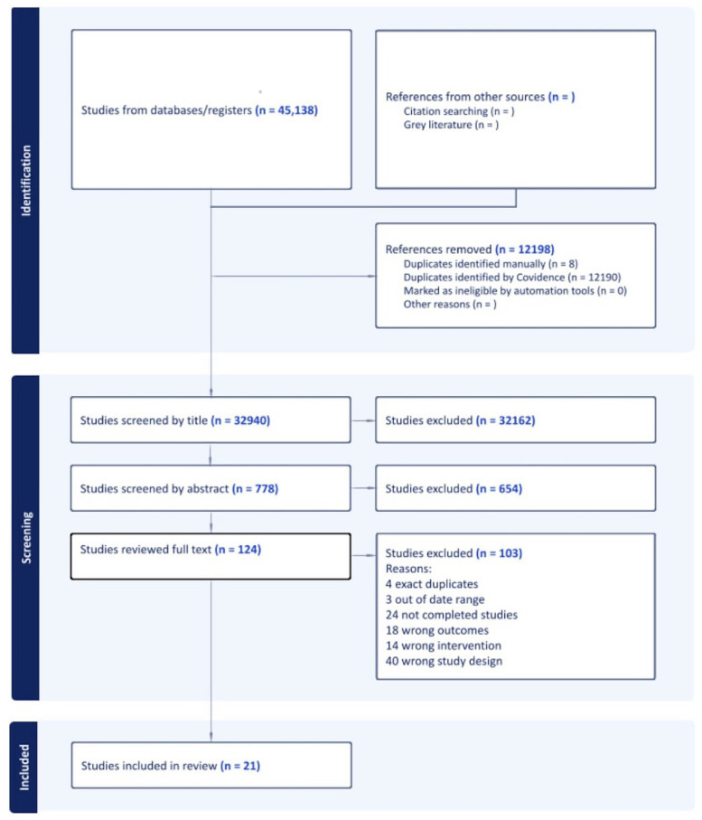

# Systematic review of sensory-based interventions for children and youth (2015–2024)

Tên tài liệu: Systematic review of sensory-based interventions for children and youth (2015–2024)

Tác giả hoặc tổ chức: Aimee Piller; Jessica McHugh Conlin; Tara J. Glennon; Lauren Andelin; Kelly Auld-Wright; Krysti Teng; Talicia Tarver

Link nguồn: https://pmc.ncbi.nlm.nih.gov/articles/PMC12658592/

Ngày xuất bản: 2025-11-13

Ngày cập nhật: Không được nguồn công bố / chưa xác minh; phiên bản: PMC12658592.1; acquired 2026-10-30

Phạm vi nội dung: Review inclusion range 0–21 years with sensory-processing challenges, mixed diagnoses; not an ASD-only sample or evidence for every age.

ID nguồn: ASD-SUP-PMC12658592

Giấy phép: https://creativecommons.org/licenses/by/4.0/. Căn cứ: https://pmc.ncbi.nlm.nih.gov/api/oai/v1/mh/?verb=GetRecord&metadataPrefix=pmc&identifier=oai:pubmedcentral.nih.gov:12658592

Trạng thái chuyển đổi: complete_text. Giới hạn chuyển đổi và phạm vi sử dụng được ghi trong catalog.jsonl.

Bản đối chiếu phục vụ nghiên cứu; chưa có thẩm định lâm sàng độc lập.

---

## NỘI DUNG NGUYÊN BẢN

<!-- ORIGINAL_DOCUMENT_BODY -->
## Systematic review of sensory-based interventions for children and youth (2015–2024)

Piller Aimee 
1
 *ConceptualizationResourcesProject administrationInvestigationData curationSupervisionMethodologyWriting – original draftFormal analysisWriting – review &amp; editing

McHugh Conlin Jessica 
2
 Writing – review &amp; editingWriting – original draftFormal analysis

Glennon Tara J. 
3
 Writing – review &amp; editingFormal analysisWriting – original draft

Andelin Lauren 
4
 Writing – review &amp; editingFormal analysisWriting – original draft

Auld-Wright Kelly 
5
 Writing – review &amp; editingWriting – original draftFormal analysis

Teng Krysti 
6
 Writing – review &amp; editingWriting – original draftFormal analysis

Tarver Talicia 
4
 MethodologyInvestigationWriting – original draftWriting – review &amp; editing

1 Piller Child Development, LLC, Phoenix, AZ, United States

2 Healthy 360, Sergant Bluff, IA, United States

3 Occupational Therapy, Quinnipiac University, Hamden, CT, United States

4 Occupational Therapy, Virginia Commonwealth University, Richmond, VA, United States

5 Occupational Therapy, Keck Graduate Institute, Claremont, CA, United States

6 Health Science Library, UCLA Lab School, Los Angeles, CA, United States

* <bold>Correspondence:</bold> Aimee Piller aimee.piller@pillerchilddevelopment.com

© 2025 Piller, McHugh Conlin, Glennon, Andelin, Auld-Wright, Teng and Tarver. 2025 Piller, McHugh Conlin, Glennon, Andelin, Auld-Wright, Teng and Tarver https://creativecommons.org/licenses/by/4.0/This is an open-access article distributed under the terms of the [Creative Commons Attribution License (CC BY)](https://creativecommons.org/licenses/by/4.0/). The use, distribution or reproduction in other forums is permitted, provided the original author(s) and the copyright owner(s) are credited and that the original publication in this journal is cited, in accordance with accepted academic practice. No use, distribution or reproduction is permitted which does not comply with these terms.

### Introduction

Children with developmental disorders often benefit from interventions supporting participation, including sensory interventions, which should be grounded and informed by evidence. The purpose of this systematic review was to evaluate and summarize current evidence on the effectiveness of sensory-based interventions (SBIs) on functional outcomes to guide interventions.

### Methods

Searches were performed in Medline (OVID), CINAHL Complete, PsycINFO, OTSeeker, Cochrane Reviews, and ERIC. Inclusion criteria included the following: published in English between May 2015 and January 2024; participants aged 0–21 years with sensory integration/processing challenges; level I and II studies as classified by Johns Hopkins Nursing Evidence-Based Practice Model; functional outcomes indicated. The review followed the guidelines of Preferred Reporting Items for Systematic Reviews and Meta-Analyses.

### Results

Twenty-one studies were included. Strong strength of evidence supported use of deep pressure tactile input and caregiver training on the use of sensory strategies. Moderate strength of evidence supported that alternative seating did not improve attention. Additionally moderate strength of evidence supported targeting a variety of sensory systems is more effective than targeting only one system. There is a lack of evidence on the impact of sensory environmental modifications.

### Discussion

SBIs may be useful for improving functional outcomes and participation. Further research is needed to clarify effectiveness for specific outcomes.

sensory

systematic review

sensory-based intervention

sensory processing

developmental disorder

American Occupational Therapy Association10.13039/100005415The author(s) declare that financial support was received for the research and/or publication of this article. This project was funded by the American Occupational Therapy Association.

### Introduction

Sensory integration and processing (SI/SP) differences are estimated to affect 5%–25% of children in the United States (1, 2). The prevalence is higher in clinical populations such as children diagnosed with autism spectrum disorder (ASD) (3), children with attention deficit hyperactivity disorder (ADHD) (4), and other developmental disorders such as fetal alcohol spectrum disorder (5), and Down syndrome (6). SI/SP differences vary and may or may not impact participation in functional activities (7). When these differences do impact participation, they may be delineated from SI/SP differences and referred to as SI/SP challenges, which is the terminology used in this manuscript. Sensory-based interventions (SBIs) are commonly used to support participation in daily activities for individuals with SI/SP challenges. Occupational therapists are widely recognized as leaders in the evaluation and treatment of SI/SP challenges (8, 9). Therefore, children with SI/SP challenges are frequently referred to occupational therapy when these challenges interfere with daily participation. Through comprehensive evaluations, occupational therapists design interventions that promote meaningful participation in everyday (10).

The aim of SBIs is to temporarily modify a child's physiological arousal level, creating a better match between the person and task, with the goal to improve behavior and participation in tasks (11). SBIs are informed by sensory integration theory, but they have clearly delineated differences from direct, one-on-one occupational therapy intervention using Ayres Sensory Integration® intervention, termed ASI (10, 11). Key features of ASI include advanced therapist training and mentorship and adherence to fidelity principles, including active engagement of the child, individually tailored activities, and play opportunities presented at the just-right challenge to facilitate adaptive responses (12, 13). In contrast, SBIs tend to be practitioner or adult-led interventions, involving passive sensory input applied to the child, and can include sensory techniques, such as massage, wearing earmuffs, passive swinging, caregiver sensory training, and sensory environmental modifications (10, 11). SBIs may be implemented by caregivers and other team members or accessed independently by the child as part of an occupational therapy intervention plan in natural environments such as the home, community, and schools.

Two systematic reviews published in 2015 examined the use of SBIs with autistic populations. Watling and Hauer (14) reviewed 23 studies and found mixed evidence for the effectiveness of SBIs, including limited evidence on the effectiveness of sound therapies and no significant effect with the use of alternative seating. Overall, weighted vest studies demonstrated some improvements with attention, but overall evidence of their effectiveness was insubstantial. Linear vestibular movement demonstrated improvement in responding to questions, though the sample size was small. This review also included one study of the sensory environment showing positive effects of sound absorption and lighting on attending behaviors. Case-Smith and colleagues (11) conducted a systematic review including 14 studies between 2001 and 2011 examining SBIs. Interventions in this review included weighted vests, brushing protocols, sitting on therapy balls, and other multi-sensory strategies; however, the rigor of the studies was compromised by the lack of specified protocols and/or manualized descriptions of the intervention and control conditions, resulting in mixed results as to effectiveness.

Two additional systematic reviews examined the evidence of the use of SBIs for children with SI/SP challenges beyond autistic populations. Bodison and Parham (15) included studies using sensory techniques and sensory environmental modifications, although not all outcomes were participation-based. The strongest evidence was found for Qigong sensory therapy for symptom reduction, decreasing parenting stress, and language skills. However, limited evidence was found for determining the effectiveness of weighted vests on in-seat behaviors and attention. This review did not find any significant positive effects of linear swinging for tabletop task behaviors, nor did it identify better play skills in the treatment group vs. the control for sensory-rich classrooms. Further, the sensory environmental modifications reviewed included only one study, which demonstrated significant improvements in participation within a dental environment. However, in this dental environment study, deep pressure touch was also provided to the participants in addition to the environmental modifications, making it difficult to determine which intervention had the greatest effect.

The second systematic review intended to examine the evidence of parent and teacher education and coaching for children with SI/SP challenges beyond the autistic population (16). This purpose of this investigation was to analyze evidence of the efficacy of parent or teacher training/coaching., the studies that met the inclusion criteria only included parents of children who all had a diagnosis of autism and none included teachers. The review included four studies that demonstrated improvements in parental stress or child performance/behaviors, but did not include evidence of SBI effectiveness.

Sensory integration and processing practice guidelines for children and youth with SI/SP challenges, published by AOTA (17), reported strong to moderate strength of evidence for the following interventions: Qigong massage to improve self-regulatory behaviors, sensory-adapted dentist office to reduce distress and discomfort for children with ASD, parent coaching to reduce stress and improve child behaviors, Alert Program® for self-regulation to improve executive function for children with fetal alcohol syndrome, and horseback riding to improve social functioning for children with ASD.

Since the release of the 2018 AOTA practice guidelines (17) and systematic reviews on SBIs, health and education fields have increasingly emphasized holistic, neuro-affirming approaches, moving away from interventions aimed primarily at symptom reduction. Further, interventions for individuals with developmental disabilities have increasingly moved away from deficit remediation toward a strengths-based approach that emphasizes identifying and building upon existing abilities. This approach functions under the assumption that people are unique and competent, have values and preferences, and build their lives around strengths rather than weaknesses (18). As part of the shift to more neuro-affirming intervention approaches, it is important to promote autonomy and independence, directed towards building strength rather than reducing symptoms. Therefore, this systematic review considered outcomes related to functional performance and participation and excluded studies that focused only on the outcome of symptom reduction.

The aim of this systematic review was to identify and examine literature on SBIs published between June 2015 and January 2024 and to answer the following question:

What is the effectiveness of specific sensory-based interventions (including sensory techniques, caregiver-focused sensory interventions, and sensory environmental modifications) to support functioning and participation for children and youth (0–21 years old) with SI/SP challenges that interfere with everyday life participation?

For this review, we defined SBIs as three distinct interventions as follows (17):

- Sensory technique: application of sensory stimuli through materials, tools, and activities applied directly to the child or through positioning a child on or in a device (e.g., weighted items, passive swinging) or accessed directly by the child.

- Caregiver-focused interventions: working with a child's caregiver (anyone who attends to or looks after a child including parent, guardian, teacher, etc.) to provide support for the sensory needs of a child who exhibits SI/SP challenges within the natural context to support participation of the child and group of which the child is a member.

- Sensory environmental modification: change in the intensity, complexity, or quality of one or more sensory elements in the ambient physical environment surrounding the child to support participation.

### Methods

The systematic review followed the Preferred Reporting Items for Systematic Review and Meta-Analysis (PRISMA) guidelines (19). Prior to initiation, the review protocol was reviewed by an independent methodologist.

#### Information sources and search strategy

The search strategies were developed by a team of experts in SI/SP together with the Health Science Librarian at Virginia Commonwealth University and built upon the search terms and strategies from the most recent systematic reviews for SBI (11, 14–16). Search terms included sensory processing, sensation disorder, sensory integration disorder, and related terms (see Table 1 file for full search terms). The review included six databases chosen based on past reviews and expert opinion of librarian: Medline (OVID), CINAHL Complete, PsycINFO, OTSeeker, Cochrane Reviews (trials only), and ERIC. Search terms were based on the research questions and identified using a Medical Subject Headings (MeSH) term search. The MeSH and keyword search strategy was translated for each of the other databases with their respective controlled vocabularies.

Table 1 

Search terms.

<table><thead><tr><th align="left" rowspan="1" colspan="1">Question</th><th align="center" rowspan="1" colspan="1">Search terms</th></tr></thead><tbody><tr><td align="left" rowspan="1" colspan="1">Population/Problem</td><td align="left" rowspan="1" colspan="1">Sensation disorders, somatosensory disorders, sensory integration disorders, sensory processing disorders, sensation disorders, somatosensory disorders, clumsy child syndrome, developmental coordination disorder, developmental dyspraxia, disorder of attention, motor, and perception, fine motor deficits, gross motor deficits, learning disabilities, nonverbal learning disorder, perceptual motor deficits, regulatory disorder, sensory integrative dysfunction, sensory modulation disorder, sensory modulation dysfunction, sensory motor deficit</td></tr><tr><td align="left" rowspan="1" colspan="1">Intervention</td><td align="left" rowspan="1" colspan="1">Activities of daily living, activity, activity groups, adaptive behavior, adaptive equipment, assistive technology, Astronaut training, attention, auditory integration training, augmentative communication, ball chairs, bilateral coordination, bilateral intervention, coaching, cognitive-behavioral therapy, cognitive intervention, consultation, context, contextual, CO-OP, decision-making skills training, early intervening, early intervention, emotional regulation, employment, environment, environmental modification, executive function, exercise, family centered care, family coping, coping skills, family interaction/participation, friendship, friendship group, functional approaches, handwriting, instrumental activities of daily living, integrated listening systems, job coaching, job training, Kawar protocol, leisure, life coaching, massage, motor planning, multisensory integration, natural environment intervention, neurodevelopmental treatment, neuromotor occupational therapy, occupational therapy, occupation-based, ocular motor skills, oral sensorimotor programs, parent/teacher mediated, parent training, peer group, peer interaction, peer mediated, perceptual motor learning, play, praxis, pressure vest, prevocational, priming, problem-solving skills training, relationship-based intervention, rest, routines-based interventions, self-care, self-management, sensory diet, sensorimotor integration, sensory integration, sensory integrative, SI, sleep, social competence, social participation, social skills training, social stories, strengths-based, supported education, supported employment, tactile stimulation, therapeutic listening, time management, touch pressure, transitioning, transitions, vestibular stimulation, weighted blankets, weighted items, weighted materials, weighted vests, Wilbarger protocol, work, yoga</td></tr><tr><td align="left" rowspan="1" colspan="1">Study Design</td><td align="left" rowspan="1" colspan="1">Appraisal, best practices, case control, case report, case series, clinical guidelines, clinical trial, cohort, comparative study, consensus development conferences, controlled clinical trial, critique, crossover, cross-sectional, double-blind, epidemiology, evaluation study, evidence-based, evidence synthesis, feasibility study, follow-up, health technology assessment, intervention, longitudinal, main outcome measure, meta-analysis, multicenter study, observational study, outcome and process assessment, pilot, practice guidelines, prospective, random allocation, randomized controlled trials, retrospective, sampling, scientific integrity review, single subject design, standard of care, systematic literature review, systematic review, treatment outcome, validation study, nonconcurrent, multiple baseline, experimental study, RCT, explanatory mixed methods, quasi-experimental, nonexperimental, exploratory, convergent, multiphase mixed methods, qualitative studies</td></tr></tbody></table>

Studies that included sensory integration but with no mention of fidelity to ASI were included as a sensory technique.

#### Inclusion/exclusion criteria

Studies were selected based on the following inclusion criteria: (1) peer-reviewed articles published between May 2015 and January 2024; (2) participants included children (ages birth to 21 years) with documented SI/SP challenges identified by psychometrically sound assessments, including disorders that are commonly associated with SI/SP challenges such as ASD, ADHD, and developmental coordination disorder (DCD) with documented SI/SP challenges; (3) published in English; and (4) have participation or occupation-based outcomes. This review included Hopkins Level I, II, and III studies, according to Johns Hopkins Nursing Evidence-Based Practice Model (20). Single-subject design (SSD) studies were considered as Level II as long as they met the criteria of Logan Level I–IV (21) classification for SSD studies (20). Inclusion criteria for SSD also required having at least three participants and at least two treatments compared to a baseline or at least three treatments compared to each other. Studies were excluded if outcomes were unrelated participation, such symptom reduction. Interventions that included terms such as “sensory integration” or “sensory integration therapy/treatment” with no mention of the ASI Fidelity Measure (13) were considered SBIs rather than direct, one-one one ASI intervention and, therefore, were included within this SBI study.

#### Study selection

The research team consisted of occupational therapists with expertise in SI/SP. Articles meeting the search terms were imported into Covidence, an online software to manage systematic reviews and allow reviewers to screen articles at various phases while remaining blinded to one another. Exact duplicates were removed by the Covidence system, and reviewers removed any additional duplicates. Initially, the titles were screened to eliminate any articles that were irrelevant to the search question and overall project (out of date range, not research articles, not related to sensory interventions, etc.). After the initial title screen, abstracts were independently reviewed by two researchers, with a third serving to resolve any conflicts. Based on the abstract review, any clearly non-relevant articles were eliminated based on the inclusion/exclusion criteria. The librarian then obtained the full-text articles, which were independently reviewed by two researchers, with a third researcher serving to resolve any conflicts. All decisions, including reasons for exclusion, were noted in the master citation table (see Supplementary File).

#### Extraction and synthesis

Extraction included levels of evidence, research design, population, inclusion criteria, dose, intervention, outcomes, and results (see Supplemental File) for each of the studies. Two researchers completed the extraction, with a third reviewing for accuracy.

#### Analysis

The levels of evidence were determined by using the Johns Hopkins Nursing Evidence-Based Practice Model (20) and the strength of evidence was evaluated utilizing the AOTA (22) <italic>Guidelines for Systematic Reviews</italic> (see Table 2). Strong evidence was identified as having at least two studies identified as a Hopkins Level I study. Moderate evidence was identified by having at least one Hopkins Level I and multiple Hopkins Level II, which included Logan Level I–IV. Low evidence was classified by studies below Hopkins Level II or Logan Level IV and studies with significant flaws or high risk of bias. Risk of bias was assessed by two reviewers, blinded to one another, using the Cochrane tool for controlled trials (23) and the National Heart Lung and Blood Institute (24) for studies without a control group.

Table 2 

Strength of evidence.

<table><thead><tr><th align="left" rowspan="1" colspan="1">Level</th><th align="center" rowspan="1" colspan="1">Description</th></tr></thead><tbody><tr><td align="left" rowspan="1" colspan="1">Strong</td><td align="left" rowspan="1" colspan="1">

- Two or more Level I studies

- The available evidence includes consistent results from well-designed, well-conducted studies. The findings are strong and unlikely to be called into question in future studies
</td></tr><tr><td align="left" rowspan="1" colspan="1">Moderate</td><td align="left" rowspan="1" colspan="1">

- At least one Level I study or multiple high-quality Level II

- The available evidence is sufficient to determine the effects on health outcomes, but confidence in the estimate is constrained by factors such as:

- - 

The number, size, and quality of individual studies

- - 

Inconsistency of findings across the individual studies

- As more information (other research findings) becomes available, the magnitude or direction of the observed effect could change, and this change may be large enough to alter the conclusion related to the usefulness of the intervention
</td></tr><tr><td align="left" rowspan="1" colspan="1">Low</td><td align="left" rowspan="1" colspan="1">

- Small number of low-level studies, flaws in the studies, and so on

- The available evidence is insufficient to assess effects on health and other outcomes of relevance to occupational therapy. Evidence is insufficient because of

- - 

a limited number or size of studies,

- - 

important flaws in study design or methods,

- - 

inconsistency of findings across individual studies, and

- - 

lack of information on important health outcomes.

- More information may allow estimation of effects on health and other outcomes of relevance to occupational therapy
</td></tr></tbody></table>

AOTA (22).

### Results

The initial search resulted in 45,138 articles with 12,198 initially identified as duplicates. After duplicates were removed, 32,940 article titles were screened for relevance and inclusion criteria. Of the original set, 32,162 were excluded based on the title, leaving 778 articles. These 778 abstracts were independently reviewed by two researchers. The two parties agreed upon 582 articles, with the remaining 196 requiring a review by a third researcher to reach agreement. In total, 654 were excluded at the abstract level, leaving 124 full-text articles. Of the 124 full-text reviews, 103 were excluded. The PRISMA Flowchart outlining the selection process, including reasons for exclusion, can be found in Figure 1. A total of 21 articles met the inclusion criteria and were, therefore, included in this review. An evidence table outlining all the details of the studies included in this review are included in a Supplementary File.

Figure 1 

PRISMA flow chart.

Flowchart detailing a systematic review process. Identification includes 45,138 studies from databases and an unspecified number from other sources. Removed references total 12,198. Screening involves 32,940 studies by title, 778 by abstract, and 124 by full text, with exclusions of 32,162, 654, and 103 respectively. Reasons for exclusions include duplicates, date range, incomplete studies, wrong outcomes, interventions, and study design. Twenty-one studies are included in the final review.

[Original figure transcription; formatting conversion, no interpretation]

Identification
Studies from databases/registers (n = 45,138)
References from other sources (n = )
Citation searching (n = )
Grey literature (n = )
References removed (n = 12198)
Duplicates identified manually (n = 8)
Duplicates identified by Covidence (n = 12190)
Marked as ineligible by automation tools (n = 0)
Other reasons (n = )
Screening
Studies screened by title (n = 32940)
Studies excluded (n = 32162)
Studies screened by abstract (n = 778)
Studies excluded (n = 654)
Studies reviewed full text (n = 124)
Studies excluded (n = 103)
Reasons:
4 exact duplicates
3 out of date range
24 not completed studies
18 wrong outcomes
14 wrong intervention
40 wrong study design
Included
Studies included in review (n = 21)

#### Study characteristics

Studies were initially organized by setting and population. Settings included school (<italic>n</italic> = 7), therapy clinics (<italic>n</italic> = 5), participant's home (<italic>n</italic> = 3), clinic and home (<italic>n</italic> = 4), home and school (<italic>n</italic> = 1), and dental clinic (<italic>n</italic> = 1). Six hundred seventy-five participants were represented in the studies. The populations represented in the studies included children with various diagnoses, including ASD (<italic>n</italic> = 7 studies), ADHD (<italic>n</italic> = 7 studies), developmental delay (<italic>n</italic> = 2 studies), and sensory processing disorder (SPD) or sensory processing concerns (<italic>n</italic> = 8 studies). Participant ages ranged from one year to 21 years of age. Of the 21 studies, eight took place in the United States, three in Canada, three in India, and one study took place in each of the following countries: Iran, Turkey, Sweden, Taiwan, Finland, Israel, and Japan. Various outcome measures were utilized in the studies and included outcomes related to attention, task completion/productivity, quality of life, motor skills, occupational performance, sleep, Frankl scale, knowledge of sensorimotor strategies, behavior and emotional functioning, and goal attainment. Of the 21 studies, five were Hopkins Level I studies and 16 were Hopkins Level II studies. Of the 16 Level II studies, six were single-subject designs of Logan Level IV or higher.

#### Sensory-based interventions

Three main concepts were articulated in the articles, each addressing one aspect of SBIs outlined in the review question: sensory techniques, caregiver-focused interventions, and sensory environmental modifications. Four main sensory techniques were identified in the studies: deep pressure tactile input, alternative seating, sensory input targeting multiple sensory systems (more than two sensory systems), and sensory interventions targeting one or two sensory systems. Caregiver-focused interventions were identified as caregiver education and home-based strategies. Only one study that addressed sensory environmental modifications met the inclusion criteria.

There is strong strength of evidence for deep pressure tactile input positively impacting functional outcomes (25–28). Four studies supported the use of deep pressure tactile stimulation, two of which examined weighted items and two of which examined massage. A Level I study (26) with moderate risk of bias demonstrated statistically significant improvements in motor skills for young children who received massage in addition to routine rehabilitation. Outcome measures for this study included <italic>Comprehensive Development Inventory for Infants and Toddlers-Diagnostic Test</italic> (29), to assess motor, language, self-help, and social skills, and a non-standardized sleep questionnaire. Weighted vest wearing did not significantly improve attention, body perception, coping skills or learning when worn in the school setting, as demonstrated by a Level II study with low risk of bias (27). This study did not indicate activities in which participants engaged in when wearing the weighted vest. Therefore, if participants were moving while wearing the weighted vest, this intervention may have also included proprioceptive and vestibular input in addition to deep pressure tactile input. The outcome measures included surveys of teachers and parents to assess the child's attention, body perception, coping skills, and learning. Two studies focused on the outcome of sleep with both showing statistically significant improvements in sleep (25, 28). The first Level II study (28) with a low risk of bias utilized massage with joint compressions prior to bedtime. Participants had significant improvements in overall sleep and a decrease in daytime sleepiness. Outcome measures for this study included Goal Attainment Scaling (<italic>GAS</italic>) (30) and the <italic>Child Sleep Habits Questionnaire (</italic>31) to assess sleep<italic>.</italic> The second study utilized a weighted blanket for sleep (25). This Level I study with a low risk of bias yielded statistically significant results for improved sleep for children with ADHD. This study used an actigraph and a sleep questionnaire as the outcome measures used to assess sleep quality.

There is moderate strength of evidence that alternative seating does not show significant improvement in functional behavior (32–34). Three studies addressed the use of alternative seating to improve attention. All three studies were Level II with two being SSD. One study (34) examined the use of stability balls in the school setting and found no significant improvements in productivity or seatwork. In another study in the school setting (32), participants did not show any significant improvements in attention while sitting on cube chairs or T-stools. The third study (33) examined the use of stability balls in the home setting and found no statistically significant improvements on attention or behavior. The risk of bias was moderate for all studies. All studies created their own operational definitions for observable behaviors and used frequency counts as the outcome measure to assess attention and behavior.

There is moderate strength of evidence that sensory techniques targeting an increased input to multiple sensory systems can impact functional behaviors (35–39). In all studies, various types of sensory input targeting multiple sensory systems (i.e., vestibular, proprioception, tactile, visual, etc.) were utilized with the goal of increasing functional outcomes. The five studies addressed the use of sensory techniques for functional outcomes. Three Level II SSD studies examined the use of multiple sensory techniques within the regular routine of the classroom, each with moderate risk of bias. For the first study (35), one of three participants showed significant improvements for in-seat behaviors. The second (36) showed significant improvement in task completion for four of seven participants. A third Level II (38) SSD study using sensory diets as part of the regular school day showed three of four participants improving behavior. While results were varied, each participant showed significant improvement in at least one phase of the intervention. All the studies used frequency counts of targeted observable behaviors as their primary outcome measure.

In settings other than schools, a nature-based sensory program used in conjunction with sensory interventions (39) found statistically significant improvements in functional performance as compared to the control group that only received sensory interventions. This was a Level II study with a moderate risk of bias. The <italic>Weiss Functional Impairment Rating Scale</italic> (40) served as the primary outcome measure for functional performance. In a Level II study with high risk of bias (37), sensory interventions, when used with behavioral interventions, were shown to have a greater effect on functional performance in toileting as compared to behavioral interventions alone. This study used frequency counts of toileting and the <italic>Canadian Occupational Performance Measure</italic> (<italic>COPM)</italic> (41) as primary outcome measures to assess participation in toileting.

There is moderate strength of evidence from one level I and two level II studies (42–44) for SBIs aimed at only one or two sensory systems. The Level I RCT study (42) with low risk of bias using movement on a treadmill with vibration showed statistically significant results for quality of life, attention, and executive functioning. However, this study did not show any differences in these areas between individuals who used the treadmill only and those who used the treadmill with vibration. Outcome measures included the <italic>Pediatric Quality of Life Inventory</italic> (<italic>PedsQL)</italic> (45), to assess quality of life, <italic>Behavior Rating Inventory of Executive Function</italic> (<italic>BRIEF)</italic> (46) to assess executive functioning, and the <italic>Conner's Rating Scale</italic> (47) and <italic>Stroop test TBAG form</italic> (<italic>STP-TBAG)</italic> (48) to assess attention. A Level II SSD (43) with moderate risk of bias study examining the use of fidget spinners indicated that participants who used fidget spinners had no significant improvements in gross motor movements (as measured by accelerometers worn by participants) and instead demonstrated increased violations of attention as compared to the control. Frequency counts were the primary outcome measure used to evaluate the effectiveness of attention. Finally, a Level II crossover experimental design study (44) with low risk of bias showed significant improvements in functional performance related to auditory stimuli for autistic children using earmuffs, whereas the use of noise-canceling headphones did not demonstrate significant results. This study used <italic>GAS</italic> (30) as the primary outcome measure to assess functional behaviors related to auditory stimuli.

There is strong strength of evidence to support sensory input provided through caregiver education and home-based strategies as effective in improving functional performance and participation in daily activities (49–53). There were five studies that addressed caregiver education and using home-based sensory strategies after parent training to improve occupational performance. A Level II study (49) with a moderate risk of bias revealed statistically significant improvements in occupational performance as measured by the <italic>COPM</italic> (41) for children with sensory concerns. Two Level II studies, one with a low risk of bias (50) and one with a moderate risk of bias (51), showed a significant increase in knowledge of sensory strategies but no significant or negative impact on functional outcomes. Both studies used the <italic>Sensory and Motor Strategies Questionnaire</italic> (50) as an outcome measure. The study by Mah and Doherty (50) also used the <italic>COPM</italic> to assess occupational performance, while the study by Mah and colleagues (51) included frequency counts as an additional outcome measure for visual attention. A Level I study (52) with moderate risk of bias found that standard therapy (speech and language and behavioral therapy), when coupled with implementation of home-based sensory interventions resulting from caregiver training, resulted in statistically significant improvements in quality of life and behavioral and emotional functioning. The study used the <italic>PedsQL</italic> and <italic>Children's Global Assessment Scale</italic> (54) as outcome measures to assess quality of life and behavior and emotional function. Finally, another Level I study (53) with a moderate risk of bias indicated a program for children with ASD that focused on caregiver sensory knowledge, coaching, and support had statistically significant improvements in functional performance. This study used the <italic>COPM, GAS,</italic> and <italic>Parenting Sense of Efficacy Measure</italic> (55) as outcome measures to assess occupational performance and parent efficacy.

There is not enough evidence to conclude the effectiveness of sensory environmental modifications. Only one study (56) explored sensory environmental modifications. This Level II study had a moderate risk of bias and examined the impact of sensory environmental modifications to a dental office on patient participation within the dental office setting. Significant differences in positive behaviors were found between the patients in the modified sensory environment and the regular dental environment as measured by the <italic>Frankl Scale</italic> (57) to assess behaviors in a dental office.

### Discussion

This systematic review included a variety of SBIs, which were grouped into three categories: (1) <italic>sensory techniques</italic>; (2) <italic>caregiver-focused interventions</italic>; and (3) <italic>sensory environmental modifications</italic>. Consistent with the findings of previous systematic reviews (11, 14–16), the current review also found mixed evidence regarding the effectiveness of SBIs. Specifically, the only <italic>sensory technique</italic> with strong evidence is the use of deep pressure tactile input. There is also strong strength of evidence for <italic>caregiver training</italic> on the use of sensory techniques. There is moderate evidence that using a variety of sensory techniques to target multiple sensory systems is more effective than targeting only one system at a time. However, this is also dependent on the reason for implementing the sensory technique. For example, interventions targeting the auditory system were more effective for activities involving auditory input than using a tactile-based strategy, such as a fidget, to support attention. Finally, there is not enough research to make any determinations on the effectiveness of sensory environmental modifications.

Sensory techniques in this review encompassed a variety of interventions targeting various sensory systems, including vestibular (42), auditory (44), tactile (26, 43), and interventions designed to target multiple sensory systems, including vestibular, proprioceptive, and tactile (35, 36, 38). Descriptions of the interventions were not always detailed, especially when more than one sensory system was targeted. The lack of uniformity in the implementation of SBIs and the lack of clearly defined goals and outcomes for the use of SBIs resulted in varied results as to the effectiveness of sensory techniques. It is also worth noting that many of the outcome measures included more subjective forms of assessment, such as GAS, which are not without bias (58, 59) and may be more subjective in nature. In addition, many of the studies had small sample sizes, which limited their generalizability.

Several studies used multiple sensory interventions targeting different sensory systems, making it difficult to isolate which SBI was responsible for the observed changes. While it is typical in clinical practice to implement more than one intervention or more than one SBI, it limits the ability to document precise research outcomes. Notably, Ikuta and colleagues (44) and Lönn and colleagues (25) presented stronger evidence of effectiveness was indicated when sensory techniques targeted specific sensory systems related to participation goals, and in studies that incorporated more than one targeted sensory system, such as in Benson and colleagues (35) and Pingale and colleagues (38). More research is needed to determine the most effective approach of using sensory techniques to target multiple sensory systems as they address unique sensory processing patterns of a child that impact participation, as compared to applying a broad approach of general sensory intervention that is not targeted to unique sensory processing needs.

The use of <italic>sensory techniques</italic> targeting a single sensory system had limited evidence. Alternative seating did not have evidence to support its use if the goal was to improve functional behaviors or attention (32–34); another study demonstrated that fidget spinners had a negative effect on attention (43); and, finally, noise-cancelling headphones (44) were not found to impact auditory participation goals. However, Ikuta and colleagues (44) did find significant improvements in auditory-related goals with earmuff use. This indicates that particular tools, headphones vs. earmuffs, may change effectiveness and prompts the need for further research to examine if the tool or the person's preferences are more impactful when examining the effectiveness of SBIs.

An exception to the generally weak evidence for interventions targeting a single sensory system is the provision of deep-pressure tactile stimulation, which has shown more promising results. Deep-pressure tactile stimulation has modulating effects on the nervous system via decreasing sympathetic arousal and increasing parasympathetic activity (60, 61). Two studies found sleep behavior improvements, one with use of weighted blankets during sleep (25) and one with massage and joint compressions prior to bedtime (28). Nielsen and colleagues (27) noted improvements in areas such as learning, attention, and coping with the use of a vest for deep-pressure tactile stimulation, but results were not significant. All three of these studies focused on children with ADHD or SI/SP challenges, suggesting that deep-tactile pressure tactile stimulation may be a useful tool in supporting occupational outcomes with these populations. These findings are consistent with previous research findings supporting use of Qigong massage (14, 15), suggesting that deep-pressure tactile stimulation should be included as part of intervention recommendations when indicated, such as for improving sleep and self-regulation, for children with SI/SP challenges.

For the <italic>caregiver-focused interventions</italic> outcomes, this review builds on the emerging evidence found by Miller-Kuhanack and Watling (16) which supports group caregiver training on sensory processing and sensory motor strategies for children with ASD. Two studies in this current review evaluated <italic>caregiver-focused interventions</italic> for children with ADHD and SPD, providing additional evidence that group training in sensory–motor strategies can enhance caregiver awareness and their ability to implement these approaches effectively (50, 51). Overall, the result of this systematic review supports the use of caregiver training to implement sensory strategies across populations of children with SI/SP challenges. However, the outcome measures across these studies varied. While two studies investigated outcomes related to quality of life and participation (52, 53), two of the studies demonstrated improvements in caregiver knowledge when using sensory-based strategies at home (50, 51). Therefore, although caregiver training has strong evidence to support its use, the impact on the client and family requires continued research.

Finally, there remains a dearth of research investigating the effectiveness of <italic>sensory environmental modifications</italic>. There was only one study that met the criteria for this systematic review (56), which focused on a sensory-adapted dental environment, finding improved behavior scores as compared to the standard dental environment. There is not enough research examining how sensory environmental modifications specifically support client participation. Future investigation in this domain may need to focus on community-engaged research that explores how environmental adaptations can enhance meaningful engagement for individuals with SI/SP challenges. For example, Silverman and Tyszka (62) conducted a qualitative community-based action research study to investigate the benefits of sensory-friendly programming for museum participation in children and adults with SI/SP challenges. Findings indicated improvements in the quality and duration of museum visits for individuals with SI/SP challenges. Contextual models such as the Ecology of Human Performance (63) may be useful in guiding research that examines the impact of sensory modifications to environments for improved participation. Sensory-friendly spaces and sensory environmental adaptations continue to be popular in contemporary culture but lack research on effectiveness related to improving participation. Understanding how the physical and social environment influences participation of individuals, groups, and populations is a key consideration for future research on the effectiveness or the impact of sensory environmental modifications on participation.

One of the key challenges in researching SBIs is the absence of clear implementation guidelines and inconsistency in reported outcome measures across studies. SBIs aim to alter the level of physiological arousal to provide a better match between the person and the task, thereby improving behavior and self-regulation (11). Many outcome measures on the effectiveness of SBIs focused on observable changes in behavior. Consequently, the outcome measures included in these studies relied on observable changes in behavior rather than considering internal physiological changes that might support occupational performance. While behavioral regulation requires the cognitive functions of attention, working memory, and inhibition (64), SBIs primarily focus on the organizing impact of sensory input to support modulation (11, 65). Therefore, there may be a mismatch between the intent of the SBI and the outcome measures used to measure the impact. Future research may consider including measures of physiological arousal such as heart rate variability, skin conductance, respiration rates, etc. [e.g., (66, 67)] in combination with participation-based outcomes.

In addition, no study examined the child's perspective on the use of sensory techniques, which is a key outcome. Sensory techniques are designed for the purpose of altering physiological states of arousal to improve participation in given tasks (11). If a child reports (or has the perception) that an SBI, such as alternative seating, improves their ability to participate in the task, then it may be considered an effective intervention. Assessing goal attainment from the individual's perspective, rather than relying on behavioral outcomes, may be a better indicator of the effectiveness of the sensory technique. Future research with SBIs should focus on systematic measurement of effectiveness and consistent outcome measurement to strengthen the body of literature in this often-requested intervention. It is important that outcomes consider the perspective of the child who is receiving the intervention. Children often report feelings of being unheard, unsupported, and disrespected in their own care (68). Including outcomes that reflect the child's perspective, rather than relying solely on proxy reports or behavioral observations, allows practitioners to tailor care to a more child-centered approach.

Finally, it is not clear if all studies included in this review had an occupational therapist guiding the intervention. Occupational therapists are considered the experts in supporting children with SI/SP challenges. They have comprehensive training and provide a unique understanding of the theoretical framework that guides evaluation of sensory processing needs and intervention decisions.

### Limitations and future research

This systematic review was limited to studies of sensory-based interventions (SBIs) published in English between 2015 and January 2024. As with any review, some studies may have been missed or published after the search date. A primary limitation of the evidence is the lack of consistency in how, when, and under what conditions SBIs were implemented. While SBIs are based on sensory integration theory, there is no fidelity measure to guide practice, and most interventions lack manuals or standardized guidance. Future research should clarify how sensory strategies, tools, and equipment are utilized and establish replicable implementation parameters. This would allow practitioners to develop clearer guidelines for SBI use and purpose.

Another limitation is the absence of subjective or objective client perceptions. Outcomes were largely observable performance or proxy reports, despite children often reporting feeling unheard in healthcare (68). Future research should examine the impact of sensory environmental modifications on learning and engagement and expand studies of caregiver training to include educators and employers. Research is needed across environments and the lifespan.

### Conclusion

This review highlights strong evidence for caregiver training on SBIs and the use of deep pressure tactile input to support functional outcomes for children and youth with SI/SP challenges. Evidence for a sensory technique targeting only one sensory system is limited and mixed, but when SBIs are matched to a child's unique sensory processing needs, they can support meaningful participation. Minimal evidence exists for modifying sensory environments, emphasizing the need to consider individual preferences and continued research. A collaborative effort between occupational therapy and other professionals should aim to enhance research quality, establish clear implementation guidelines, and ensure the effective translation of findings into practice to support participation of individuals with SI/SP challenges across settings.

#### Implications

The findings of this systematic review have the following implications:

- - 

The evidence indicates that caregiver training or coaching should be considered as part of any sensory intervention.

- - 

SBIs may be more effective when implemented as part of a larger intervention plan, rather than as a standalone intervention.

- - 

SBIs interventions should be matched to the unique sensory needs of an individual. Therefore, a clear assessment of sensory processing as part of a comprehensive evaluation to identify the client's needs should be performed by a trained practitioner to guide the intervention process.

- - 

Sensory environmental modifications need more research to determine their effectiveness for individuals, groups, and populations.

- - 

Continued research is needed to clarify the benefits of SBIs and standardized procedures should be developed so that SBI implementations are replicable and evidence-based.

## End matter (original)

Edited by: [Teresa A. May-Benson](https://loop.frontiersin.org/people/4379/overview), TMB Educational Enterprises, LLC, United States

Reviewed by: [Breanne E. Kearney](https://loop.frontiersin.org/people/1952588/overview), The University of Western Ontario, Canada

[Lisa Porter](https://loop.frontiersin.org/people/3242021/overview), Western Oregon University, United States

### Data availability statement

The original contributions presented in the study are included in the article/Supplementary Material, further inquiries can be directed to the corresponding author.

### Author contributions

AP: Conceptualization, Resources, Project administration, Investigation, Data curation, Supervision, Methodology, Writing – original draft, Formal analysis, Writing – review &amp; editing. JM: Writing – review &amp; editing, Writing – original draft, Formal analysis. TG: Writing – review &amp; editing, Formal analysis, Writing – original draft. LA: Writing – review &amp; editing, Formal analysis, Writing – original draft. KA-W: Writing – review &amp; editing, Writing – original draft, Formal analysis. KT: Writing – review &amp; editing, Writing – original draft, Formal analysis. TT: Methodology, Investigation, Writing – original draft, Writing – review &amp; editing.

### Conflict of interest

AP was employed by Piller Child Development, LLC.

The remaining authors declare that the research was conducted in the absence of any commercial or financial relationships that could be construed as a potential conflict of interest.

### Generative AI statement

The author(s) declare that no Generative AI was used in the creation of this manuscript.

Any alternative text (alt text) provided alongside figures in this article has been generated by Frontiers with the support of artificial intelligence and reasonable efforts have been made to ensure accuracy, including review by the authors wherever possible. If you identify any issues, please contact us.

### Publisher's note

All claims expressed in this article are solely those of the authors and do not necessarily represent those of their affiliated organizations, or those of the publisher, the editors and the reviewers. Any product that may be evaluated in this article, or claim that may be made by its manufacturer, is not guaranteed or endorsed by the publisher.

### Supplementary material

The Supplementary Material for this article can be found online at: [https://www.frontiersin.org/articles/10.3389/fped.2025.1720179/full#supplementary-material](https://www.frontiersin.org/articles/10.3389/fped.2025.1720179/full#supplementary-material)

[Original supplementary document, full converted text; formatting conversion, no interpretation]

Evidence Table

<table><tr><td>Author/Year</td><td>Level of Evidence

Study Design

Risk of Bias</td><td>Participants

Inclusion Criteria

Study Setting</td><td>Intervention and Control Groups</td><td>Outcome Measures</td><td>Results</td></tr><tr><td colspan="6">Sensory Techniques: Alternative Seating</td></tr><tr><td>Benson et al., 2019

https://doi.org/10.1080/19411243.2019.1672606</td><td>Level II

SSD: ABAB

Risk of Bias

Moderate</td><td>Participants

N = 4; 4.2-4.6 yr with ASD; 3 boys, 1 girl

Inclusion Criteria

Preschool children attending the LEAP program

Intervention Setting

Preschool

Country

United States</td><td>Intervention

Use of alternative seating (T-stool or cube chair)

A: Wks 1 &amp; 3, no seat

B: Wks 2 &amp; 4, alternative seat

Control Group

n/a (SSR)</td><td>Attention and In-seat Behavior: Video recording of morning circle over 4 wks, 2xs/wk for 10 min ea; observation of duration based on operational definitions of attention (e.g., answering, asking, pointing, raising hand, concentration on some feature of the process) and in-seat behaviors (e.g., contact with the seat with some part of body, breaking seat contact to engage with instructional task, returning to seat with one cue); visual analysis using 2 standard deviation band method</td><td>Significant Findings

None

Nonsignificant Findings

Duration of attention and in seat behaviors improved, but results were not significant for any participant</td></tr><tr><td>Krombach &amp; Miltenberger, 2020

https://doi.org/10.1007/s10803-019-04283-8</td><td>Level II

SSD: ABC

Risk of Bias

Moderate</td><td>Participants

N = 4; 4-12 yr, with ASD

and intellectual disability that had difficulties remaining seated more than 5 min

Inclusion Criteria

Students with ASD, intellectual disability, difficulty in attending during seated tasks, ability to sit upright on a ball without assistance, receptive language, and capable of complying with one-step directions

Intervention Setting

Home

Country

United States</td><td>Intervention

Sitting on a stability ball 

A - Baseline

B - Intervention

15-20 wks; 2xs/wk intervention session (sessions ranged from 5-16 minutes in length, dependent on child)

C - Choice

Control Group

n/a (SSR)</td><td>In-seat Behavior and Attention: Videotaped observation of duration of the 2 behaviors based on operational definitions of in-seat behavior (e.g., buttocks in contact with the ball, ball in contact with the floor, one foot on the floor) and attention (e.g., appropriate interaction with materials per directive; responding to or looking at speaker, not oriented to other activities or items).</td><td>Significant Findings

None

Nonsignificant Findings

Attention and in-seat behavior percentage of time improved during intervention phase (ball chair) for all 4 children</td></tr><tr><td>Macphee et al., 2019

https://doi.org/10.17105/SPR-2017-0151.V48-3</td><td>Level II

2x3 Within Subjects Design

Risk of Bias

Moderate</td><td>Participants

N = 64; ages 5-12 yr (M = 8.14 years; (82.8% male), with ADHD

Inclusion Criteria

Children with diagnoses of ADHD, IQ ≥80, without ASD, no current treatment with psychotropic medications, and no noted intolerability of psychostimulant medication.

Intervention Setting

School 

Country

United States</td><td>Intervention

Sitting on stability ball for duration of class; wearing weighted vest for duration of class; 6 wks; 1 hr/wk during Summer Treatment Program;

received medication or placebo 

Control Group

n/a (SSR)</td><td>Classroom Rule Following and Accuracy of Seatwork Productivity

Teacher recorded frequencies of classroom rule (e.g., be respectful, raise hand, remain in seat, work quietly) violations and the number of worksheet items a child could correctly complete in a 30 min period</td><td>Significant Findings

Statistically significant differences in the medication group for increased frequency of following rules (p = 0.032) and improved seatwork productivity (p &lt; 0.001)

Nonsignificant Findings

No statistically significant improvements in the frequency of following classroom rules or seatwork productivity with either stability ball or weighted vest</td></tr><tr><td colspan="6">Sensory Techniques: Multiple Sensory Techniques</td></tr><tr><td>Benson et al., 2020

https://doi.org/10.1080/19411243.2020.1732262</td><td>Level II

SSD: BABA

Risk of Bias

Moderate</td><td>Participants

N = 3; 4 yr, 3 mos - 5 yr, 2 mos with ASD; all males

Inclusion Criteria

Children with ASD in a convenience sample integrated preschool classroom

 

Intervention Setting

Preschool

Country

United States</td><td>Intervention

B: Sensorimotor phase (sensorimotor activities designed by OT for ea student’s sensory needs)

A: Non-sensorimotor phase

4 weeks (2 intervention phases and 2 non-intervention phases); 

B: 15 min ea preschool circle time

A: no intervention

Control Group

n/a (SSR)</td><td>Attention and In-seat Behavior: Videotape of morning circle over 4 wks, 2xs/wk for the first 10 min after the child was seated;  observation of duration based on operational definitions of attention (e.g., answering or asking questions, participation upon request, raising hand, no more than 2 teacher cues to complete instructional directive) and in-seat behavior (e.g., maintaining physical contact with seating option, breaking contact to engage in instructional task if appropriate, returning to seat with one teacher cue).</td><td>Significant Findings

Only 1 of the 3 participants had significant effect for in-seat behavior and attention improvement in both sensorimotor phases (100% PND) with p=0.05 set as significant

Nonsignificant Findings

Although improvements were observed, statistically significant improvements in attention or in-seat behavior were not observed in 2 of 3 participants.</td></tr><tr><td>Benson et al., 2022

https://doi.org/10.1080/19411243.2021.2003734</td><td>Level II

SSD: ABAB

Risk of Bias

Moderate</td><td>Participants

N = 7; ages 8-12 yr, with ASD; 5 males, 2 females

Inclusion Criteria

Convenience sample from private, special education school; ASD diagnosis and identified as having sensory processing challenges that impacted task performance

Intervention Setting

School

Country

United States</td><td>Intervention

2 consecutive weeks;

A: Baseline (days 1 &amp; 2)

B: Intervention (days 4 &amp; 5); Sensory Activity Schedule (SAS) embedded in workstation schedule during independent work time as part of TEAACH teaching model, inclusive of vestibular, proprioceptive, oral motor, and visual

Control Group

n/a (SSR)</td><td>On-task Behavior

6 observations ea day of phases; 15 min per observation; duration of on task behavior during independent work time per operational definition (e.g., interaction with materials for targeted behaviors, task completion) and the number of cues students needed to engage in on-task behavior</td><td>Significant Findings

Significant decrease in number cues for 4 of 7 participants (p=0.05)

Significant difference in mean number of cues provided for all participants from phase A1 to B1 (p=0.01) 

Nonsignificant Findings

Non-effective on PND for all participants (PND 70% or higher considered effective)</td></tr><tr><td>Pingale et al., 2022

https://doi.org/10.1080/19411243.2021.1941492</td><td>Level II

SSD: ABCA

Risk of Bias

Moderate</td><td>Participants

N = 5 (5.2 - 10 yr; all male); 

Inclusion Criteria

Children ages 4-11 yr in pre-k through 4th grade; documented SI/SP challenges; no physical

limitations or disabilities, not taking stimulants, anti-anxiety, or anticonvulsant medications, and not having received sensory diets within 6 mo

 

Intervention Setting

School

Country

United States</td><td>Intervention

28 days (7 days for ea phase) 

A: regular school day

B: age-appropriate fine-motor and visual activities that are typically used in classrooms per the schedule

C: Sensory diet (SD) including customized; tactile, vestibular, and proprioceptive activities; 3xs/day for 5-7 min

Control Group

n/a (SSD design)</td><td>Individualized Target Behaviors

Video recorded for

15 min interval during a group activity; frequency counts/duration of individualized target behaviors addressing sensory processing, psychosocial skills, and classroom engagement goals; each participant had individualized definitions for the three categories of targeted behaviors</td><td>Significant Findings

P1: significant for phases B-C for classroom engagement (p = .01) and C-A2 for psychosocial skills and classroom engagement (p = .01)

P2: significant for phase B-C for psychosocial skills and classroom engagement and C-A2 for sensory processing skills (p = .01) 

P3: significant for phase B-C for sensory processing skills, psychosocial skills, and classroom engagement and C-A2 for sensory processing skills (p = .01)

P4: significant for phase B-C for psychosocial skills and in C-A2 for psychosocial skills and classroom engagement

(p = .01)

P5: significant for phase B-C for sensory processing skills, psychosocial skills, and classroom engagement and C-A2 for psychosocial skills and classroom engagement (p = .01) 

Nonsignificant Findings

All participants showed a decrease in problematic behaviors for all categories with introduction of SD phase and increase upon withdrawal

Additional results: 

P2: psychosocial skills and classroom engagement improved approaching significance for phase C-A2; contra-therapeutic responses for classroom engagement upon withdrawal of SD phase

P3: classroom engagement improved approaching significance for phase B-C</td></tr><tr><td>Voola &amp; Kumair, 2022

https://doi.org/10.35841/0971-9032.26.4.1381-1385</td><td>Level II

Quasi-experimental pretest/posttest 

Risk of Bias

Moderate</td><td>Participants

N = 10 (9 male, 1 female); 6-12 yr, with ADHD

Inclusion Criteria

Children 6-12 yr with diagnosed ADHD and SI/SP 

 

Intervention Setting

Clinic and sensory garden

Country

India</td><td>Intervention

N = 5

Nature-based sensory garden (SG); 12 wks, 3xs/wk for a total of 46 sessions (45 min ea session); 

plus indoor sensory integration (SI) 

Control Group

N = 5

only received indoor SI therapy</td><td>Functional Skills 

Weiss Functional Impairment Rating Scale (WFIRS)</td><td>Significant Findings

Improvements in the SG intervention group on WFIRS (p &lt; 0.01) for functional behavior

Nonsignificant Findings

None</td></tr><tr><td>Koshy et al., 2018

https://doi.org/10.4103/0445-7706.244548</td><td>Level II

Quasi-experimental

Risk of Bias

High</td><td>Participants

N = 21; 3-10 yr with sensory processing disorder and toileting difficulties 

Inclusion Criteria

Children 3-10 yr  with complaints of toileting problems and conditions such as autism, ADHD, learning disabilities, fragile X, and emotional problems but without physical dysfunction, visual, or hearing impairments; must not be receiving other laxative therapy, enemas, and

suppositories, biofeedback, or medication for constipation.

Intervention Setting

Clinic and Home

Country

India</td><td>Intervention

N = 10

SI treatment and behavioral modification therapy; 4 mos, 2xs/wk (45 min/session; remaining days at home by parents 

Control

N = 11

Behavior modification therapy</td><td>Toileting

Canadian Occupational Performance Measure (COPM)</td><td>Significant Findings

Significant difference (significance set at p&lt;.05) for experimental group (p=0.005)

and control group (p=0.004) for performance and satisfaction on COPM toileting tasks 

Medium effect size for experimental group; small effect size for control

Nonsignificant Findings

None</td></tr><tr><td colspan="6">Sensory Techniques: Sensory Tools</td></tr><tr><td>Durgut et al., 2020

https://doi.org/10.3233/NRE-203040</td><td>Level 1

RCT

Risk of Bias

Low</td><td>Participants

N = 30, 15 per group (3 girls, 12 boys); randomly assigned to Treadmill Training (TT) (M age = 8.33 yr) or TT + Whole Body Vibrational Training (WBVT) (M age = 7.93 yr)

Inclusion Criteria

Children ages 7-11 diagnosed with ADHD with no previous treatment for ADHD or comorbid conditions; children and parents with reading skills

Intervention Setting

Outpatient clinic

Country

Turkey</td><td>Intervention

TT + WBVT; 3xs/wk for 8 wks; TT was 45 min and WBVT in a standing position for 15 min w/o hand

support on a sinusoidal vibration platform

Control Group

3xs/wk for 8 wks; TT only (45 min)</td><td>Quality of Life Pediatric Quality of Life Inventory (PedsQL)

Executive Functioning Behavior Rating Inventory of Executive Function (BRIEF)

Attention

Conner’s Rating Scale

Stroop test TBAG form (STP-TBAG)</td><td>Significant Findings

Statistically significant improvements (p&lt;0.05) for both groups on PedsQL both children and parent forms, BRIEF (executive functioning), Conner’s Rating scale (attention), and STP-TBAG form for intervention group (attention)

Nonsignificant Findings

None</td></tr><tr><td>Graziano et al., 2020

https://doi.org/10.1177/1087054718770009</td><td>Level II

SSD: ABAB

Risk of Bias

Moderate</td><td>Participants

N = 60 (M age = 4.86 yr), 75% male with ADHD;

Data collected for 4 random children in each classroom, rotated across 3 days for a total of 48 children

Inclusion Criteria

Diagnosis of ADHD, enrollment in school in the prior yr, IQ of ≥ 70, no diagnosis of ASD or psychotic disorder, ability to attend 8-week program

Intervention Setting

School

Country

United States</td><td>Intervention

Use of fidget spinners during the school day of a Summer Treatment Program (STP)

A: Baseline (wks 1 and 6 of STP)

B: Fidget spinner (wks 2 and 7 of STP); regular behavior interventions 

Control Group

n/a (SSR)</td><td>Gross Motor Movements

Accelerometers worn during both phases

Behavior and Attention in the Classroom: Videotape for 5 min during ELA classroom to attain frequency counts rule “violations” as part of the school’s standard rule structure</td><td>Significant Findings

First intervention phase: 

Significantly greater number of attention violations with use of fidget spinner (p&lt;0.01)

Nonsignificant Findings

Gross motor movements not statistically significant in either phase (p=0.07)

No effect on second phase for behavior in the classroom significance at p&lt;0.05)</td></tr><tr><td>Ikuta et al., 2016

https://doi.org/10.1016/j.hkjot.2016.09.001</td><td>Level II

Within subjects crossover experimental design

Risk of Bias

Low</td><td>Participants

N = 21; 4-16 yr; 16 boys and 5 girls with ASD

Inclusion Criteria

Children diagnosed with autistic disorder, Asperger’s disorder, or pervasive developmental disorder; 3-17 yr; hyper-reactivity to auditory stimuli 

Intervention Setting

Home and school

Country

Japan</td><td>Intervention

Wearing earmuffs and noise canceling (NC) headphones worn part of the day. 

A - Baseline

B - Earmuff

C - NC headphones

4 wks (2 wks earmuff use and 2 wks NC headphone use); random order for various amounts of time 

Control Group

n/a (SSR)</td><td>Behaviors Related to Auditory Stimuli 

Goal Attainment Scaling (GAS)</td><td>Significant Findings

Improved GAS (participation behaviors) related to auditory stimuli for earmuff period as compared to the baseline/control period (p = 0.006)

Nonsignificant Findings

No statistically significant participation behavior changes in NC headphone phase compared to the baseline phase, or between earmuff and NC headphone phases</td></tr><tr><td colspan="6">Sensory Techniques: Deep Pressure Tactile</td></tr><tr><td>Lönn et al., 2024

https://doi.org/10.1111/jsr.13990</td><td>Level I

RCT

crossover design

Risk of Bias

Low</td><td>Participants

N = 91; 6-14 yr (M = 9 yr); 57% boys; ADHD 

Inclusion Criteria

Children with ADHD without significant comorbidities; sleep problems, stable medication, lack of or discontinuation of melatonin medication, and no prior use of WBs.

Intervention Setting

Home

Country

Sweden</td><td>Intervention

Weighted blanket (WB) for sleep; 

8 wks; 4 + 4 wks; randomized to start with weighted blanket (WB) or control blanket (CB)

Control Group

CB (non-weighted; 2kg) for sleep</td><td>Sleep Onset Latency, Total Sleep Time, Sleep Efficiency, and Wake After Sleep Onset 

Actigraph

Sleep questionnaire</td><td>Significant Findings

Intervention group statistically significant improvements in total sleep time (p = 0.027); sleep efficiency (p = 0.038); and wake after sleep onset (p = 0.015)

(Significance set at p&lt;0.05)

Nonsignificant Findings

No effect on sleep onset latency</td></tr><tr><td>Lu et al., 2019

https://doi.org/10.1080/17518423.2018.1537317</td><td>Level I

RCT

Risk of Bias

Moderate</td><td>Participants

N = 36 children; ages 1-3 years, with developmental delay; stratified by age (7–12 mos vs. 13–36 mos) and motor development quotient (DQ) on the CDIIT-DT (DQ ≥ 70 vs. DQ &lt; 70)

Inclusion Criteria Children between the ages of 7 and 36 mos, diagnosis of DD, one or more delays on the Comprehensive Development Inventory for Infants and Toddlers Diagnostic Test (CDITT-DT), body weight below 50th percentile for age, and native Chinese speaking primary caregiver. 

Intervention Setting

Clinic or Home

Country

Taiwan</td><td>Intervention

N = 18 (M age = (24.1; 55.6% boys); 

Face and body massage by author (OT and certified infant massage instructor) as tolerated; 2xs/wk for 12 wks; 20 min ea session; with routine rehabilitation intervention 

Control

N = 18 (M age = 23.4; 72% boys); 

Routine rehabilitation intervention</td><td>Motor, Language, Self-help, and Social Skills

CDIIT-DT

Sleep

Sleep questionnaire</td><td>Significant Findings

Intervention group statistically significant improvement in total motor score (p=0.023) 

Significance set at p=0.05

Nonsignificant Findings

No significant effect was found in the scores on CDITT-DT subtests for fine motor, cognitive, language, self-help, or social; gross motor approached significance (p=0.047); No significant difference in sleep patterns for intervention or control</td></tr><tr><td>Nielsen et al., 2023

https://doi.org/10.3390/children10111800</td><td>Level II

Quasi-experimental pretest/posttest

Risk of Bias

Low</td><td>Participants

N = 70; 6-12 yr (M age = 8.93; 51 boys, 19 girls), exhibiting sensory seeking behaviors 

Inclusion Criteria

Documented SI/SP challenges with no other significant diagnosis 

Intervention Setting

School

Country

Finland</td><td>Intervention

3 wks of wearing the vest for the first 90 min at the start of every school day; students then invited to use the vest as much as they liked, both at home and at school

Teachers received 90-min lecture about dysfunctions in sensory processing (DSP), the use of Protac My Fit ball vest, and how to support childrens’ attention in the classroom. 

Control Group

None</td><td>Attention, Body Perception, Coping Skills, and Learning

Five to Fifteen (FTF) parental survey; Strengths and Difficulties Questionnaire

(SDQ) teacher survey</td><td>Significant Findings

No statistically significant results (significance set at p &lt; 0.05)

Nonsignificant Findings

Reported increases in attention, improvements in body perception, and improvements in coping skills in learning affecting everyday life but not statistically significant</td></tr><tr><td>Spira, 2021

https://doi.org/10.1108/IJOT-09-2020-0014</td><td>Level II

Quasi-experimental 

pretest/posttest with non-blinded randomization

Risk of Bias

Low</td><td>Participants

N = 50; 5.2 to 10.8 yr with sensory processing differences and sleep difficulties 

Inclusion Criteria

Children ages 5.0-11.11 yr with significant SI/SP difficulties concurrent significant behavioral sleep difficulties no comorbid diagnoses of ASD, intellectual disabilities, or psychiatric disorders 

Intervention Setting

Home

Country

Israel</td><td>Intervention

N = 25 (16

males, 9 females); massage with joint compressions; 4 wks for 15-20 min nightly

Control Group

N = 25 (15 males, 10 females); bedtime story</td><td>Sleep 

Goal Attainment Scaling (GAS)’

Child Sleep Habits Questionnaire (CSHQ)</td><td>Significant Findings

Statistically significant improvements in sleep behaviors (p &lt; 0.001); parasomnias (p &lt; 0.01); and sleep duration (p &lt; 0.05)

Decreases in sleep anxiety (p &lt; 0.05); daytime sleepiness (p &lt; 0.05); and GAS (p &lt; 0.0001)

Nonsignificant Findings

Sleep disordered breathing did not show significant improvement</td></tr><tr><td colspan="6">Caregiver Training</td></tr><tr><td>Heyburn et al., 2023

https://doi.org/10.1080/01942638.2022.2104151</td><td>Level II

Quasi-experimental pretest/posttest

Risk of Bias

Moderate</td><td>Participants

N = 95; Parents of children ages 2-18 yr (M age = 6 yr; 72% male) with sensory concerns

Inclusion Criteria

Parents of children referred for children’s allied health program for sensory concerns, registered for intervention

Intervention Setting

Therapy center

Country

Canada</td><td>Intervention

Sensory in-service;

structured, 2 hr, group-based (up to 15 families), caregiver education intervention, 

Control Group

No control</td><td>Occupational Performance

Canadian Occupational Performance Measure (COPM)

Caregiver Knowledge of Sensory Processing and How to Support Their Child

Sensory Processing and Your Child Caregiver Knowledge Questionnaire</td><td>Significant Findings

COPM improvements (individualized occupational performance goals) (p&lt;0.001); COPM Satisfaction (p&lt;0.001) and Caregiver knowledge (p&lt;0.001).

Large effect size for all (EF=.94-1.00)

Nonsignificant Findings

None</td></tr><tr><td>Padmanabha et al. 2019

https://doi.org/10.1007/s12098-018-2747-4</td><td>Level I

RCT 

Risk of Bias

Moderate</td><td>Participants

N = 40; children 3-12 yr, with ASD and sensory processing differences 

Inclusion Criteria

Age 3-12 yr; confirmed sensory processing difficulties; no active seizures; no tuberous sclerosis

Intervention Setting

Home and clinic

Country

India</td><td>Intervention 

N = 21(M age = 48 mos; 76% male);

12 wks; 5 days/wk (45-60 min sessions) of sensory intervention group therapy, plus home-based sensory interventions by caregiver

Control Group 

N = 19 (M age = 48 mos; 94% male);

standard therapy (speech therapy and ABA therapy)</td><td>Quality of Life

Pediatric Quality of Life Inventory (PedsQL) 

Behavior and Emotional Function

Children’s Global Assessment Scale (CGAS)</td><td>Significant Findings

PedsQL: improvement in quality of life for intervention group (p&lt;0.008)

CGAS: improvement (behavioral and emotional functioning) (p &lt; 0.011)

Nonsignificant Findings

None</td></tr><tr><td>Pashazadeh Azari et al., 2019

https://doi.org/10.22037/ijcn.v13i4.21156</td><td>Level I

RCT with a mixed within-between-

subjects design

Risk of Bias

Moderate</td><td>Participants

N = 38 (31 completed all phases); parents of children ages 3-10 yr, with ASD diagnosis and sensory processing differences

Inclusion Criteria

Parents of children 3-10 yr at point of recruitment; prior ASD diagnosis; at least one sensory pattern out of typical range on Short Sensory Profile - 2 

Intervention Setting

Clinic 

Country

Iran</td><td>Intervention

N = 19 (parents of children M age = 6.5 yrs); 16 completed all phases of study; 

Contextual Intervention adapted for ASD (CI-ASD) with three components: 1) sensory processing knowledge, 2) coaching, 3) social support

11 wks; 2 group training sessions in CI-ASD and 10 weekly, individual coaching sessions (45 min ea)

Control Group

N = 19; (parents of children M age = 7.12 yrs) 15 completed all phases of study;

Wait list; usual treatment; all participants received other services (ABA, speech therapy, group therapy, medication) throughout the study</td><td>Occupational Performance

Canadian Occupational Performance Measure (COPM)

Goal Attainment in functional goals and routines 

Goal attainment scaling (GAS)

Parent Efficacy

Parenting Sense of Efficacy Measure (PSEM)</td><td>Significant Findings

COPM improvements (individualized goals) for performance (post p = 0.011; follow-up p &lt;  0.001); and Caregiver satisfaction (post p = 0.004; follow-up p &lt; 0.001)

GAS improvements for individualized goals (post p &lt; 0.001; follow-up p &lt; 0.001)

PSEM improvements in parent efficacy (post p = 0.011; follow-up p = 0.043)

Nonsignificant Findings

None</td></tr><tr><td>Mah &amp; Doherty, 2021

https://doi.org/10.1007/s10826-021-01900-y</td><td>Level II

Pretest/posttest with randomization

Risk of Bias

Low</td><td>Participants

N =16; 8-12 yr (M age = 9.37; (93.8% male), with ADHD and SPD, and their guardian

Inclusion Criteria

Able to participate in a group setting; speak and understand English; be

stable on medication for ADHD if taking any; not have unmanaged ADHD symptoms, psychosis, an intellectual disability, or autism spectrum disorder; have not completed previous “How Does Your Engine Run? - The Alert Program® for Self Regulation (AP) groups

Intervention Setting

Clinic

Country

Canada</td><td>Intervention

AP; 4 consecutive wks; one 2 hr session/wk; facilitated by OT (who received 2-day in class training on AP) and nurse clinician (trained by OT); N=8 families

Control Group

Wait list

N=8</td><td>Knowledge of Sensorimotor

Sensory and Motor Strategies Questionnaire (SMSQ)

Occupational Performance 

Canadian Occupational Performance Measure (COPM)</td><td>Significant Findings

Significant increase in knowledge of sensorimotor strategies on SMSQ (p &lt; 0.001)

Large effect in knowledge and sensorimotor strategies (&gt;0.14)

Nonsignificant Findings

No significance on COPM</td></tr><tr><td>Mah et al., 2023

https://doi.org/10.1177/13591045231162680</td><td>Level II 

Quasi-experimental pretest/posttest

Risk of Bias

Moderate</td><td>Participants

N = 27; children 8-12 yr (M age = 9.96; 22 male, 5 female), with ADHD and SPD, and their guardians 

Inclusion Criteria

Diagnosis of ADHD; able to participate in a group setting; stable on ADHD meds if taking any; no unmanaged ADHD

symptoms, psychosis,  intellectual disability, or autism spectrum disorder; speak and understand English; had not previously completed an AP group; no previous or current behavioral parent interventions 

Intervention Setting

Clinic

Country

Canada</td><td>Intervention

AP; 8 consecutive wks; one 90 min session/wk; primarily facilitated by OT (who received 2-day in class training on AP) and supported by nurse clinician or psychologist; parent-only psychoeducation sessions occurred at pre- and post-AP (2 sessions)

Control Group

None</td><td>Knowledge of Sensorimotor

Sensory and Motor Strategies Questionnaire (SMSQ)

Visual Attention

Frequency counts of observed problem behaviors (i.e., off-task behaviors, fidgeting, vocalizing, plays with objects, out of seat) during videotaped visual related tasks</td><td>Significant Findings

Statistically significant increase in knowledge and use of sensorimotor strategies for parents at home (p &lt; 0.001), but not for teachers.

Large effect size (&gt; 0.14)

Child problem behaviors observed on the visual attention task significantly increased from pre-AP to post-AP (p &lt; 0.001)

Nonsignificant Findings

None</td></tr><tr><td colspan="6">Sensory Environmental Modifications</td></tr><tr><td>Kim et al., 2019

https://doi.org/10.1111/scd.12360</td><td>Level II

Crossover study

Risk of Bias

Moderate</td><td>Participants

N= 22; children 6-21 yr (62% male), 57% non-verbal, 71% probable sensory modulation disorder 

Inclusion Criteria

Sample of convenience from university clinic for oral health; English speaking patient or guardian; diagnosed with a developmental delay and sensory modulation disorder

 

Intervention Setting

Dental office

Country

United States</td><td>Intervention

Crossover study

Sensory adapted dental environment (SADE) 36 visits; randomly selected for one environment, followed by opposite environment 3 mos later

Control Group

Regular dental environment (RDE)</td><td>Behaviors in Dental Office

Frankl Scale

Physiological Signs

Heart rate and oxygen saturation</td><td>Significant Findings

Frankl behavior (indicating attitude towards dental treatment) score for SADE was significantly higher compared to Frankl score for RDE (p = 0.0368)

Nonsignificant Findings

Paired analysis of Frankl behavior rating scale approached significance (p=0.07);

No significant difference in physiological (heartrate and oxygen saturation) outcomes</td></tr></table>

## References

*Indicates articles included in systematic review.

1. Ben-Sasson ACarter ASBriggs-Gowan MJ. Sensory over-responsivity in elementary school: prevalence and social–emotional correlates. J Abnorm Child Psychol. (2009) 37:705–16. 10.1007/s10802-008-9295-819153827PMC5972374

2. Jussila KJunttila MKielinen MEbeling HJoskitt LMoilanen ISensory abnormality and quantitative autism traits in children with and without autism spectrum disorder in an epidemiological population. J Autism Dev Disord. (2020) 50:180–8. 10.1007/s10803-019-04237-031583623PMC6946727

3. Schaaf RCMailloux ZRidgway EBerruti ASDumont RLJones EASensory phenotypes in autism: making a case for the inclusion of sensory integration functions. J Autism Dev Disord. (2023) 53(12):4759–71. 10.1007/s10803-022-05763-036167886

4. Jurek LDuchier AGauld CHénault LGiroudon CFourneret PSensory processing in individuals with attention-deficit/hyperactivity disorder compared with control populations: a systematic review and meta-analysis. J Am Acad Child Adolesc Psychiatry. (2025) 64(10):1132–47. 10.1016/j.jaac.2025.02.01940250555

5. Jirikowic TLThorne JCMcLaughlin SAWaddington TLee AKCAstley Hemingway SJ. Prevalence and patterns of sensory processing behaviors in a large clinical sample of children with prenatal alcohol exposure. Res Dev Disabil. (2020) 100:103617. 10.1016/j.ridd.2020.10361732203885

6. Isralowitz EBSideris JStein Duker LIBaranek GTCermak SA. Comparing sensory processing in children with down syndrome to a mental age matched sample of children with autism, other developmental disabilities, and typically developing children. Res Dev Disabil. (2023) 134:104421. 10.1016/j.ridd.2022.10442136638671

7. Hartman DO’Connell-Killen TDoyle JKKavanagh MDay AAzevedo J.The Adult Autism Assessment Handbook: A Neurodiversity Affirming Approach. London: Jessica Kingsley Publishers (2023).

8. Dean EELittle LMWallisch ADunn W. Sensory processing in everyday life. In: Boyt Schell BAGillen G, editors. Willard and Spackman’s Occupational Therapy. 13th ed. Philadelphia: Wolters Kluwer (2018). p. 942–64.

9. Mills CJMichail EBye RA. A survey of occupational therapists on a new tool for sensory processing. Occup Ther Int. (2020) 2020:5909347. 10.1155/2020/590934732190013PMC7068139

10. American Occupational Therapy Association. Position statement: sensory integration approaches for children and youth within occupational therapy practice. Am J Occup Ther. (2023) 77(Suppl. 3):7713410230. 10.5014/ajot.2023.77S300438175825

11. Case-Smith JWeaver LLFristad MA. A systematic review of sensory processing interventions for children with autism spectrum disorders. Autism. (2015) 19:133–48. 10.1177/136236131351776224477447

12. Bundy ALane S. Sensory integration: a. Jean Ayres’ theory revisited. In: Bundy ALane S, editors. Sensory Integration: Theory and Practice. 3rd ed. Philadelphia: F. A. Davis (2020). p. 2–20.

13. Parham LDRoley SSMay-Benson TAKoomar JBrett-Green BBurke JPDevelopment of a fidelity measure for research on the effectiveness of the Ayres sensory integration® intervention. Am J Occup Ther. (2011) 65(2):133–42. 10.5014/ajot.2011.00074521476360

14. Watling RHauer S. Effectiveness of Ayres sensory integration® and sensory-based interventions for people with autism spectrum disorder: a systematic review. Am J Occup Ther. (2015) 69:6905180030p1–12. 10.5014/ajot.2015.01805126356655

15. Bodison SCParham LD. Specific sensory techniques and sensory environmental modifications for children and youth with sensory integration difficulties: a systematic review. Am J Occup Ther. (2018) 72:7201190040. 10.5014/ajot.2018.02941329280714

16. Miller-Kuhaneck HWatling R. Parental or teacher education and coaching to support function and participation of children and youth with sensory processing and sensory integration challenges: a systematic review. Am J Occup Ther. (2018) 72(1):7201190030p1–11. 10.5014/ajot.2018.02901729280713

17. Watling RMiller Kuhaneck HParham LDSchaaf R. Occupational Therapy Practice Guidelines for Children and Youth with Challenges in Sensory Integration and Sensory Processing. Bethesda: AOTA Press (2018).

18. Patten Koenig K. A strength-based frame of reference for autistic individuals. In: Kramer PHinojosa JHowe T, editors. Frames of References for Pediatric Occupational Therapy. 4th ed. Philadelphia: Wolters Kluwer (2020). p. 496–522.

19. Moher DLiberati ATetzlaff JAltman DG, PRISMA Group. Preferred reporting items for systematic reviews and meta-analyses: the PRISMA statement. PLoS Med. (2009) 6:e1000097. 10.1371/journal.pmed.100009719621072PMC2707599

20. Dang DDearholt SBissett KAscenzi JWhalen M. Johns Hopkins Evidence-Based Practice for Nurses and Healthcare Professionals: Model and Guidelines. 4th ed. Indianapolis: Sigma Theta Tau International (2022).

21. Logan LRHickman RRHarris SRHeriza CB. Single-subject research design: recommendations for levels of evidence and quality rating. Dev Med Child Neurol. (2008) 50(2):99–103. 10.1111/j.1469-8749.2007.02005.x18201299

22. American Occupational Therapy Association. Guidelines for systematic reviews. Am J Occup Ther. (2020). Available online at:[https://research.aota.org/DocumentLibrary/AOTA_AJOT_systematic%20reviews%20instructions.pdf](https://research.aota.org/DocumentLibrary/AOTA_AJOT_systematic%20reviews%20instructions.pdf) (Accessed January 21, 2025).

23. Higgins JPTSterne JACSavović JPage MJHróbjartsson ABoutron IA revised tool for assessing risk of bias in randomized trials. Cochrane Database Syst Rev. (2016) 2016(10 Suppl. 1):29–31. 10.1002/14651858.CD201601

24. National Heart Lung and Blood Institute. Quality Assessment Tool for Before–After (Pre–Post) Studies with no Control Group. (2014). Available online at:[https://www.nhlbi.nih.gov/health-topics/study-quality-assessment-tools](https://www.nhlbi.nih.gov/health-topics/study-quality-assessment-tools) (Accessed February 10, 2025).

25. *Lönn MSvedberg PNygren JJarbin HAili KLarsson I. The efficacy of weighted blankets for sleep in children with attention-deficit/hyperactivity disorder—a randomized controlled crossover trial. J Sleep Res. (2024) 33(2):e13990. 10.1111/jsr.1399037452697

26. *Lu WPTsai WHLin LYHong RBHwang YS. The beneficial effects of massage on motor development and sensory processing in young children with developmental delay: a randomized control trial study. Dev Neurorehabil. (2019) 22:487–95. 10.1080/17518423.2018.153731730376388

27. *Nielsen ANla Cour KBrandt Å.Teachers’ and parents’ assessment of challenges in children exhibiting sensory seeking behavior and possible effects of the use of ball vests: a pre–post study. Children. (2023) 10(11):1800. 10.3390/children1011180038002891PMC10670564

28. *Spira G. A sensory intervention to improve sleep behaviours and sensory processing behaviours of children with sensory processing disorders. Irish J Occup Ther. (2021) 49(1):11–20. 10.1108/IJOT-09-2020-0014

29. Wang TM. The Comprehensive Developmental Inventory for Infants and Toddlers: Manual. Taipei, Taiwan: Special Education Division, Ministry of Education (2003).

30. Kiresuk TJSherman RE. Goal attainment scaling: a general method of evaluating comprehensive community mental health programs. Community Ment Health J. (1968) 4(6):443–53. 10.1007/BF0153076424185570

31. Owens JASpirito AMcGuinn M. The children’s sleep habits questionnaire CSHQ): psychometric properties of a survey instrument or school-aged children. Sleep. (2000) 23(8):1043–51. 10.1093/sleep/23.8.1d11145319

32. *Benson JDMorgus KDonoso Brown ESmitsky D. The effect of alternate seating on improving attention and in-seat behavior of preschoolers with autism: a pilot study. J Occup Ther Sch Early Interv. (2019) 12:455–65. 10.1080/19411243.2019.1672606

33. *Krombach TMiltenberger R. The effects of stability ball seating on the behavior of children with autism during instructional activities. J Autism Dev Disord. (2020) 50:551–9. 10.1007/s10803-019-04283-831676916

34. *Macphee FLMerrill BMAltszuler ARRamos MCGnagy EMGreiner ARThe effect of weighted vests and stability balls with and without psychostimulant medication on classroom outcomes for children with ADHD. Sch Psych Rev. (2019) 48:276–89. 10.17105/SPR-2017-0151.V48-3

35. *Benson JDDonoso Brown EVBlough ASmitsky D. The effect of sensorimotor strategies on attention and in-seat behavior in preschoolers with autism spectrum disorder: a pilot study. J Occup Ther Sch Early Interv. (2020) 13:236–49. 10.1080/19411243.2020.1732262

36. *Benson JDBlaskowitz MGCollins ASmitsky DChippich EConnell C. The effect of a sensory activity schedule (SAS) on the on-task behaviors of children with autism spectrum disorders. J Occup Ther Sch Early Interv. (2022) 15:439–54. 10.1080/19411243.2021.2003734

37. *Koshy NMSugi SRajendran K. A study to identify prevalence and effectiveness of sensory integration on toilet skill problems among sensory processing disorder. Indian J Occup Ther. (2018) 50(3):86–91. 10.4103/0445-7706.244548

38. *Pingale VFletcher TSCandler CPickens NDunlap K. Effects of sensory diets: a single subject study. J Occup Ther Sch Early Interv. (2022) 15:165–80. 10.1080/19411243.2021.1941492

39. *Voola SIKumari VM. Sensory garden: piloting an affordable nature-based intervention for function behavior of children with attention deficit hyper activity disorder (ADHD). Curr Pediatr Res. (2022) 26:1381–5. 10.35841/0971-9032.26.4.1381-1385

40. Weiss MD. Weiss Functional Impairment Rating Scale. Vancouver: University of British Columbia (2000).

41. Law MBaptiste SCarswell AMcColl MAPolatajko HPollock N. Canadian Occupational Performance Measure. 5th ed. Ottawa: CAOT Publications ACE (2019).

42. *Durgut EOrengul ACAlgun ZC. Comparison of the effects of treadmill and vibration training in children with attention deficit hyperactivity disorder: a randomized controlled trial. NeuroRehabilitation. (2020) 47:121–31. 10.3233/NRE-20304032741784

43. *Graziano PAGarcia AMLandis TD. To fidget or not to fidget, that is the question: a systematic classroom evaluation of fidget spinners among young children with ADHD. J Atten Disord. (2020) 24(1):163–71. 10.1177/108705471877000929676193PMC13520153

44. *Ikuta NIwanaga RTokunaga ANakane HTanaka KTanaka G. Effectiveness of earmuffs and noise-cancelling headphones for coping with hyper-reactivity to auditory stimuli in children with autism spectrum disorder: a preliminary study. Hong Kong J Occup Ther. (2016) 28(1):24–32. 10.1016/j.hkjot.2016.09.00130186064PMC6091992

45. Varni JWSeid MKurtin PS. PedsQL™ 4.0: reliability and validity of the pediatric quality of life inventory™ version 4.0 generic core scales in healthy and patient populations. Med Care. (2001) 39(8):800–12. 10.1097/00005650-200108000-0000611468499

46. Gioia GAIsquith PKGuy SCKenworthy L. Behavior Rating Inventory of Executive Function. Lutz, FL: Psychological Assessment Resources (2000).

47. Conners CK. Conners. 3rd ed. Toronto: Multi-Health Systems (2008).

48. Karakaş SErdoğan ESak LSoysal AŞUlusoy TUlusoy İYStroop test TBAG form: standardisation for Turkish culture, reliability and validity. J Clin Psychol. (1999) 2(2):75–88.

49. *Heyburn KShaw DCarbert KThompson-Hodgetts S. “Sensory in-service”: an exploratory evaluation of a group-based, caregiver intervention for children with sensory processing difficulties. Phys Occup Ther Pediatr. (2023) 43:228–42. 10.1080/01942638.2022.210415135920254

50. *Mah JWDoherty M. Sensorimotor intervention group for children with ADHD and sensory processing difficulties: a feasibility study. J Child Fam Stud. (2021) 30:447–59. 10.1007/s10826-021-01900-y

51. *Mah JWGill HDoherty M. Feasibility and efficacy of the alert program® for children with attention-deficit/hyperactivity disorder. Clin Child Psychol Psychiatry. (2023) 28:924–36. 10.1177/1359104523116268037015349

52. *Padmanabha HSinghi PSahu JKMalhi P. Home-based sensory interventions in children with autism spectrum disorder: a randomized controlled trial. Indian J Pediatr. (2019) 86:18–25. 10.1007/s12098-018-2747-430043192

53. *Pashazadeh Azari ZPHosseini SARassafiani MSamadi SAHoseinzadeh MDunn W. Contextual intervention adapted for autism spectrum disorder: an RCT of a parenting program with parents of children diagnosed with ASD. Iran J Child Neurol. (2019) 13(4):19–35. 10.22037/ijcn.v13i4.2115631645864PMC6789080

54. Shaffer DGould MSBrasic JAmbrosini PFisher PBird HA children’s global assessment scale (CGAS). Arch Gen Psychiatry. (1983) 40(11):1228–31. 10.1001/archpsyc.1983.017901000740106639293

55. Jamali Nejad R. Psychometric characteristics of parenting self-efficacy measurement (PSEM) among families of preschool children in mashad (Master of science thesis). Ferdosi University (2012).

56. *Kim GCarrico CIvey CWunsch PB. Impact of sensory adapted dental environment on children with developmental disabilities. Spec Care Dentist. (2019) 39:180–7. 10.1111/scd.1236030729554

57. Frankl SNShiere FRFogels HR. Should the parent remain with the child in the dental operatory?J Dent Child. (1962) 29:150–63.

58. Logan BJegatheesan DViecelli APascoe EHubbard R. Goal attainment scaling as an outcome measure for randomised controlled trials: a scoping review. BMJ Open. (2022) 12(7):e063061. 10.1136/bmjopen-2022-06306135868829PMC9316030

59. Steenbeek DKetelaar MGalama KGorter JW. Goal attainment scaling in paediatric rehabilitation: a critical review of the literature. Dev Med Child Neurol. (2007) 49(7):550–6. 10.1111/j.1469-8749.2007.00550.x17593130

60. Reynolds SCostanza SOdom MLane SMeeley LOwen AEffect of engagement in sensory-based tasks on autonomic nervous system activity and attention. Am J Occup Ther. (2015) 69(Suppl. 1):6911520072p1. 10.5014/ajot.2015.69S1-RP101B

61. Chen HYYang HChi HJChen HM. Physiological effects of deep touch pressure on anxiety alleviation: the weighted blanket approach. J Med Biol Eng. (2013) 33:463–70. 10.5405/jmbe.1043

62. Silverman FTyszka AC. Supporting participation for children with sensory processing needs and their families: community-based action research. Am J Occup Ther. (2017) 71(4):7104100010p1–9. 10.5014/ajot.2017.02554428661377

63. Dunn WBrown CMcGuigan A. The ecology of human performance: a framework for considering the effect of context. Am J Occup Ther. (1994) 48(7):595–607. 10.5014/ajot.48.7.5957943149

64. Wanless SBMcClelland MMAcock ACPonitz CCSon SHLan XMeasuring behavioral regulation in four societies. Psychol Assess. (2011) 23(2):364. 10.1037/a002176821381840PMC3076895

65. Ayres AJ. Sensory Integration and the Child. Los Angeles: Western Psychological Services (1979).

66. Aranberri Ruiz ANevado BMigueles Seco MAritzeta G. Heart rate variability biofeedback intervention programme to improve attention in primary schools. Appl Psychophysiol Biofeedback. (2024) 49(6):651–64. 10.1007/s10484-024-09659-w39179947PMC11588880

67. Sonawane UKasetti P. How valid are cortisol and galvanic skin responses in measuring student stress during training?JMIR Med Educ. (2023) 9:e45340. 10.2196/4534037594784PMC10474504

68. Söderbäck MCoyne IHarder M. The importance of including both a child perspective and the child’s perspective within health care settings to provide truly child-centered care. J Child Health Care. (2011) 15(2):99–106. 10.1177/136749351039762421685225
